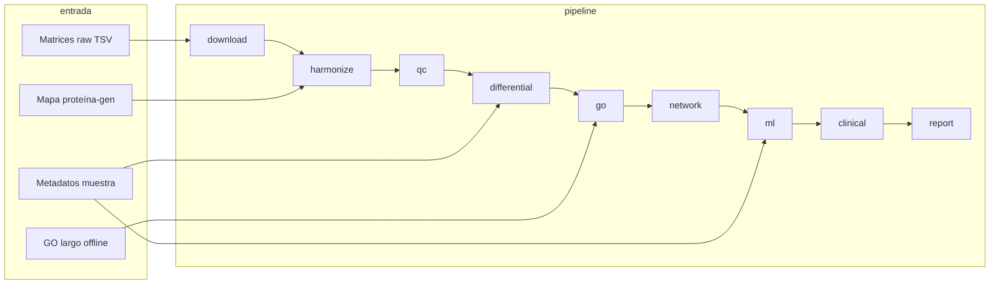

# Documentación orientada a tesis — OncoGO-CRC

Este documento enlaza el **anteproyecto**, el **reajuste técnico** y la **implementación** contenidos en `Informacion/Paquete/docs/` con el código ejecutable del repositorio. Está redactado para incorporarse como anexo metodológico o capítulo de “material y métodos computacionales”.

## 1. Pregunta de investigación y arquitectura del software

La pregunta reescrita en el anteproyecto (`01_anteproyecto_completo_reescrito.txt`) se centra en procesos biológicos protein-centric en CCR y en el uso de IA explicable para priorizar biomarcadores y módulos proteína–proceso.

El software materializa tres capas conceptuales del reajuste técnico (`02_reajuste_tecnico_pipeline.txt`):

1. **Integración y armonización** (IDs y metadatos coherentes).
2. **Capa estadística y funcional central** (diferencial + GO con reducción semántica).
3. **Capa de sistemas y decisión** (redes, ML interpretable, traslación con niveles de evidencia).

## 2. Flujo de datos y reproducibilidad

Cada etapa escribe artefactos versionables o ignorados por Git según `.gitignore` (los datos masivos y resultados intermedios no deben saturar el repositorio; el **modo `--demo`** permite validar la lógica sin archivos externos).

**Workspace externo (`paths.data_workspace` / `ONCOGO_CRC_DATA_WORKSPACE` / `--data-workspace`):** las rutas `data/`, `results/`, `reports/`, `metadata/` y `docs/web/` pueden resolverse en un segundo volumen. Al iniciar la CLI se sincronizan mapas y GO desde el clon hacia ese `metadata/` cuando el repo es más reciente; las descargas (`download_real`) y el resto del pipeline escriben allí. Detalle operativo: [GUIA_CONFIGURACION.md](GUIA_CONFIGURACION.md#data-workspace) y [docs/proceso_datos_y_pipeline.md](docs/proceso_datos_y_pipeline.md).

## 3. Descripción de etapas (mapeo tesis ↔ código)

### Fase A — `download`

- **Ciencia**: registro de cohortes públicas y trazabilidad de archivos (`manifest.tsv`).
- **Código**: `oncogo_crc/stages/download_data.py`.
- **Demo**: genera matrices sintéticas CPTAC/plasma, `data/interim/.demo_protein_mapping.tsv`, `data/interim/.demo_go_gene_long.tsv` y metadatos `_demo_*_samples.tsv`.

### Fase B — `harmonize`

- **Ciencia**: traducción de identificadores de plataforma a símbolos de gen y colapso de duplicados (mediana por muestra).
- **Código**: `utils/ids.py`, etapa `harmonize_ids.py`.
- **Salida**: `data/interim/<dataset>_harmonized.tsv`.

### Fase C — `qc`

- **Ciencia**: control de calidad, transformación, imputación y normalización (`03_configuraciones_reajustadas.txt`).
- **Código**: `utils/qc.py`, etapa `qc_normalize.py`.
- **Salida**: `data/processed/<dataset>_normalized.tsv`.

### Fase D — `differential`

- **Ciencia**: contrastes tumor vs normal, plasma CRC vs sano, etc. (`comparisons.yaml`).
- **Código**: `utils/stats.py`, `utils/plots.py`, etapa `differential_analysis.py`.
- **Salida**: `results/differential/<comparison>_diff.tsv`, `results/figures/*_volcano.png`.
- **Nota metodológica**: el estadístico implementado es **t-test de Welch + FDR-BH** a nivel de proteína/gén; puede sustituirse por modelos mixtos o limma en extensiones si el diseño lo requiere.

### Fase E — `go` (eje central)

- **Ciencia**: ORA protein/gene-centric y reducción semántica como proxy controlado de REVIGO (`02_reajuste_tecnico_pipeline.txt`).
- **Código**: `utils/go_utils.py`, etapa `go_enrichment.py`.
- **Salida**: `results/go/<comparison>_go.tsv` y `*_go_reduced.tsv`.

### Fase F — `network`

- **Ciencia**: topología de coexpresión y hubs (`06_network_modules` en el diseño original).
- **Código**: `utils/network_utils.py`, etapa `network_modules.py`.
- **Salida**: `results/networks/<primary>_hub_proteins.tsv`.

### Fase G — `ml`

- **Ciencia**: priorización explicable (L1 / Elastic Net SGD + Random Forest), **nested CV** para estimación menos optimista que un único hold-out, **transferencia CPTAC→PRIDE** alineada por gen, y bootstrap opcional de estabilidad de coeficientes L1.
- **Código**: `utils/ml_utils.py`, etapa `ml_prioritization.py`.
- **Salida**: `results/ml/<primary>_feature_ranking.tsv`, `*_model_metrics.tsv/json`, `*_nested_cv_per_fold.tsv`, `*_nested_cv_summary.tsv/json` (opcional `only_rf` o lista `models`), `*_train_*_test_transfer.json` (métricas sin calibrar y con **calibración probabilística** opcional `sigmoid`/`isotonic` solo sobre CPTAC), opcional `*_feature_stability_bootstrap.tsv`.

### Fase H — `clinical`

- **Ciencia**: ranking traslacional y niveles `tier_A_cuantitativo_fuerte | tier_B_cuantitativo_moderado | tier_C_hipotesis | tier_D_exploratorio` (cuantitativos) más columnas literarias (`literature_evidence_tier`, `cms_pathway_hints`) desde `metadata/clinical_layers/crc_context_layers.yaml`.
- **Código**: `utils/translation_utils.py`, etapa `clinical_translation.py`.
- **Salida**: `results/clinical_translation/<primary>_translation_ranked.tsv`.

### Fase H-bis — `external_evidence`

- **Ciencia**: matriz de evidencia (tiers CMS/módulos MAPK desde YAML), concordancia direccional con **RNA-seq de referencia** (TSV opcional tipo TCGA) y fusión con **Cox por gen** (TSV opcional de supervivencia exportada externamente).
- **Código**: `stages/external_evidence.py`.
- **Salida**: `results/external_evidence/evidence_matrix.tsv`, `tcga_rnaseq_concordance.tsv`, `survival_gene_cox_merged.tsv`, `external_evidence_summary.json`.

### Fase I — `report`

- **Ciencia**: consolidación para comité / manuscrito.
- **Código**: `stages/generate_report.py`.
- **Salida**: `reports/executive_summary/results_summary.md`.

## 4. Equivalencia con scripts `01_…09_` del paquete Informacion

El paquete de reconstrucción sugería comandos `python -m src.01_download_data`, etc. En Python estándar **no existen** módulos importables con identificadores que comiencen por número; la equivalencia oficial es:

| Documento original | Comando moderno |
|----------------------|-----------------|
| `01_download_data` | `oncogo-crc run --stage download` |
| `02_harmonize_ids` | `oncogo-crc run --stage harmonize` |
| `03_qc_normalize` | `oncogo-crc run --stage qc` |
| `04_differential_analysis` | `oncogo-crc run --stage differential` |
| `05_go_enrichment` | `oncogo-crc run --stage go` |
| `06_network_modules` | `oncogo-crc run --stage network` |
| `07_ml_prioritization` | `oncogo-crc run --stage ml` |
| `08_clinical_translation` | `oncogo-crc run --stage clinical` |
| `08b_external_evidence` | `oncogo-crc run --stage external_evidence` |
| `09_generate_report` | `oncogo-crc run --stage report` |

También puede usarse `python -m oncogo_crc run ...` (equivale a la CLI).

## 5. Criterios de verificación (checklist operativo)

Tomado de `Informacion/Paquete/docs/06_checklist_operativo.txt`, con nombres actualizados:

| Etapa | Comprobación rápida |
|-------|----------------------|
| QC | existen `data/processed/*_normalized.tsv` |
| Diferencial | `results/differential/*_diff.tsv` y volcanos |
| GO | `results/go/*_go.tsv` (+ `*_go_reduced.tsv` si aplica) |
| Red | `results/networks/*_hub_proteins.tsv` |
| ML | `results/ml/*_model_metrics.tsv` (+ nested CV / transfer si config) |
| Traslación | `results/clinical_translation/*_translation_ranked.tsv` |
| Evidencia externa | `results/external_evidence/evidence_matrix.tsv` |
| Informe | `reports/executive_summary/results_summary.md` |

## 6. Limitaciones explícitas (para discusión de tesis)

1. **Generalización estadística**: los datos públicos no constituyen una cohorte prospectiva única; los contrastes dependen de la disponibilidad de covariables.
2. **Batch effects**: la corrección COMBAT está preparada a nivel de configuración pero no forzada en el MVP.
3. **GO offline**: la ORA usa la tabla larga versionada; la cobertura depende de la calidad del mapeo proteína→gen.
4. **Red de coexpresión**: no es una red PPI curada; interpretar como **asociación estadística** entre abundancias.
5. **IA explicable**: los modelos son baseline; SHAP/LIME pueden añadirse como dependencias opcionales.

## 7. Cómo citar el recurso computacional

Sugerencia de texto para tesis:

> Los análisis bioinformáticos se implementaron en el entorno reproducible **OncoGO-CRC** (Python 3.11), integrando control de calidad, modelado diferencial, enriquecimiento funcional protein-centric con reducción semántica, modelado de redes, aprendizaje automático interpretable y clasificación de evidencia traslacional.

## 8. Próximos pasos científicos (fuera del MVP)

- Integración CPTAC/PDC y PRIDE reales siguiendo `datasets.yaml`.
- Ampliación de `go_gene_long.tsv` con GOA/UniProt+.
- Modelos mixtos por covariables clínicas.
- Validación externa sistemática entre cohortes (`pride_crc_meta`).
