# Arquitectura y diseño de OncoGO-CRC 2.0 (pre-implementación)

> **Actualización 3.0.** La arquitectura de stages de este documento sigue siendo el mapa del código. La capa de certificación se añadió como etapa `certification`, después de `prioritization`. Las reglas nuevas (no fusionar cohortes, no imputar para inferir, índice R, auditoría de independencia) están en [GUIA_ESTUDIANTE_CERTIFICACION.md](GUIA_ESTUDIANTE_CERTIFICACION.md).

> **Estado:** documento de **diseño previo a la implementación**. Define arquitectura, diagramas, flujo de
> datos y la **capa web** para consulta pública. Marca qué **ya existe** en OncoGO-CRC 1.0 y qué es **nuevo**
> (2.0). Los diagramas están en [Mermaid](https://mermaid.js.org/) y se renderizan en la web (MkDocs Material).

> **Encuadre (invariante).** OncoGO-CRC 2.0 es una **metodología/herramienta de análisis reproducible** que
> **prioriza candidatos como HIPÓTESIS con evidencia convergente**. No promete dianas validadas ni uso clínico.
> Toda la arquitectura está diseñada para hacer explícita esa prudencia (trazabilidad, versión de datos,
> etiquetado de salidas como exploratorias).

---

## 1. Visión general

OncoGO-CRC 2.0 se organiza en **tres capas metodológicas** sobre el pipeline base:

- **Capa A — Homogeneización e integración multi-ómica** (corrección batch + MOFA+/VAE + métricas).
- **Capa B — Análisis de red** (módulos/subredes con GNN + WGCNA sobre STRING/Reactome).
- **Capa C — Priorización por evidencia convergente** (DepMap, Open Targets, DGIdb/DrugBank/ChEMBL, HPA, GTEx, cBioPortal).

Todo se ejecuta desde un **orquestador por etapas (stages)**, se registra en `run_manifest.json` (hashes
SHA-256 + versiones de bases de datos) y se publica en una **capa web** consultable por cualquier persona.

### 1.1 Diagrama de contexto (nivel sistema)

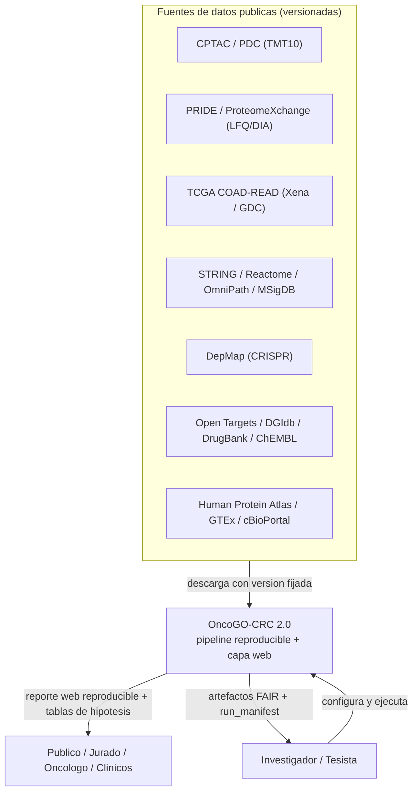

### 1.2 Diagrama de contenedores (nivel arquitectura)

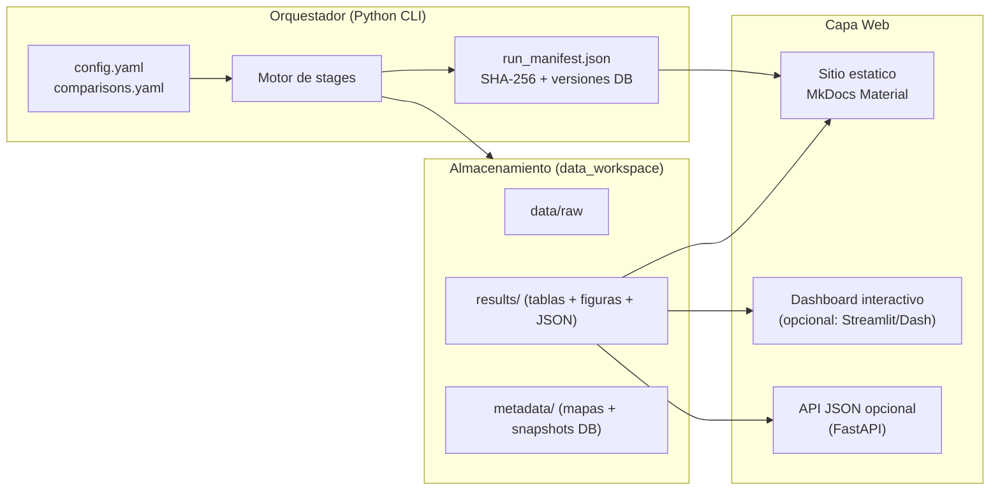

---

## 2. Arquitectura del pipeline (end-to-end)

### 2.1 Flujo maestro por etapas

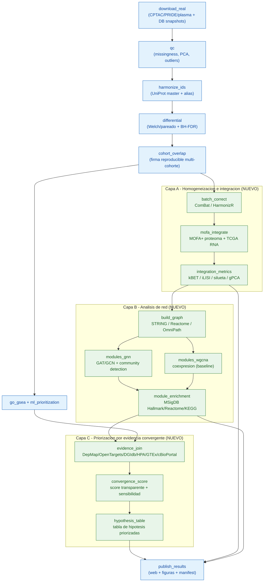

Azul = ya existe en 1.0. Verde = nuevo en 2.0.

### 2.2 Flujo de datos (qué produce cada etapa)

```mermaid
flowchart LR
    raw["Matrices crudas<br/>(procesadas de PDC/PRIDE)"] --> norm["Matrices normalizadas<br/>log2 / zscore"]
    norm --> diff["*_diff.tsv<br/>log2FC + FDR"]
    diff --> sign["core_signature.tsv<br/>concordancia de signo"]
    sign --> corr["matrices corregidas<br/>+ metrics.json"]
    corr --> factors["MOFA factors<br/>+ varianza explicada"]
    sign --> graph["grafo.graphml"]
    graph --> mods["modules.tsv<br/>+ enrichment.tsv"]
    factors --> ev
    mods --> ev["evidence_matrix.tsv"]
    ev --> score["hypothesis_priority.tsv<br/>(candidatos + banderas + score)"]
    score --> web["Reporte web + figuras"]
    corr --> web
    mods --> web
```

---

## 3. Detalle por capa

### 3.1 Capa A — Homogeneización e integración

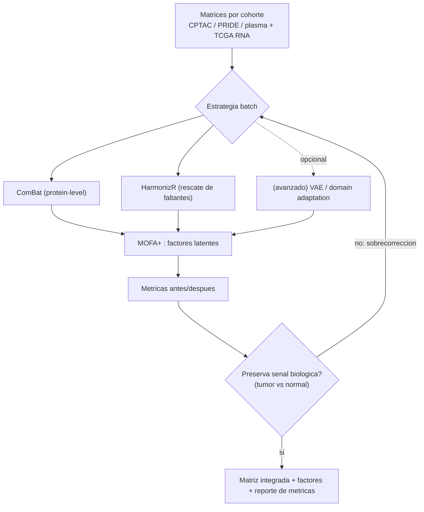

Métricas: kBET, iLISI/cLISI, ASW batch/bio, gPCA, silueta; **detección de sobrecorrección** (RBET / inspección
de marcadores CRC conocidos) para no borrar biología real.

### 3.2 Capa B — Análisis de red

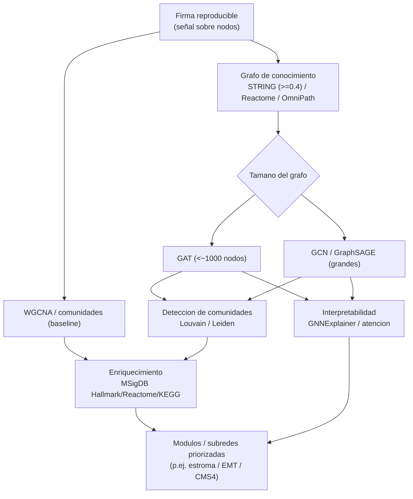

### 3.3 Capa C — Priorización por evidencia convergente

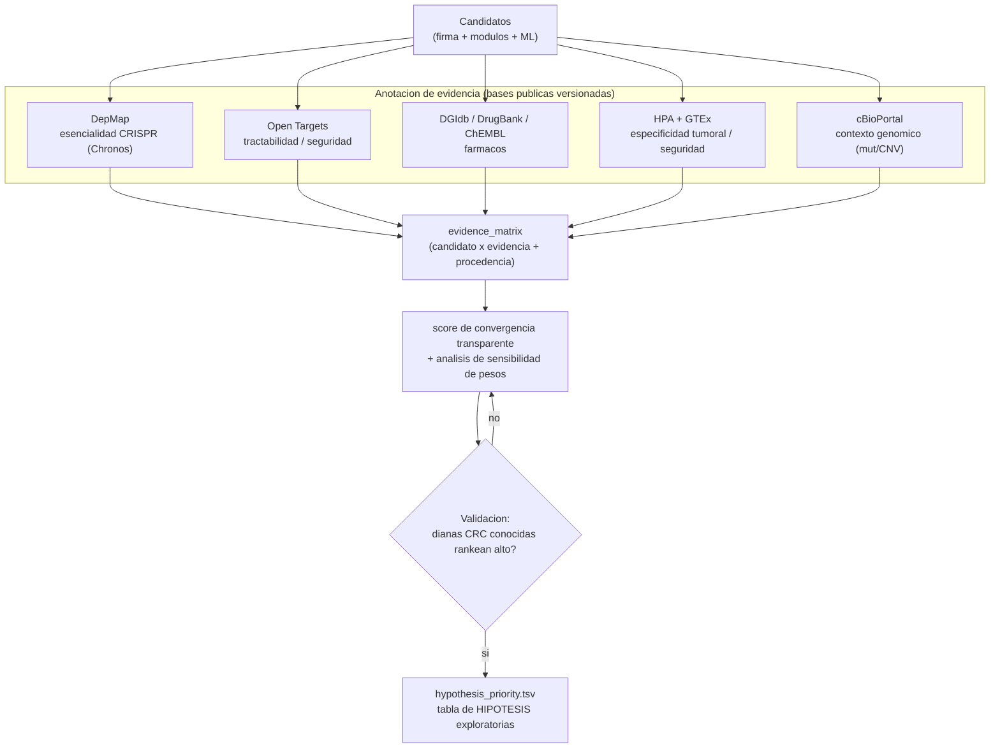

> Cada fila lleva **banderas de evidencia + procedencia (base y versión)** y se etiqueta como *hipótesis*.

### 3.4 Ciclo de vida de un candidato (estados)

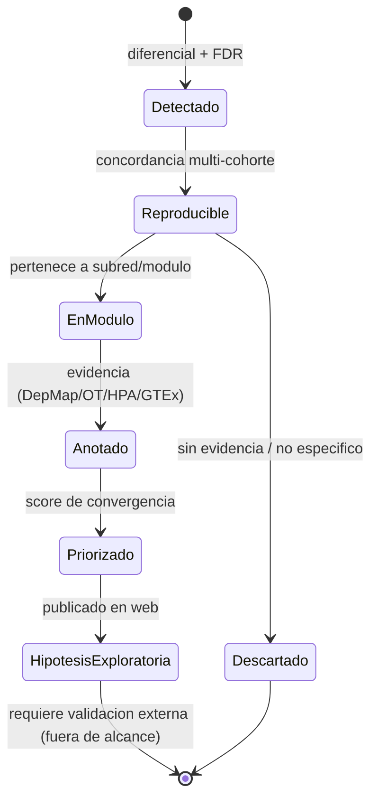

---

## 4. Cómo funciona (narrativa de ejecución)

### 4.1 Secuencia de una corrida completa

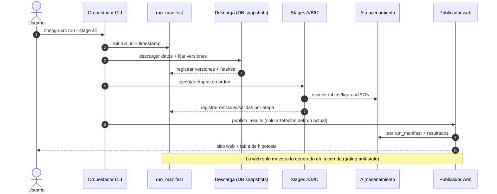

### 4.2 Modelo de reproducibilidad y trazabilidad

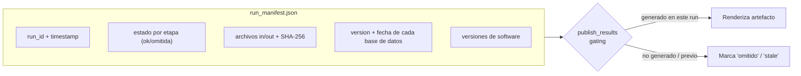

---

## 5. Arquitectura de la capa web

Objetivo: que **cualquier persona** (jurado, oncólogo, otros investigadores) pueda **consultar los procesos,
el análisis y los resultados** sin instalar nada. Diseño en **dos niveles** (estático + interactivo), ambos con
opciones de hospedaje **gratuito**.

### 5.1 Vista de la capa web

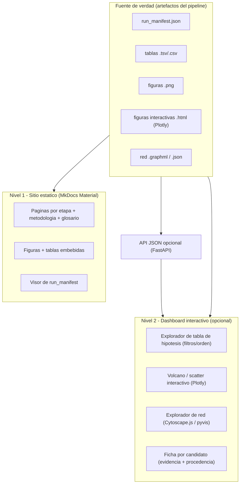

### 5.2 Mapa del sitio (sitemap)

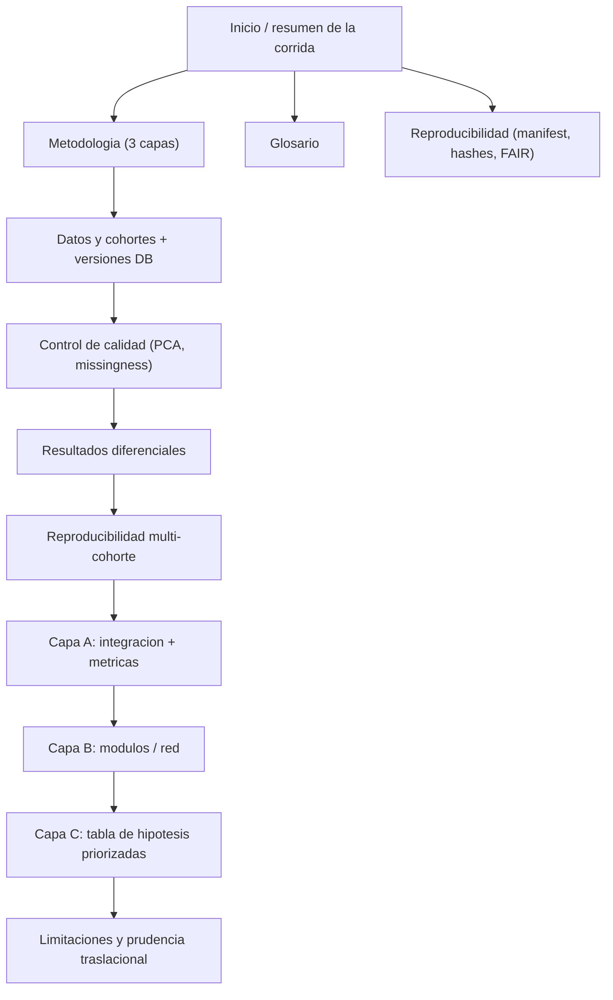

### 5.3 Interacción del usuario con el dashboard

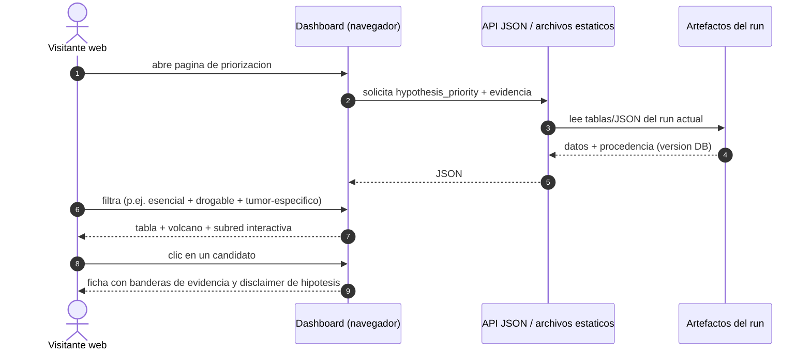

### 5.4 Stack tecnológico propuesto

| Componente | Tecnología | Hospedaje gratuito | Estado |
|---|---|---|---|
| Sitio estático informativo | **MkDocs Material** (ya usado) | GitHub Pages | Existe (ampliar) |
| Figuras estáticas | Matplotlib (ya usado) | — | Existe |
| Figuras interactivas | **Plotly** (HTML embebible) | GitHub Pages | Nuevo |
| Explorador de red | **Cytoscape.js** o **pyvis** | GitHub Pages | Nuevo |
| Dashboard interactivo | **Streamlit** o **Dash** | Streamlit Community Cloud / HF Spaces | Nuevo (opcional) |
| API de datos | **FastAPI** (sirve JSON del run) | Render/Fly.io free / HF Spaces | Nuevo (opcional) |
| Contenedor reproducible | Docker | — | Nuevo (opcional) |

> **Recomendación pragmática:** empezar por **Nivel 1 (estático)** — cubre "ver procesos, análisis y
> resultados" para cualquiera, con costo cero y máxima reproducibilidad — y añadir el **Nivel 2 (dashboard)**
> solo para exploración interactiva de la tabla de hipótesis y las redes.

### 5.5 Contrato de datos web (fuente única de verdad)

La web **no recalcula**: consume artefactos del run. Contrato mínimo:

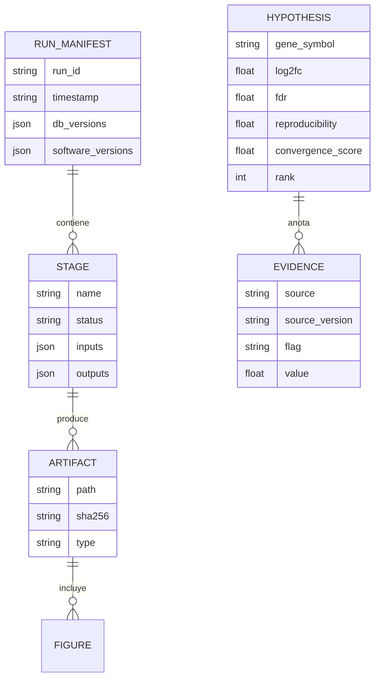

---

## 6. Vista de despliegue

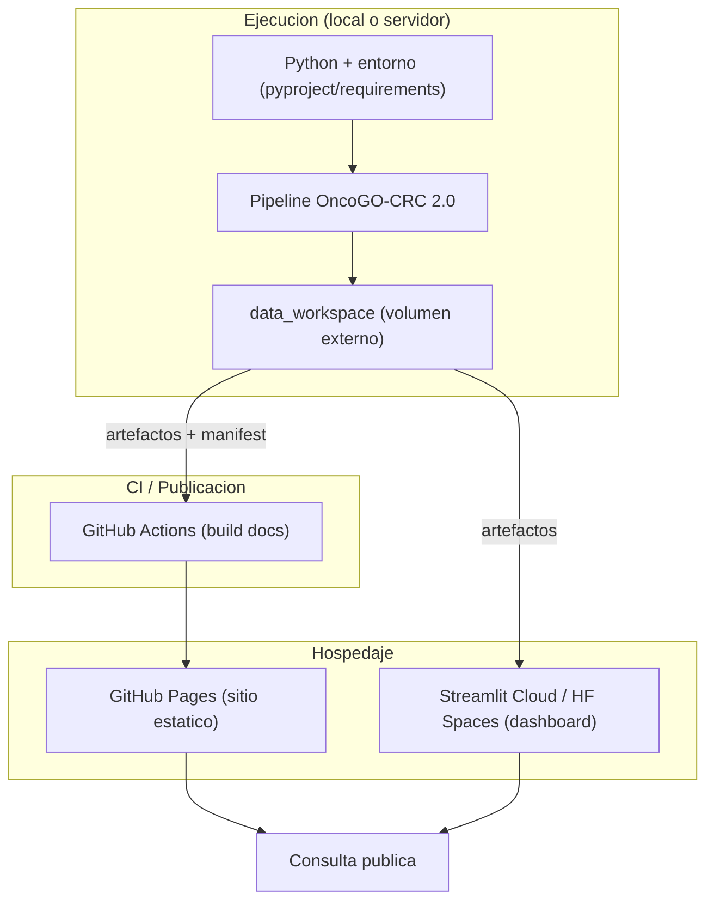

---

## 7. Qué existe vs qué es nuevo (resumen)

| Área | Existe (1.0) | Nuevo (2.0) |
|---|---|---|
| Ingesta + QC + armonización + diferencial + overlap | ✅ | — |
| GO/GSEA + ML interpretable + TPS | ✅ | — |
| run_manifest + gating + FAIR | ✅ | + versión de DB por artefacto |
| Sitio MkDocs con figuras/glosario | ✅ | + figuras interactivas Plotly |
| Capa A (batch + MOFA+ + métricas) | — | ✅ |
| Capa B (GNN/WGCNA + módulos + enrichment) | — | ✅ |
| Capa C (evidencia convergente + tabla hipótesis) | — | ✅ |
| Dashboard interactivo + API | — | ✅ (opcional) |

---

## 8. Secuencia de implementación sugerida (mínimo riesgo)

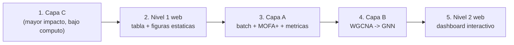

Racional: la **Capa C** entrega el artefacto de mayor valor (tabla de hipótesis con evidencia) con bajo costo
técnico; el **Nivel 1 web** lo hace consultable de inmediato; luego se profundiza integración (A) y red (B), y
por último la interactividad (Nivel 2).

---

## 9. Referencias de diseño

Ver `docs/DISENO_TECNICO_ONCOGO_2.0.md` (métodos, métricas y referencias validadas por capa) y
`docs/PROMPT_SCISPACE_BIBLIOGRAFIA_V2.md` (marco bibliográfico). El soporte metodológico de cada capa está
respaldado por la revisión de literatura 2024–2026 (MOFA+/VAE, corrección batch a nivel proteína, GNN sobre
PPI, marcos de priorización con DepMap/Open Targets, y estándares FAIR/DOME/TRIPOD+AI).
```
