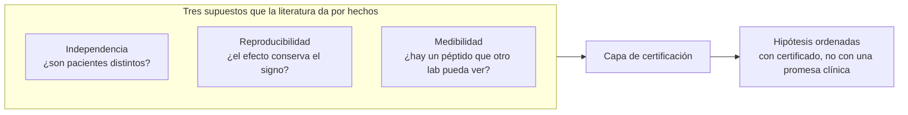
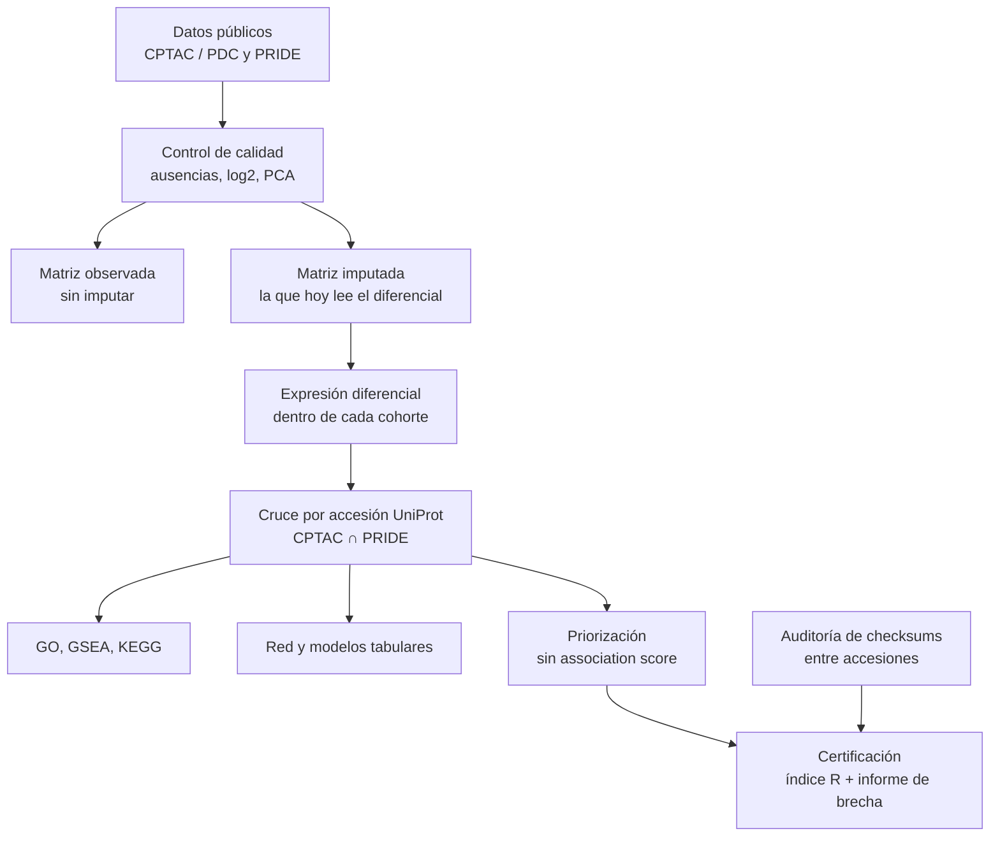

# Guía de estudio — OncoGO-CRC: de cero a la tesis

Esta guía está escrita para quien va a defender el trabajo y todavía no domina proteómica, meta-análisis ni redes. Léela en orden. Cada sección supone solo la anterior.

El código de descubrimiento que ya existía se conserva. Esta actualización le pone encima una **capa de certificación**: reglas que el análisis no puede saltarse, un índice de reproducibilidad por proteína y un detector de solapamiento entre datasets públicos.

---

## 1. Qué se busca, en una frase

Se busca saber si las listas de proteínas «alteradas en cáncer colorrectal» que salen de reutilizar datos públicos merecen ser creídas, y dejar escrito, para cada candidata, **por qué sí o por qué no**.

No se busca un fármaco. No se busca un biomarcador listo para el hospital. El producto es una metodología y una tabla de **hipótesis**, cada una con un certificado que un laboratorio puede auditar.

Tres suposiciones circulan hoy en esa literatura y casi nadie las comprueba:

1. Que dos accesiones públicas son personas distintas (independencia).
2. Que una proteína significativa en un estudio lo sigue siendo en otro (reproducibilidad).
3. Que esa proteína se puede medir en otro laboratorio (medibilidad).

Si fallan, los q-valores de un meta-análisis que suma pacientes no significan lo que parecen significar.



---

## 2. Qué se actualizó en el repositorio

El pipeline anterior ya descarga, armoniza identificadores, hace expresión diferencial, cruza CPTAC con PRIDE, enriquece en Gene Ontology y prioriza con evidencia pública. Eso sigue. Lo nuevo es la frontera entre lo que ese pipeline **hace** y lo que la tesis **puede afirmar**.

| Pieza | Antes | Ahora |
|---|---|---|
| *Association score* de Open Targets | El lector de snapshots podía cargarlo si el TSV lo traía | Prohibido. Se lee solo la tractabilidad. Si la columna entra por otro camino, la priorización la elimina y lo anota en la procedencia |
| Matriz para inferir | Una sola: `*_log2norm.tsv`, con ausencias rellenadas por KNN | Sigue existiendo, y el diferencial **todavía la usa**. Además se escribe `*_log2_observed.tsv`, con las ausencias intactas |
| Certificado por proteína | Una bandera «reproducible» dentro del score de convergencia | Etapa `certification`: subíndices R1–R5. Solo R1 y un proxy de R2 se calculan con el cruce actual. R3, R4 y R5 quedan marcados como no calculables |
| Independencia entre depósitos | No había detector | `scripts/pride_independence_audit.py` compara checksums entre accesiones PRIDE |
| Umbrales de las hipótesis | Estaban en documentos de diseño, no en la configuración que corre | Bloque `certification` en `config/config.yaml`: concordancia de proteína &lt; 0,70, de vía &gt; 0,80, medibilidad redundante si ≥ 90 %, efecto mínimo log2(1,5) = 0,585 |
| Documentos de las capas A/B/C | Leían como el plan vigente, incluido ComBat para integrar y explicar un GNN | Siguen en el repo como historia del diseño. Arriba llevan un aviso: la guía que manda es esta |

Lo que **no** se cambió, a propósito:

- El motor del diferencial sigue siendo un t de Welch o un t pareado. Pasar a limma/`treat` cambia todos los q-valores. Eso se hace cuando el preregistro esté depositado, no en silencio.
- No se fusionan cohortes en un solo modelo. Tampoco se añadió ComBat al camino de inferencia.
- No se reescribieron resultados numéricos. Si no hay cruce CPTAC∩PRIDE en disco, la etapa de certificación igual escribe el informe de brecha y deja los índices en blanco.

Comandos nuevos:

```bash
oncogo-crc run --stage certification
python scripts/pride_independence_audit.py --accessions PXD019504 PXD031705 PXD034575
```

Salidas:

- `results/certification/informe_brecha.md`
- `results/certification/indice_R.tsv`
- `results/certification/certificado_resumen.json`
- `results/independence/file_collisions.tsv` (solo si ejecutas la auditoría contra PRIDE)

---

## 3. El mapa del trabajo, de punta a punta



La flecha que importa para la defensa es esta: **el descubrimiento produce candidatos; la certificación dice cuánto de eso se sostiene**. Un candidato sin certificado no es un hallazgo de la tesis. Es una entrada del pipeline.

---

## 4. Conceptos, en el orden en que hay que aprenderlos

Cada bloque dice qué es, por qué está en esta tesis, el error típico y qué leer. No hace falta memorizar fórmulas el primer día. Sí hace falta poder explicar el error típico en voz alta.

### 4.1 Cáncer colorrectal, solo lo que el análisis usa

El cáncer colorrectal es un tumor del colon o del recto. Muchos empiezan como un pólipo (adenoma) y, con el tiempo, una fracción se vuelve carcinoma. Esa secuencia justifica un brazo aparte de adenomas: no se mezclan con el contraste tumor frente a normal, porque la pregunta es distinta.

Hay tres rutas moleculares que aparecen en cualquier texto del tema: inestabilidad cromosómica (CIN), inestabilidad de microsatélites (MSI) y el fenotipo metilador (CIMP). Los subtipos consenso (CMS) agrupan tumores parecidos. CMS4 se parece mucho a tejido con mucho estroma (el tejido de soporte, no las células tumorales). Por eso la pureza tumoral es una covariable obligatoria en el diseño 3.0: sin ella se puede «descubrir» estroma y llamarlo tumor.

Error típico: afirmar que el cáncer colorrectal de inicio temprano tiene más MSI. La evidencia reciente apunta más a inestabilidad ligada a TP53. No copies esa frase de un borrador viejo.

Lectura: un capítulo de revisión clínica corto de CRC (epidemiología y secuencia adenoma–carcinoma) y la figura de los CMS del artículo de Guinney et al., *Nature Medicine* 2015.

### 4.2 Qué mide la proteómica de espectrometría de masas

Un gen es una instrucción. Una proteína es la molécula que esa instrucción produce y que hace el trabajo en la célula. Esta tesis trabaja con proteínas, no con ARN, salvo cuando usa TCGA como contexto externo.

La espectrometría de masas rompe las proteínas en péptidos, los pesa y, a partir de esas masas, infiere qué proteína estaba. La clave canónica del proyecto es la **accesión de UniProt** (por ejemplo `P04637`), no el símbolo del gen (`TP53`). Los símbolos cambian y a veces un símbolo apunta a más de una proteína.

Tres formas de cuantificar, y por eso las cohortes no se pueden tratar como si fueran la misma balanza:

| Forma | Idea en una frase | Cohorte de referencia en el diseño |
|---|---|---|
| TMT | Varias muestras se marcan, se mezclan y se miden juntas | CPTAC, PDC000116 |
| iTRAQ | Otra química de marcaje isobárico, distinta de TMT | PDC000111 |
| LFQ | Cada muestra se mide sola; se compara la intensidad | PXD019504, PXD002137 |
| DIA | Se fragmenta una ventana de masas, no un pico elegido | PXD054790, apoyo, no el contraste primario |

El marcaje isobárico **comprime** los cocientes: un cambio de 4 veces puede parecer de 2. Atenúa el tamaño del efecto. No le da la vuelta al signo. Por eso una concordancia de signo baja no se explica diciendo «TMT y LFQ tienen escalas distintas»: el log2FC se calcula **dentro** de cada cohorte.

Error típico: imputar un cero que la máquina no vio y luego hacer el test sobre ese número inventado. En espectrometría, no ver una proteína depende de lo poco abundante que es. Rellenar ese hueco empuja el efecto en una dirección. El diseño 3.0 prohíbe imputar para inferir. El código actual todavía imputa en `log2norm` y lo declara en el informe de brecha. La matriz honesta es `log2_observed`.

Lectura: un tutorial de proteómica cuantitativa (LFQ frente a TMT) y Ow et al. 2009 sobre la compresión de iTRAQ (`10.1021/pr900634c`).

### 4.3 Fresco-congelado y FFPE

Fresco-congelado es tejido congelado nada más extraerlo. FFPE es tejido fijado en formol y metido en parafina, el que guarda anatomía patológica. La fijación cambia qué proteínas se recuperan. Si todas las muestras de una plataforma son FFPE y todas las de la otra son frescas, no se puede separar «efecto de la máquina» de «efecto del hospital».

El diseño nuevo elige cohortes para que esa confusión no sea perfecta: hay LFQ en más de un tipo de muestra y marcaje isobárico con dos químicas. Eso se llama diseño factorial parcial. No está completo (falta la celda isobárico × FFPE) y esa ausencia es una limitación, no un detalle.

### 4.4 Expresión diferencial, q-valor y umbral de efecto

Dentro de una cohorte se pregunta, proteína a proteína: ¿la media en tumor es distinta de la media en normal?

- El **log2FC** es el tamaño del cambio en escala logaritmo base 2. log2FC = 1 es el doble. log2(1,5) ≈ 0,585 es el umbral de efecto declarado (un 50 % más o menos).
- El **p-valor** es la probabilidad de un resultado así de extremo si en realidad no hubiera diferencia.
- El **q-valor** (FDR de Benjamini–Hochberg) corrige el hecho de que se hacen miles de pruebas a la vez.

Un p-valor pequeño con un cambio diminuto no interesa. `treat` (McCarthy y Smyth, 2009) contrasta contra el umbral de efecto, no contra cero. El pipeline de hoy contrasta contra cero y luego puede filtrar por `|log2FC|`. Eso no es lo mismo: el filtro posterior no controla el error como el test contra umbral.

`limma` presta fuerza entre proteínas: estima la varianza de cada una usando también la del resto. Con decenas de muestras eso es más estable que un t de Welch proteína a proteína. Es el motor previsto para LFQ. Para TMT, el lote real es el **plex** (el grupo de muestras medidas juntas); ignorarlo infla la significación. Eso lo modela `msqrob2` con el plex como efecto aleatorio. Ninguno de los dos está en el código Python actual.

Lectura: Ritchie et al. 2015 (limma) y McCarthy y Smyth 2009 (treat).

### 4.5 Por qué no se juntan las cohortes

Si se pegan todas las muestras en una matriz y se llama «tumor» o «normal», la plataforma viaja pegada a la etiqueta. Cualquier corrector de lote (ComBat, Harmony) puede borrar la biología creyendo que borra la máquina, o al revés. Las métricas de integración (kBET, iLISI) no avisan: dan por hecho que entre lotes hay la misma biología.

La alternativa correcta: diferencial **dentro** de cada cohorte, y luego un **meta-análisis de efectos aleatorios**. Cada cohorte aporta su log2FC y su error. El modelo permite que el efecto verdadero no sea idéntico en todas (eso es τ²). I² dice qué parte de la variación entre estudios no es ruido de muestreo. Si I² es alto, un efecto grande no es un hallazgo robusto.

Lectura: Viechtbauer 2010, el artículo de `metafor`. Basta con forest plot, τ² e I².

### 4.6 Reproducibilidad no es «volver a correr el script»

Hay dos ideas que se confunden:

- **Reproducibilidad computacional:** mismos datos, mismo código, mismo resultado.
- **Replicación:** otros datos, misma conclusión.

H1 mide la segunda. La métrica principal es la **concordancia de signo**: de las proteínas significativas en la cohorte de descubrimiento, ¿qué fracción tiene el log2FC en la misma dirección en la réplica? El intervalo es el exacto de Clopper–Pearson (no la aproximación normal: la proporción puede estar cerca de 0,5 y n no es enorme). Se compara contra 0,5, que es el azar de una moneda.

Un efecto real y bien medido debería concordar muy por encima de 0,70. El diseño dice: si la concordancia de proteína llega a 0,70 o más, **esa parte** de H1 se rechaza. H1 también exige que las vías concuerden por encima de 0,80. Las dos cláusulas van juntas. La etapa `certification` solo puede mirar la de proteína, y solo si existe el TSV del cruce.

π₁ de Storey estima qué fracción de las pruebas en la réplica son alternativas verdaderas. La curva CAT mira si al menos los efectos más grandes coinciden. Son métricas secundarias. Aún no las calcula la etapa nueva.

### 4.7 Independencia y el hallazgo de los 44 ficheros

Un meta-análisis pondera cada estudio como si sus pacientes no estuvieran ya en otro estudio. Si 22 personas están dos veces, el intervalo de confianza sale más estrecho de lo que es.

La genómica detecta a la misma persona con una huella de variantes. La proteómica pública no tiene ese control de rutina. El nivel A hace lo más barato: si dos accesiones de PRIDE tienen un fichero `.raw` con el mismo checksum, es el mismo archivo depositado dos veces.

El caso ya visto, y que hay que **repetir con TLS verificado** antes de ponerlo en la tesis: 44 ficheros con el mismo SHA-1 entre `PXD019504` y `PXD031705`, 22 sujetos, pares tumor/normal. El tono del texto es de fallo de metadatos, no de acusación a un laboratorio. Volver a depositar datos de un estudio anterior es razonable. Lo que falla es que quien reutiliza los datos no tiene un campo que se lo diga.

El nivel A calla cuando no hay colisión: la misma persona puede haberse medido en otra tanda, con otro fichero. Por eso hacen falta el nivel B (huella de correlación de proteínas) y, si hay tiempo, el nivel C (péptidos con variante de un aminoácido). Esos dos niveles no están implementados.

`PXD019504` puede seguir como réplica LFQ **solo si** `PXD031705` y `PXD034575` no entran en el mismo análisis primario.

### 4.8 Redes, y por qué un grafo puede hacer trampa

STRING es una base de interacciones entre proteínas. Parte de sus canales sale de textos científicos y de perfiles de expresión. Validar un resultado de expresión con una red construida a partir de expresión y de textos es circular. Por eso el diseño pide dos redes: la completa y `physical_only` (experimentos y bases curadas, sin minería de texto ni coexpresión).

En este régimen hay muchas más proteínas que muestras (n ≪ p). Una red neuronal de grafos puede parecer mejor solo porque los nodos muy conectados son más fáciles de predecir, no porque la topología importe. El control es un **rewiring** que conserva el grado de cada nodo y cambia las parejas de aristas (Maslov–Sneppen). Si el modelo sobre la red real no supera a ElasticNet, Random Forest y un MLP, y tampoco supera a ese nulo, no se interpreta la atención del grafo. Interpretar un modelo que no gana al azar topológico no es un resultado.

El código actual tiene módulos de red y modelos tabulares. No tiene el nulo de rewiring ni la variante `physical_only` como contraste obligatorio. H2 sigue abierta.

### 4.9 Priorización sin contar dos veces

Ordenar candidatos mezclando canales que contienen la misma información produce un ranking inflado. El *association score* de Open Targets ya incluye literatura, diferencial y genética. Por eso está prohibido. Sí se puede usar el cubo de **tractabilidad** (¿hay química conocida?), DepMap (¿la célula de colon depende de ese gen?), HPA y GTEx (¿está en el tejido normal?).

DepMap tiene una trampa: un filtro ingenuo de «esencial en líneas de colon» recupera ribosoma, proteasoma y espliceosoma, esenciales en casi cualquier célula. Ventana terapéutica nula. Hay que excluir la lista de esenciales comunes y pedir que el efecto en colon sea más fuerte que en otros linajes.

La priorización de esta tesis es **descriptiva**. El pipeline elige, filtra y vuelve a elegir. El q-valor final de esa cascada no tiene la interpretación de un único test. Hacen falta al menos 100 permutaciones de las etiquetas tumor/normal, de extremo a extremo. No están corridas.

### 4.10 Medibilidad

Una proteína prioritaria que nadie puede volver a medir no es accionable. El criterio del diseño: cuantificada en al menos dos cohortes, y al menos un péptido proteotípico (un péptido que identifica esa proteína y no a sus vecinas) visto en al menos dos plataformas. H4 se falsifica si el 90 % o más de los candidatos ingenuos ya cumple eso: el filtro no aportaría nada.

La etapa actual calcula un **proxy**: entre las significativas en CPTAC, qué fracción tiene log2FC finito en PRIDE. El informe lo etiqueta como proxy. No es el péptido.

### 4.11 Identificadores y reproducibilidad computacional

UniProt antes que símbolo. Semilla fija. Versión y fecha de cada base externa (STRING, GO, DepMap cambian y el resultado cambia con ellas). Hash de entradas y salidas. Lo que no se pueda regenerar con un comando no es un resultado, es un archivo suelto.

---

## 5. Las cinco hipótesis, como se falsifican

Un resultado que no pasa el umbral se escribe igual. Repetir el análisis hasta que pase invalida el preregistro y es justo lo que la tesis critica.

| Id | Enunciado corto | Se rechaza si… | Estado en el código de hoy |
|---|---|---|---|
| H0 | Hay solapamiento no declarado entre datasets públicos de CRC | Cero pares por encima del umbral, con un detector que recupera ≥ 95 % de los controles positivos | Nivel A exploratorio (44 checksums). Hay que repetirlo con TLS. Niveles B y C no existen |
| H1 | La concordancia es baja en proteína (&lt; 0,70) y alta en vía (&gt; 0,80) | Proteína ≥ 0,70 **o** vía ≤ 0,80 | Solo la cláusula de proteína, y solo si existe el TSV del cruce |
| H2 | La topología no aporta sobre líneas base ni sobre un nulo que conserva el grado | El intervalo del modelo de red es disjunto y mejor que la mejor línea base **y** el p empírico del rewiring &lt; 0,05 | No evaluable |
| H3 | Ponderar por R mejora el ranking en un corte temporal (31 dic 2020), también en genes poco estudiados | Los IC de precision@50 se solapan, o la ventaja desaparece en los cuartiles de poca literatura | No evaluable. El score actual no es ese holdout |
| H4 | Muchos candidatos ingenuos no son medibles; el filtro recorta de verdad | ≥ 90 % ya cumplen el criterio | Solo el proxy de dos cohortes |

H0 nivel A, si se confirma al repetirlo, **sostiene** la hipótesis. No la cierra: un paciente puede estar en dos estudios con ficheros distintos.

---

## 6. El índice R, sin convertirlo en un solo número

Cada proteína lleva cinco números entre 0 y 1. Colapsarlos esconde patrones opuestos: mucha concordancia de signo con un efecto que desaparece al permutar las etiquetas no es lo mismo que el patrón inverso.

| Código | Pregunta | De dónde saldría | Hoy |
|---|---|---|---|
| R1 | ¿El signo coincide entre cohortes? | Cruce de log2FC | Se calcula |
| R2 | ¿Se cuantificó de verdad en suficientes cohortes? | Ausencias por cohorte | Proxy de dos cohortes |
| R3 | ¿El efecto es homogéneo? | 1 − I² y leave-one-out | No calculable |
| R4 | ¿Sobrevive al ajuste por pureza? | Diferencial con y sin pureza | No calculable |
| R5 | ¿Aguanta permutar las etiquetas? | ≥ 100 permutaciones | No calculable |

La priorización, cuando el índice esté completo, compara tres rankings: el ingenuo, el ponderado por R, y el ponderado por R más el filtro de medibilidad. Ahora el ranking que existe es el score de convergencia de la etapa `prioritization`, con la tractabilidad permitida y el association score fuera.

---

## 7. Cómo se escribe la tesis, en este orden

Los capítulos de resultados se escriben cuando el número existe. El marco teórico se escribe después, para sostener esos números y no al revés. Un marco de sesenta páginas que no sostiene ningún resultado resta en la defensa.

Orden: **métodos → independencia → descubrimiento → reproducibilidad → redes → priorización → estado del arte → marco teórico → introducción → discusión**.

La introducción va penúltima porque su trabajo es prometer exactamente lo que los resultados entregan.


### Paso a paso

1. **Congela el contrato antes de mirar más matrices.** Resuelve los campos que siguen en duda (preanalítica de PXD019504, n de PDC000116, si PDC000111 tiene normales, si el atlas pan-cáncer tiene colon normal). Deposita el preregistro. A partir de ahí un cambio de umbral es una desviación escrita, con fecha y motivo.
2. **Repite H0 nivel A** con `scripts/pride_independence_audit.py` y TLS activo. Confirma al menos tres checksums descargando el fichero. Lee las declaraciones de disponibilidad de datos de los dos artículos. Escribe el capítulo de independencia con el veredicto y el tono de infraestructura.
3. **Escribe métodos con los valores que de verdad corren**, no con los que el diseño desea. Si el diferencial es un t pareado sobre matriz imputada, el capítulo 4 lo dice, y el informe de brecha explica qué falta para llegar a limma/`treat` sin imputar. Un método descrito y no ejecutado es un problema de defensa.
4. **Descubrimiento, cohorte por cohorte.** Volcano, distribución de p-valores, pureza cuando exista, enriquecimiento con el universo de proteínas cuantificadas en esa cohorte (no el proteoma entero). El meta-análisis entra aquí cuando exista. Hasta entonces no hay un «efecto combinado» que citar.
5. **Reproducibilidad.** Reporta la concordancia de signo con su intervalo. No la disculpes. Si está cerca de 0,5, ese es el resultado. Separa las explicaciones fáciles (escala TMT/LFQ, profundidad, pureza, pipeline) y contrástalas; no las afirmes.
6. **Redes.** Declara una sola tarea de aprendizaje. Entrena las líneas base. Si no hay nulo de rewiring, el capítulo dice que H2 no está contrastada. No añadas GNNExplainer para llenar páginas.
7. **Priorización.** Tabla final con accesión, efecto, los subíndices que existan, los que no y por qué, y —cuando exista— el péptido. El score de convergencia se presenta como descriptivo.
8. **Estado del arte.** Cada apartado termina en la brecha que un capítulo de resultados cubre. Si no hay resultado, la brecha se formula como pregunta abierta, no como contribución cerrada.
9. **Marco teórico.** Una sección existe solo si un resultado la necesita. Borra el resto.
10. **Introducción.** Objetivos numerados que coinciden con H0–H4. Contribuciones ajustadas a lo obtenido, incluidas las negativas.
11. **Discusión y limitaciones.** Un párrafo por hipótesis. La lista de limitaciones incluye: n pequeño, factorial incompleto, nivel C no hecho, metadatos clínicos incompletos, ground truth del holdout imperfecto, DepMap en cultivo 2D, priorización descriptiva, sin validación húmeda, plasma como otro proteoma, y cualquier recorte de permutaciones.
12. **Resumen, al final, y en este orden de frases:** contexto, problema, qué se hizo, números sin adjetivos, qué puede hacer distinto quien reutilice datos, dónde está el código.

Regla de números: el que esté en el texto tiene que salir de una tabla generada por código (`indice_R.tsv`, el JSON del certificado, las tablas del diferencial). No se teclea un q-valor de memoria.

### Calendario de emergencia

Si el tiempo se acaba, se recorta en este orden: nivel C de H0, luego el brazo de adenomas, luego la cohorte iTRAQ, luego el número de permutaciones (dejando escrito el valor original y el ejecutado). No se recortan las líneas base ni los nulos. Sin ellos el capítulo de redes no se defiende.

---

## 8. Qué leer cada semana, mínimo

No es una bibliografía de tesis. Es la pila para entender lo que vas a escribir.

| Semana de estudio | Concepto | Lectura mínima |
|---|---|---|
| 1 | La pregunta y el hallazgo de independencia | Esta guía, secciones 1–3 y 4.7. Después el artículo de Robles et al. 2024 (`10.1371/journal.pcbi.1011828`): es el meta-análisis que suma pacientes sin auditar solapamiento |
| 2 | Cómo se midieron las cohortes | Vasaikar et al. 2019, *Cell* (CPTAC). Tanaka et al. 2020, *Oncotarget* (PXD019504). Wiśniewski et al. 2015 (PXD002137, FFPE) |
| 3 | Estadística del diferencial | Ritchie 2015 (limma) y McCarthy 2009 (treat). Una tarde con un volcano y una distribución de p-valores del propio proyecto |
| 4 | Meta-análisis | Viechtbauer 2010. Dibuja a mano un forest plot con tres estudios inventados hasta que τ² e I² dejen de ser siglas |
| 5 | Reproducibilidad | Storey y Tibshirani 2003 (π₁). Clopper y Pearson 1934, solo la idea del intervalo exacto. Calcula una concordancia de signo con diez proteínas de juguete |
| 6 | Redes y trampa del grado | Maslov y Sneppen 2002. Szklarczyk et al. sobre STRING: localiza qué canales son texto y coexpresión |
| 7 | Priorización | Dempster et al. 2021 (Chronos). Ochoa et al. 2023 (Open Targets): señala en el artículo dónde el association score mezcla fuentes |
| 8 | Cómo se reporta | Page et al. 2021 (PRISMA 2020) para el estado del arte. Collins et al. 2024 (TRIPOD+AI) para el capítulo de modelos. Declara el uso de asistencia de IA: herramienta, fase y qué revisaste tú |

Guías ya escritas en el repo, y para qué sirven:

| Documento | Úsalo para |
|---|---|
| Esta guía | Entender y escribir |
| `GUIA_EJECUCION_Y_REDACTION_TESIS.md` | Qué comando produce qué tabla de cada capítulo |
| `PLAN_EJECUCION_TESIS.md` | Orden técnico de las etapas que ya existen |
| `docs/DISENO_TECNICO_ONCOGO_2.0.md` | Historia de las capas A/B/C. No es el contrato estadístico vigente |
| `docs/HERRAMIENTAS_Y_TECNICAS.md` | Catálogo de librerías |
| `config/config.yaml`, bloque `certification` | Umbrales que no se mueven para favorecer un resultado |

---

## 9. Frases que sí se pueden decir en la defensa

- «El pipeline prioriza hipótesis. No valida dianas.»
- «El nivel A demuestra redepósito de ficheros cuando el checksum coincide. No demuestra que el resto de cohortes sean independientes.»
- «La concordancia de signo se calcula dentro de cada cohorte. La compresión de TMT no explica una inversión de signo.»
- «El association score no entra en el ranking porque repetiría la evidencia que el propio diferencial acaba de generar.»
- «R3, R4 y R5 no están calculados. El informe de brecha dice qué falta.»
- «Mientras el diferencial lea la matriz imputada, el método escrito en la tesis tiene que decirlo.»

## 10. Mapa rápido del código que toca esta actualización

| Ruta | Papel |
|---|---|
| `src/oncogo_crc/certification/contract.py` | Umbrales, concordancia de signo, proxy de medibilidad, índice R |
| `src/oncogo_crc/certification/independence.py` | Colisión de checksum, tamaño y nombre |
| `src/oncogo_crc/stages/certification.py` | Escribe el informe aunque no haya cruce |
| `src/oncogo_crc/stages/qc_normalize.py` | Guarda la matriz observada además de la imputada |
| `src/oncogo_crc/utils/evidence_providers.py` | No carga el association score |
| `src/oncogo_crc/stages/evidence_prioritization.py` | Lo elimina si aparece y lo registra |
| `scripts/pride_independence_audit.py` | Nivel A contra la API de PRIDE |
| `tests/test_certification_contract.py` | Contratos que no dependen de datos reales |
