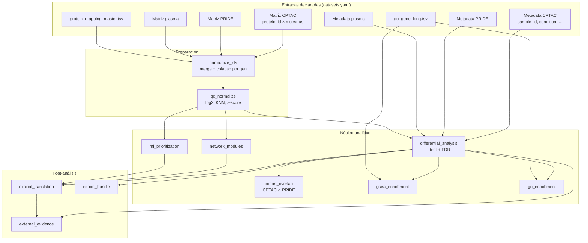
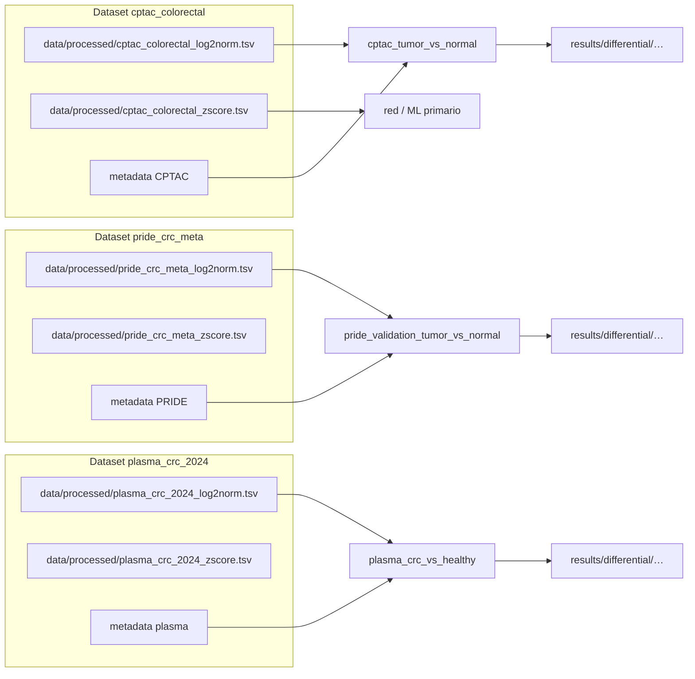

# Proceso completo: datos, datasets y pipeline OncoGO-CRC

Este documento describe **de dónde salen los datos**, **qué aporta cada cohorte declarada en `config/datasets.yaml`**, y **qué hace cada etapa** del comando `oncogo-crc run --stage all` (orden real en código). Para la tabla corta por fases, ver también [Pipeline por fases](pipeline.md).

---

## 1. Dónde vive la información (tres capas)

| Capa | Directorio típico | Contenido |
|------|-------------------|-----------|
| **Crudo** | `data/raw/<proveedor>/` | Matrices anchas (proteínas × muestras o equivalente) tal como llegan de PDC, PRIDE o curación manual. |
| **Intermedio** | `data/interim/` | Matrices **harmonized** (IDs unificados, una fila por gen tras colapso). En `--demo`, también metadatos `_demo_*_samples.tsv` y mapas `.demo_*`. |
| **Procesado** | `data/processed/` | Tras QC: log2, imputación KNN, **z-score por proteína** entre muestras — es la entrada de **diferencial, GO, GSEA, red, ML**. |
| **Resultados** | `results/` | Tablas (`*.tsv`), figuras, JSON de métricas, reproducibilidad, export, etc. |
| **Informes web** | `reports/web/` y espejo `docs/web/` | Markdown generado por `publish_results` para MkDocs. |

El **workspace de datos** opcional (`paths.data_workspace` o `ONCOGO_CRC_DATA_WORKSPACE`) redirige `data/`, `results/`, `reports/`, `metadata/` y `docs/web` fuera del clon del repo; el código y `config/` siguen en el repositorio. Al **iniciar cualquier comando** `oncogo-crc` con workspace activo, el programa **sincroniza metadata** desde el repo hacia ese volumen: mapas `protein_id_maps/`, anotación `gene_ontology/` y plantillas `tcga_auxiliary/` se **actualizan si el fichero del repo es más reciente** (p. ej. tras `git pull` o regenerar el bulk UniProt); `sample_metadata/` y `clinical_layers/` solo se copian si **aún no existen** en el workspace (no se pisan curaciones ya escritas allí).

### 1.1 Workspace externo: corrida completa y siguiente corrida

**Qué queda en el volumen externo** (misma jerarquía relativa que en el repo):

| Ruta lógica | Contenido |
|-------------|-----------|
| `data/raw/` | Descargas `download_real`, manifiestos auxiliares |
| `data/manifests/` | `_summary.json`, inventario de descarga |
| `data/interim/` | Harmonized, caches (p. ej. UniProt), artefactos demo |
| `data/processed/` | Matrices `*_log2norm.tsv`, `*_zscore.tsv` |
| `data/versions/` | `version_inputs`: copias fechadas de matrices/metadata |
| `metadata/` | Mapas, GO, plantillas TCGA (sincronizados desde repo según reglas arriba); metadata de muestras curada o harmonizada |
| `results/` | Toda la analítica, `run_manifest.json`, validación, figuras |
| `reports/web/` y `docs/web/` | Markdown generado por `publish_results` (MkDocs) |
| `reports/executive_summary/` | Informes ejecutivos |
| `reports/runs/latest/` | `run_manifest.json` agregado (descarga + `pipeline_run`) |

**Checklist — una corrida `all` dejando todo listo para repetir:**

1. Fijar workspace: `paths.data_workspace` en `config/config.yaml` **o** `export ONCOGO_CRC_DATA_WORKSPACE=/ruta/absoluta` **o** `oncogo-crc run --data-workspace /ruta …`.
2. (Opcional) Regenerar mapa UniProt bulk en el **repo** y hacer `git pull` en el clon; al siguiente `oncogo-crc run`, el TSV más reciente se copiará al workspace si el mtime del repo gana.
3. Tokens según proveedor (`PDC_TOKEN`, `PRIDE_TOKEN`, …) si usas `download_real`.
4. `oncogo-crc run --stage all` (o `bash scripts/run_pipeline.sh` con el mismo `export`).
5. `oncogo-crc run --stage publish_results` (incluido en `all`) — se **espejan** las páginas web a `docs/web/` del repo si el workspace es distinto, para `mkdocs build`.
6. Para **otra corrida** con los mismos datos: basta volver a ejecutar el paso 4 (y 5 si quieres refrescar el sitio); `run_manifest.json` se reinicializa al inicio de cada `run`.

---

## 2. Cada dataset: qué es, qué trae y para qué sirve

Los datasets son **entradas lógicas** definidas en [`config/datasets.yaml`](../config/datasets.yaml). Cada uno tiene al menos:

- **`matrix_path`**: TSV con columna `protein_id` (u otra según `protein_column`) y columnas numéricas por **muestra** (`sample_id` debe coincidir con el metadata).
- **`sample_metadata`**: TSV con `sample_id` y columnas fenotípicas (`condition`, y opcionalmente `stage_bin`, `msi_status`, etc.) usadas en [`config/comparisons.yaml`](../config/comparisons.yaml).

| Clave | Rol en el proyecto | Qué datos aporta | Uso principal en el pipeline |
|-------|--------------------|------------------|------------------------------|
| **`cptac_colorectal`** | **Cohorte primaria** (descubrimiento) | Proteoma tumor vs adyacente normal (estudio PDC **PDC000116** en configuración por defecto). Intensidades o abundancias por proteína/muestra + metadata clínica cuando se harmoniza con PDC. | Contraste núcleo **tumor vs normal**, red, **ML**, **traslación clínica**, KEGG opcional; referencia para firma reproducible. |
| **`pride_crc_meta`** | **Validación externa** (tejido) | Matriz proteómica de estudios PRIDE (p. ej. **PXD034575** en config por defecto) + metadata con `condition` tumor/normal u otro diseño. IDs a menudo **UniProt** o texto distinto al CPTAC. | Comparación **PRIDE tumor vs normal**, **cohort_overlap** (firma CPTAC∩PRIDE vía mapa UniProt), **transferencia ML** CPTAC→PRIDE tras alinear por **gen**. |
| **`plasma_crc_2024`** | **Capa clínica / biopsia líquida** | Plasma/suero: en la config actual se enlaza lógica a **PXD015163** y matriz operativa **DIA-NN** de **PXD055218** (CRC vs sano en suero). | Contraste **CRC vs healthy** en plasma; discusión traslacional frente a tejido (señal más débil es esperable). |
| **`crcdb_context`**, **`pharmacoproteomics`**, **`metastatic_crc_optional`** | Expansión | Desactivados por defecto (`enabled: false`). Sirven para contexto CRCDB, farmacoproteómica u otro diseño metastásico si añades matrices y metadata. | Mismas etapas `harmonize`→`qc`→`differential` si existen archivos y comparaciones que los referencien. |

**Mapa maestro de IDs** (`protein_id_map` en `datasets.yaml` → `metadata/protein_id_maps/protein_mapping_master.tsv`): traduce `protein_id` / símbolo gen / **UniProt** para colapsar filas y para cruzar CPTAC (genes) con PRIDE (UniProt).

**Mapa suplementario (miles de genes → UniProt reviewed)**: opcionalmente `mapping.supplementary_map_paths` en `config/config.yaml` incluye un TSV generado desde la API REST de UniProt. Para regenerarlo (paginación completa, ~20k entradas humanas Swiss-Prot): `python scripts/fetch_uniprot_human_reviewed_gene_map.py` (por defecto sobrescribe `metadata/protein_id_maps/gene_uniprot_human_reviewed_bulk.tsv`; usar `--max-rows N` para pruebas).

**Gene Ontology offline** (`metadata/gene_ontology/go_gene_long.tsv`): anotación gen→GO para **ORA** y **GSEA** sin API obligatoria.

---

## 3. Orden real de etapas (`oncogo-crc run --stage all`)

La lista oficial es `STAGE_ORDER` en [`src/oncogo_crc/pipeline/registry.py`](../src/oncogo_crc/pipeline/registry.py). **`ingest_cptac` no forma parte de `all`** (solo bajo demanda).

| # | Etapa | Función resumida |
|---|--------|------------------|
| 1 | **`download_real`** | Descarga desde **PDC / PRIDE** (y similares) según `datasets.*.download_real`; en `--demo` no descarga. |
| 2 | **`download`** | Registra rutas en manifiesto; en **`--demo`** genera matrices sintéticas CPTAC/plasma/PRIDE y metadatos demo. |
| 3 | **`harmonize_public_metadata`** | Cruza matriz CPTAC con catálogo PDC/biospecimen/clínica y reescribe `cptac_metadata.tsv` cuando aplica; harmonizadores PRIDE/plasma según config. **En `--demo` se omite** (ya hay `_demo_*`). |
| 4 | **`validate_inputs`** | Comprueba existencia de matrices/metadata, matching muestra↔columna, cobertura de variables clínicas recomendadas; escribe `results/validation/`. |
| 5 | **`version_inputs`** | Copia/versiona insumos para trazabilidad bajo `data/versions/`. |
| 6 | **`harmonize`** | Une cada matriz cruda con el **mapa maestro** (+ suplementos en `mapping.supplementary_map_paths`) y **colapsa por `gene_symbol`** → `data/interim/<dataset>_harmonized.tsv`; cobertura por dataset → `results/reproducibility/mapping_coverage.tsv`. |
| 7 | **`qc`** | Filtro missingness; **log2 solo si intensidad > 0** (no positivos → NaN antes de KNN); imputación KNN → **`data/processed/<dataset>_log2norm.tsv`** (diferencial, GO, GSEA, overlap); z-score por proteína sobre esa matriz → **`data/processed/<dataset>_zscore.tsv`** (red, ML, clinical correlación). Opcional: `*_normalized.tsv` = copia de zscore (`preprocessing.write_legacy_normalized_alias`). Informes en `results/qc/`. |
| 8 | **`differential`** | Por comparación: t-test **Welch** o **pareado** si hay pares `participant_id` (config `paired_by` / `differential.paired_column`) sobre **log2norm** + FDR-BH → `results/differential/<comp>_diff.tsv` + `*_diff_input_audit.json` + volcano. |
| 9 | **`cohort_overlap`** | Intersección CPTAC∩PRIDE (UniProt bridge + firma núcleo doble FDR) → `results/reproducibility/`. |
| 10 | **`gsea`** | GSEA pre-ranked por gen (métricas configurables) → `results/gsea/`. |
| 11 | **`go`** | ORA Fisher + reducción semántica opcional → `results/go/`. |
| 12 | **`kegg`** | Enrichr + gseapy si está instalado; si no, mensaje y sigue. |
| 13 | **`network`** | Coexpresión (correlación) en cohorte primaria → hubs → `results/networks/`. |
| 14 | **`ml`** | L1 / Elastic Net / RF, nested CV opcional, transfer CPTAC→PRIDE, bootstrap L1 opcional → `results/ml/`. |
| 15 | **`clinical`** | Fusiona diff + red + ML + capas YAML → ranking traslacional → `results/clinical_translation/`. |
| 16 | **`external_evidence`** | Matriz de evidencia `hit_*` + tablas opcionales TCGA/Cox → `results/external_evidence/`. |
| 17 | **`export_bundle`** | JSON contextual (STRING, UniProt, druggability hipótesis, etc.) → `results/export/`. |
| 18 | **`report`** | Resumen ejecutivo Markdown en `reports/executive_summary/`. |
| 19 | **`stability`** | Comparación núcleo vs estratos opcionales si hay salidas → `results/stability/`. |
| 20 | **`publish_results`** | Regenera `reports/web/*.md` y espejo bajo `docs/web/` para MkDocs. |

---

## 4. Diagrama de secuencia (orden de ejecución)

Visión **simplificada**: cada bloque puede leer config y escribir en `data/` o `results/`. Las flechas muestran la **dependencia lógica principal** (no todos los archivos intermedios).

```mermaid
sequenceDiagram
    autonumber
    actor Usuario as Usuario / CI
    participant CLI as oncogo-crc run
    participant Raw as data/raw
    participant Meta as metadata/sample_metadata
    participant Inter as data/interim
    participant Proc as data/processed
    participant Res as results/

    Usuario->>CLI: --stage all (o etapas sueltas)

    rect rgb(240,248,255)
        Note over CLI,Raw: Adquisición y registro
        CLI->>Raw: download_real (PDC/PRIDE, si aplica)
        CLI->>Raw: download (demo sintético o manifiesto)
        CLI->>Meta: harmonize_public_metadata (CPTAC/PRIDE real; no demo)
    end

    rect rgb(255,250,240)
        Note over CLI,Res: Validación y versionado
        CLI->>Res: validate_inputs → validation/
        CLI->>CLI: version_inputs
    end

    rect rgb(245,255,245)
        Note over Raw,Proc: Preparación por dataset
        CLI->>Inter: harmonize (mapa gen + colapso)
        CLI->>Proc: qc (log2norm + zscore + informes QC)
    end

    rect rgb(255,245,245)
        Note over Proc,Res: Inferencia y capas
        CLI->>Res: differential → differential/
        CLI->>Res: cohort_overlap, gsea, go, kegg, network
        CLI->>Res: ml → ml/
        CLI->>Res: clinical → clinical_translation/
        CLI->>Res: external_evidence
        CLI->>Res: export_bundle, report, stability
    end

    rect rgb(248,248,255)
        Note over CLI,Res: Documentación web
        CLI->>Res: publish_results → reports/web + docs/web
    end
```

---

## 5. Diagrama de flujo de datos (lineage)

De **matriz cruda** a **artefactos interpretables**:



---

## 6. Diagrama: comparaciones y datasets

Las **comparaciones** enlazan un **dataset procesado** con una columna de metadata y dos valores de grupo (`config/comparisons.yaml`).



Las comparaciones con **`optional: true`** solo se ejecutan si la columna existe y hay suficientes muestras por grupo (reglas en `config.yaml`).

---

## 7. Qué hace cada “cosa” importante (glosario rápido)

| Término | Qué hace |
|---------|----------|
| **Harmonize (IDs)** | Alinea identificadores con el mapa maestro y **una fila por gen** para que CPTAC, PRIDE y GO hablen el mismo lenguaje donde sea posible. |
| **Z-score por proteína** | Estandariza cada proteína entre muestras; el `log2fc` del diferencial está en esa escala (no es log-ratio de intensidad cruda sin transformar). |
| **ORA** | Lista binaria de genes “significativos” vs universo detectado → Fisher por término GO. |
| **GSEA** | Usa **todo el ranking** continuo (p. ej. `t_stat` o `sign × −log10 p`) → sensible a señal distribuida cuando la ORA es poco informativa. |
| **Firma CPTAC∩PRIDE** | Cruce de genes/proteínas con reglas de significación y, cuando hay UniProt, métricas de concordancia de `log2fc` entre cohortes. |
| **ML** | Prioriza genes con modelos explicables; nested CV estima generalización **dentro** de CPTAC; **transfer** evalúa en PRIDE con calibración opcional. |
| **Traslación clínica** | Combina evidencia cuantitativa con capas YAML (CMS, MAPK, módulos, tiers literarios) y **TPS** cuando está configurado. |

---

## 8. Cómo leer esto junto al código

- **Orden de etapas**: [`src/oncogo_crc/pipeline/registry.py`](../src/oncogo_crc/pipeline/registry.py) (`STAGE_ORDER`).
- **Datasets**: [`config/datasets.yaml`](../config/datasets.yaml).
- **Comparaciones**: [`config/comparisons.yaml`](../config/comparisons.yaml).
- **Umbrales globales**: [`config/config.yaml`](../config/config.yaml).
- **Narrativa de tesis auto-generada**: tras `publish_results`, abre en el sitio MkDocs [Síntesis para tesis](web/thesis_synthesis.md) y [Resultados base](web/results_base.md).

Si MkDocs no renderiza Mermaid en tu entorno, instala un plugin compatible o visualiza los diagramas en GitHub / un editor con preview Mermaid.
