# OncoGO-CRC · Informe de la versión 2

> Este informe se genera desde las tablas de `results/v2/`. Ningún número está escrito a mano.

> **Ningún resultado de esta tesis sirve para decidir sobre un paciente.**

## Índice

1. [Qué se busca y cómo leer esto](#sec-1)
2. [El gradiente normal–adenoma–carcinoma no se sostiene](#sec-2)
3. [Comparar modelos sin repetir pacientes](#sec-3)
4. [La cláusula de vías, con un mínimo de términos](#sec-4)
5. [La brecha tejido–plasma no es un límite de detección](#sec-5)
6. [Las cohortes concuerdan en dirección, no en magnitud](#sec-6)
7. [Comprobar que una cohorte nueva es de verdad nueva](#sec-7)
8. [Composición del tejido, sin circularidad](#sec-8)
9. [El índice R y las hipótesis](#sec-9)
10. [Qué determina el CEA en sangre](#sec-10)
11. [El índice de composición de R4 frente a una pureza medida](#sec-11)
12. [Cuánto varía un tumor dentro de sí mismo](#sec-12)
13. [Estimar la composición del tejido con una referencia de fuera](#sec-13)
14. [Separar cáncer de sano no es separar cáncer de enfermo](#sec-14)
15. [El CEA frente a las alternativas, según la literatura](#sec-15)
16. [Lo que haría falta para responder la pregunta que queda abierta](#sec-16)
17. [Limitaciones](#sec-17)

## 1. Qué se busca y cómo leer esto

Esta tesis busca proteínas que distingan un tumor de colon de tejido normal del mismo paciente, y después comprueba si esas mismas proteínas siguen distinguiéndolos en otras cohortes y si alguna se puede medir en sangre.

La versión 1 del análisis llegó a unas conclusiones. Esta versión 2 las vuelve a comprobar con el método corregido. No sustituye a v1: v1 queda congelada, con su manifiesto de hashes, y lo que cambia se documenta número por número.

Lo importante de leer un informe así es distinguir tres cosas. Un resultado que se sostiene. Un resultado que se cae al corregir el método. Y un resultado que no se puede evaluar con los datos que hay. Las tres aparecen aquí, y la tercera no es un fracaso: es la respuesta honesta cuando el dato no alcanza.

El certificado de esta corrida usa alfa 0,05, un umbral de magnitud de 0,585 en log₂ y la semilla base 20260914. Todo análisis con azar deriva su semilla de esa y queda escrito en la tabla correspondiente.

## 2. El gradiente normal–adenoma–carcinoma no se sostiene

La idea es intuitiva. Un pólipo es un paso intermedio entre el tejido normal y el tumor, así que sus proteínas deberían quedar a medio camino. v1 dijo que eso pasaba en el 91,9 % de los casos.

El problema es cómo se eligieron las proteínas. v1 las eligió por ser las más alteradas en el brazo del tumor, y después midió el gradiente en ese mismo brazo. Elegir y medir en el mismo sitio garantiza encontrar lo que se busca, porque una proteína entra en la lista en parte por ruido y ese ruido vuelve a aparecer cuando se la mide.

v2 lo hace de cuatro formas distintas para separar el efecto real del artefacto de selección. Con selección independiente, que es el análisis principal preregistrado, las proteínas se eligen en CPTAC y se miden en la réplica: el gradiente baja a 0,562 (18 de 32 proteínas, IC 95 % 0,377–0,736), que no se distingue del azar.

El nulo lo confirma por el otro lado. Si se sortea al azar qué brazo hace de tumor y se vuelve a seleccionar, el gradiente que sale solo por regresión a la media ya es 0,752. Lo observado en el mismo brazo, 0,854, está por encima de eso (p = 0,000999), pero la mayor parte del número de v1 era el artefacto, no el gradiente.

Lo que sí sobrevive es la **dirección**: de las proteínas que la réplica alcanza a medir, 32 de 36 suben o bajan en el pólipo en el mismo sentido que en el tumor (0,889, IC 95 % 0,739–0,969). Lo que no sobrevive es la magnitud ordenada. El pólipo se parece al tumor en el sentido del cambio, no en quedar a medio camino.

Esto obligó a una enmienda. El nulo preregistrado estaba mal especificado: intercambiaba las etiquetas por paciente, lo que destruye justo la ventaja de selección que se quería medir, y daba un resultado significativo con ruido puro. Queda escrito en `docs/enmiendas_v2.md` como enmienda E7, con la fecha y el motivo. El preregistro no se edita.

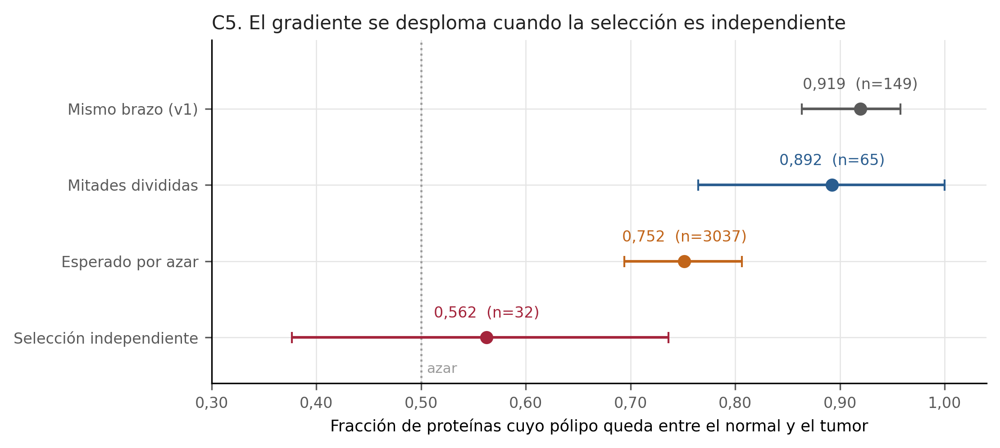

**Figura 2.** El gradiente normal-adenoma-carcinoma con selección independiente. Cada fila mide lo mismo con un diseño distinto. La primera elige y mide las proteínas en el mismo brazo, que es lo que hizo v1. La última las elige en CPTAC y las mide en la réplica, que es el análisis principal preregistrado. La tercera es el valor que saldría solo por regresión a la media. La selección independiente cae hasta el azar.

*Tabla de origen: `c5_gradiente_adenoma_carcinoma.tsv`.*

## 3. Comparar modelos sin repetir pacientes

Aquí se entrena un clasificador en una cohorte y se prueba en otra. La validación externa tiene 32 muestras de 16 pacientes, que es el detalle que lo cambia todo: cada paciente aporta su tumor y su normal, así que hay 16 personas independientes y no 32.

v1 remuestreaba especímenes. Eso trata el tumor y el normal del mismo paciente como dos observaciones independientes, y no lo son. v2 remuestrea pacientes: cada uno entra con sus dos muestras o con ninguna.

Conviene decir algo que va contra la intuición. Agrupar casi siempre ensancha el intervalo, pero aquí lo estrecha, porque el diseño es emparejado y el efecto del paciente se cancela dentro del par. La razón para agrupar no es obtener un intervalo más ancho: es remuestrear la unidad que de verdad se repetiría si se repitiera el estudio.

El mejor modelo es random forest, con AUC 0,902 (IC 95 % 0,758–0,988). Pero la regla de decisión preregistrada dice que solo hay ganador si su intervalo no se solapa con el del segundo, y se solapan. Así que no hay ganador declarado.

Hay una discrepancia que merece quedar escrita. El criterio de decisión es el solape, y por solape no hay ganador. La diferencia por pares sí separa al mejor modelo de los otros dos. No se cambia la regla después de ver el resultado: el veredicto declarado sigue siendo que no hay ganador, y la diferencia por pares se reporta como lo que es, una señal de que con más muestras podría haberlo.

Son dos preguntas distintas, y la diferencia por pares es la más potente porque aprovecha que los modelos se evalúan en las mismas muestras. Pero cambiar el criterio después de ver el resultado sería elegir el que da la respuesta que gusta. Se reporta la discrepancia y se mantiene la regla.

Y una limitación del propio ajuste. Con tan pocos pacientes el bucle interno de validación no distingue entre hiperparámetros: empatan en los tres modelos (logistica l1 (2 valores), elastic net (3 valores), random forest (3 valores)). Se toma el primero de la rejilla, así que esa elección no está respaldada por el dato y queda declarada como arbitraria en la tabla.

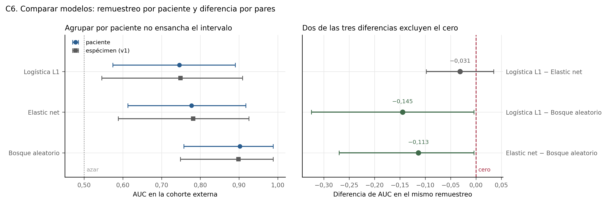

**Figura 3.** Selección de modelo con remuestreo por paciente. Izquierda: el AUC de cada modelo con su intervalo, remuestreando pacientes y remuestreando especímenes. En un diseño emparejado el intervalo por paciente sale más estrecho, porque el efecto del paciente se cancela dentro del par. Derecha: la diferencia de AUC calculada en el mismo remuestreo. La regla de decisión preregistrada es el solape de los intervalos de la izquierda, y por solape no hay ganador.

*Tabla de origen: `c6_modelos_auc_externo.tsv`.*

## 4. La cláusula de vías, con un mínimo de términos

Una vía es un conjunto de proteínas que trabajan juntas. La pregunta es si las vías alteradas en una cohorte también lo están en otra, lo que sería más robusto que mirar proteínas una a una.

v1 dio esta cláusula por satisfecha con una concordancia de 1,0, que suena perfecta. Detrás había 4 términos y un intervalo que bajaba hasta 0,398. Con cuatro términos un intervalo así no distingue una vía real de una moneda al aire.

v2 exige 10 términos como mínimo, prueba tres colecciones independientes y usa una prueba competitiva, que compara el conjunto contra el resto de proteínas en lugar de contra nada. La prueba competitiva además infla la varianza según la correlación entre genes del conjunto: dejarla en cero haría la prueba anticonservadora.

De las tres colecciones solo Reactome llega al mínimo, con 51 términos evaluables de 449 significativos en el descubrimiento. Su concordancia es 0,922 (47 de 51, IC 95 % 0,811–0,978) y supera el umbral de 0,80 por 0,011.

Eso es poco margen y hay que decirlo: La cláusula se apoya en una sola de las tres colecciones y el límite inferior de su intervalo supera el umbral por poco. No es un resultado robusto: es el mínimo que la regla preregistrada acepta.

El cuello de botella no es el resultado, es la cobertura. La réplica mapea a símbolo de gen solo 17,3 % de sus proteínas, 1179 de 6824. Con tan pocos genes casi ningún conjunto llega al mínimo de términos.

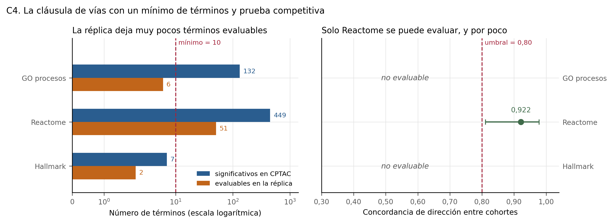

**Figura 4.** La cláusula de vías exige un mínimo de términos. v1 declaró la cláusula satisfecha con cuatro términos y un intervalo que bajaba hasta 0,398. v2 exige diez términos como mínimo y que el límite inferior del intervalo supere el umbral. De las tres colecciones solo Reactome llega al mínimo, y lo supera por 0,011. El cuello de botella no es el resultado: es que la réplica mapea a símbolo de gen una parte pequeña de sus proteínas.

*Tabla de origen: `c4_clausula_de_vias.tsv`.*

## 5. La brecha tejido–plasma no es un límite de detección

Una proteína alterada en el tumor sería útil si se pudiera medir en un análisis de sangre. En los datos no es así: la dirección del cambio en tejido y en plasma concuerda en 0,488 de los casos (42 de 86), que es azar.

Antes de concluir algo hay que descartar una explicación aburrida. Puede que la concordancia falle no porque la biología sea distinta, sino porque el experimento de suero no llega a medir las proteínas poco abundantes. Eso sería un artefacto de detección, no un resultado.

Para comprobarlo se usan las concentraciones en sangre del Human Protein Atlas (4396 proteínas con concentración y accesión), prefiriendo las medidas por espectrometría de masas porque es la tecnología del propio experimento de suero.

La ventana de detección existe y es fuerte: por cada orden de magnitud de concentración la probabilidad de cuantificarse sube con pendiente 1,453 en escala logit (z = 23,6). El umbral donde la probabilidad pasa de la mitad está en 8,52 en log₁₀ de pg/L.

Y sin embargo la ventana no explica la brecha. Dentro de la ventana la concordancia es 0,540 (34 de 63, IC 95 % 0,409–0,666), que sigue siendo compatible con el azar. Restringir a la ventana de detección no cambia el resultado: la concordancia sigue siendo compatible con el azar. Así que la brecha tejido→plasma no es un artefacto del límite de detección, y eso es una conclusión más fuerte que la de v1, no más débil: ahora se sabe que tampoco se transfiere entre las proteínas que el método sí alcanza.

Esto es una afirmación más fuerte que la de v1 y mejor acotada. v1 decía que no había traslación. v2 dice que no la hay incluso restringiendo a las proteínas que el experimento sí podía ver, lo que descarta la explicación técnica y deja la biológica: lo que cambia en el tumor no es lo que llega medible a la sangre.

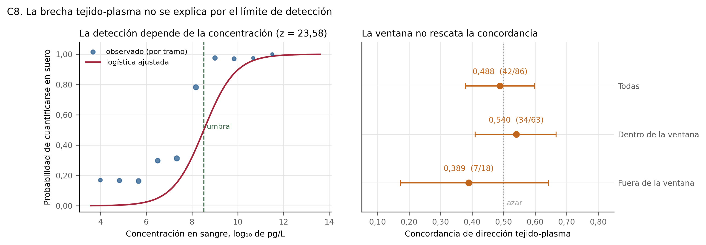

**Figura 5.** La ventana de detección no explica la brecha tejido-plasma. Izquierda: la probabilidad de que una proteína se cuantifique en suero crece con su concentración en sangre, así que el experimento tiene una ventana de detección real. Derecha: restringir la concordancia a las proteínas que caen dentro de esa ventana no la separa del azar. Eso convierte la brecha en un resultado y no en un artefacto, que es una afirmación más fuerte que la de v1 y mejor acotada.

*Tabla de origen: `c8_ventana_de_deteccion.tsv`.*

## 6. Las cohortes concuerdan en dirección, no en magnitud

R3 mide si las cohortes concuerdan en la **magnitud** del efecto, no solo en su dirección. En v1 era no calculable: el preregistro pide al menos 3 cohortes de tejido y solo había dos.

v2 incorpora una tercera y ya se puede calcular. Sale 0,094 sobre 101 proteínas presentes en las tres, de 185 que están en al menos dos.

Ese número conviene leerlo del revés. R3 es uno menos I², así que un R3 de 0,094 significa un I² mediano de 0,906. Es heterogeneidad altísima: las tres cohortes casi no concuerdan en cuánto cambia cada proteína, aunque sí concuerden en si sube o baja.

La explicación fácil sería la tecnología. CPTAC usa marcaje isobárico y las otras dos usan cuantificación sin marcaje, y comparar razones logarítmicas con intensidades podría generar heterogeneidad por sí solo. Se comprobó repitiendo el cálculo en las mismas proteínas sin CPTAC: el I² mediano baja de 0,906 a 0,851, es decir 0,055. Apenas cambia.

La heterogeneidad apenas cambia al quitar la cohorte de TMT, así que no se explica por la diferencia de tecnología. Con dos cohortes I² es inestable, así que este número es un diagnóstico y no un valor del certificado. R3 sigue siendo el de las tres.

De las 101 proteínas evaluables, 51 tienen un efecto combinado cuyo intervalo excluye el cero. Hay señal compartida; lo que no hay es acuerdo en su tamaño.

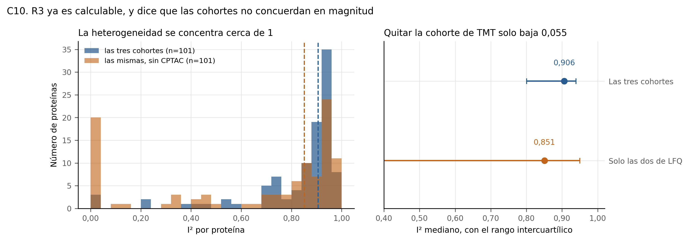

**Figura 6.** Heterogeneidad entre cohortes y de dónde viene. Con tres cohortes de tejido R3 pasa de no calculable a tener un valor, y ese valor es bajo: el I² mediano está cerca de 1, es decir que las tres cohortes casi no concuerdan en la magnitud del efecto. El panel derecho descarta la explicación fácil: al quitar la cohorte de marcaje isobárico y dejar solo las dos de LFQ, la heterogeneidad apenas baja. No es la tecnología. El histograma naranja además muestra por qué ese cálculo es solo un diagnóstico: con dos cohortes I² se va a cero o a uno y casi nada queda en medio, así que su mediana es un número inestable.

*Tabla de origen: `c10_heterogeneidad_i2.tsv`.*

## 7. Comprobar que una cohorte nueva es de verdad nueva

Añadir una cohorte solo vale si de verdad es otra cohorte. Si dos depósitos públicos contienen los mismos pacientes, sumarlos infla la confianza sin añadir información, y eso es peor que no sumar nada.

La comprobación tiene dos niveles. El primero compara los checksums de los ficheros en PRIDE. El segundo correlaciona cada muestra de un depósito con cada muestra del otro sobre las proteínas comunes. El segundo es el que decide, porque dos depósitos pueden ser ficheros distintos del mismo paciente y entonces los hashes no coinciden pero los datos sí.

Resultado: ningún par de muestras llega al umbral de sospecha de 0,98. El máximo es 0,877 y la mediana 0,732, una diferencia pequeña que es justo lo que se espera de cohortes distintas del mismo tejido.

El primer nivel sí sirvió para descartar algo. PXD031705 comparte ficheros con PXD019504, así que no es una cohorte distinta. Entra una de las dos, nunca las dos.

Veredicto: PXD019504 entra como tercera cohorte de tejido.

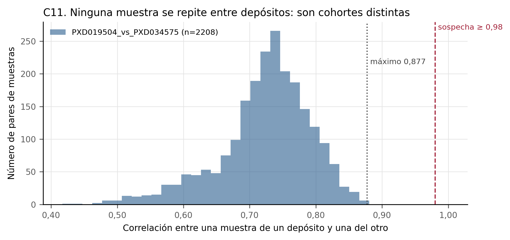

**Figura 7.** Dos niveles para comprobar que las cohortes son independientes. Comparar los checksums de PRIDE no basta: dos depósitos pueden ser ficheros distintos del mismo paciente. El segundo nivel correlaciona cada muestra de un depósito con cada muestra del otro sobre las proteínas comunes. Ningún par llega al umbral de sospecha, así que PXD019504 entra como tercera cohorte. PXD031705 sí compartía ficheros con PXD019504 y quedó fuera.

*Tabla de origen: `c11_independencia_de_cohortes.tsv`.*

## 8. Composición del tejido, sin circularidad

Un tumor no es solo células tumorales. Lleva tejido de soporte, vasos y células inmunes, y la proporción cambia de una muestra a otra. Una proteína puede parecer alterada simplemente porque el trozo de tumor tenía más estroma que el trozo de tejido normal.

v1 ajustaba por un índice estromal construido con las proteínas de matriz extracelular, y después contrastaba esas mismas proteínas contra ese índice. Cada una contribuía a su propia covariable, así que parte del ajuste era la proteína explicándose a sí misma.

v2 recalcula el índice sin la proteína que se está ajustando. Como el índice es la media de valores estandarizados, quitar una es aritmética simple y no hay que recomputar nada.

Con ese ajuste sobreviven 308 de 688 de los hallazgos certificados, 0,448 (IC 95 % 0,410–0,486). Menos de la mitad. R4 es una cota del efecto de composición, no una pureza medida, salvo cuando la covariable es la pureza ABSOLUTE de TCGA.

Queda una pregunta distinta: ¿la concordancia entre cohortes venía del estroma? Se recalculó R1 usando el efecto ya ajustado tanto para elegir las proteínas como para su signo. Pasa de 0,874 a 0,942 (65 de 69, IC 95 % 0,858–0,984), con el denominador reducido en 50 proteínas. La concordancia de dirección no cambia de forma apreciable al ajustar: los intervalos se solapan. La concordancia no venía del estroma.

Con una limitación que hay que declarar: la réplica entra sin ajustar, porque no tiene suficientes proteínas de matriz extracelular medidas en los dos brazos para construirle su propio índice. Así que la comparación es efecto ajustado contra efecto crudo, y es una cota de lo que el ajuste puede romper, no un contraste simétrico.

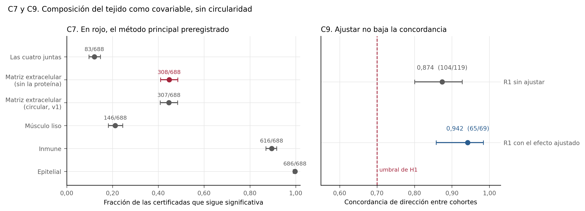

**Figura 8.** Composición del tejido: qué sobrevive y qué le pasa a R1. Izquierda: al ajustar por el índice estromal, recalculado sin la propia proteína, menos de la mitad de los hallazgos certificados sigue significativa. Eso es una cota del efecto de composición, no una pureza medida. Derecha: la concordancia de dirección entre cohortes no baja al usar el efecto ajustado, aunque el denominador se reduce. La cláusula de proteína de H1 exige bajar de 0,70 y no lo hace ni antes ni después.

*Tabla de origen: `c7_c9_composicion.tsv`.*

## 9. El índice R y las hipótesis

El índice R no es una nota. Los cinco subíndices no se promedian. Cada uno mide una cosa distinta y alguno puede no ser calculable; colapsarlos en un número ocultaría eso.

**Concordancia de dirección entre cohortes**: 0,874 (104 de 119). Fracción de proteínas certificadas en CPTAC cuyo log2FC tiene el mismo signo en la réplica, entre las que la réplica alcanza a medir con log2FC finito y distinto de cero. El intervalo es el exacto de Clopper–Pearson y el contraste es contra 0,5.

**Detectabilidad de los hallazgos en la réplica**: 0,328 (226 de 688). Fracción de proteínas certificadas en CPTAC cuyo UniProt tiene al menos un péptido único en el proteinGroups de la réplica.

**Homogeneidad entre estudios (1 − I²)**: 0,094. Mediana de (1 − I²) entre las proteínas certificadas con efecto y error estándar en al menos tres cohortes de tejido, por meta-análisis de efectos aleatorios REML ajustado proteína por proteína. Las matrices no se fusionan: solo se combinan los efectos.

**Fracción del efecto que sobrevive al igualar la composición del tejido**: 0,448 (308 de 688). Fracción de proteínas certificadas que siguen pasando treat y BH cuando el contraste de composición del par entra como covariable y el efecto se evalúa en diferencia de composición cero.

**p empírico frente al nulo de permutación**: 0,000100, y es un tope, no una estimación. Ninguna permutación alcanzó lo observado, así que el valor es el mínimo que el número de permutaciones permite. Es una cota, no una estimación.

**H1** queda en `rechaza_h1`. Es la conjunción de dos cláusulas: la de proteína rechaza y la de vía sostiene. El intervalo de R1 llega hasta 0,928, que no está por debajo de 0,70. La dirección se repite más de lo que la hipótesis predecía.

**H2** queda en `no_evaluada`. No hay nulo que conserve el grado de cada nodo. Ninguna red se interpreta. Para evaluarla haría falta ≥1000 redes con reconexión que conserve grados. v1 informaba de H2 como si tuviera respuesta. Sin un nulo que conserve el grado de cada nodo, cualquier red parece estructurada.

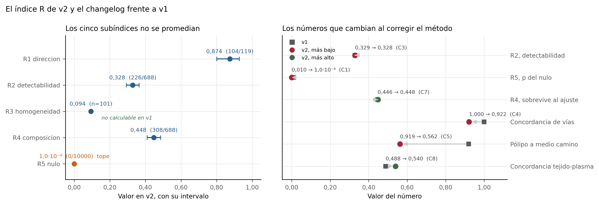

**Figura 9.** El índice R de v2 y qué números cambian frente a v1. Izquierda: cada subíndice responde a una pregunta distinta, así que colapsarlos en un número daría un valor sin interpretación. R3 era no calculable en v1 porque hacían falta tres cohortes de tejido y solo había dos. R5 figura como tope y no como estimación: el nulo no produjo ninguna permutación que igualara lo observado, así que el valor es el mínimo alcanzable con ese número de permutaciones. Derecha: los números que se mueven al corregir el método, con el código de la corrección que los movió. El changelog completo incluye además dos números que no caben en este eje porque no son fracciones: los términos de vía pasan de 4 a 51, y el veredicto de H1 cambia de etiqueta.

*Tabla de origen: `indice_r_y_changelog.tsv`.*

## 10. Qué determina el CEA en sangre

El CEA es el marcador en sangre que de verdad se usa en el seguimiento del cáncer de colon, y el gen que lo produce, CEACAM5, es una de las proteínas que esta tesis encuentra alteradas en el tumor. La pregunta de este eje es la que une las dos cosas: si un tumor expresa mucho CEACAM5, ¿sube el CEA en la sangre de ese paciente?

Se responde en TCGA, que tiene a la vez la expresión del gen en el tumor y el CEA prequirúrgico del mismo paciente. De 594 muestras de tumor primario, 380 tienen CEA (64,0 %) y 586 tienen una pureza tumoral medida sobre el ADN.

La respuesta es que sí, pero mucho menos de lo que cabría esperar. Por cada duplicación de la expresión tisular de CEACAM5, el CEA sérico sube 0,113 en logaritmo decimal, y la asociación no es casualidad (p = 0,000289). Pero la magnitud es lo decisivo: la expresión del gen explica por sí sola el 2,4 % de la variación del CEA, frente al 40,0 % del modelo completo con estadio, metástasis, pureza, edad, sexo, lado del tumor y subtipo. Añadir CEACAM5 a ese modelo completo aporta 2,3 %.

Dicho en palabras: el CEA de un paciente depende sobre todo de cuánto tumor hay y de dónde está, no de cuánto gen expresa el tumor. Esa es la razón por la que una proteína alterada en el tejido no se convierte automáticamente en un marcador en sangre, y conecta directamente con la brecha tejido–plasma de la sección 5: lo que allí parecía la rareza de un experimento pequeño aquí se mide en el caso mejor estudiado que existe.

Hay además un fenotipo que conviene nombrar. 53 tumores de esta cohorte están en el cuartil alto de expresión de CEACAM5 y aun así tienen el CEA por debajo del umbral de normalidad de 5 ng/ml. Existen, y no son una rareza. Lo que los distingue en estos datos es principalmente la ausencia de metástasis, que vuelve a apuntar a que el determinante es la carga tumoral.

Estos números no son un subíndice del certificado y no cambian ninguna hipótesis. Son el contexto que explica por qué la parte de plasma de esta tesis sale como sale.

## 11. El índice de composición de R4 frente a una pureza medida

La sección 8 ajusta el efecto tumor–normal por un índice de composición del tejido construido con las proteínas de matriz extracelular del propio proteoma. Queda una pregunta que ese ajuste no puede responderse a sí mismo: ¿ese índice mide de verdad cuánto tumor hay en la muestra?

Para contestarla hace falta una pureza medida con otra tecnología y en los mismos pacientes. Existe: un proteoma retrospectivo de TCGA cuyos pacientes tienen pureza tumoral calculada sobre el ADN con ABSOLUTE.

El índice correlaciona con la pureza medida en el sentido correcto —más estroma, menos tumor— con una correlación de rangos de −0,228 (IC 95 % de −0,423 a −0,013, n = 83 pacientes). No está midiendo ruido. Pero comparte con la pureza solo el 5,2 % de la varianza: de cada cien partes de variación en pureza tumoral, el índice capta unas pocas.

El contraste con la firma inmune lo deja claro. Con cuatro proteínas llega a −0,362, más lejos que las 230 proteínas de la firma de matriz extracelular. Más proteínas no es más información cuando las proteínas miden otra cosa.

La consecuencia para la tesis es precisa y conviene no suavizarla. R4 sigue siendo un análisis de sensibilidad válido: ajustar por el índice responde a «cuánto del efecto sobrevive si los pares no difieren en composición medida así». Lo que no se puede decir es que R4 controle la pureza. El lenguaje obligatorio del preregistro no es una cautela de más: es la descripción correcta.

Esta fuente deja además dos cifras sobre la fiabilidad de la medida que afectan a cómo se leen todos los coeficientes de este informe. La primera: el perfil completo de un mismo tumor medido dos veces correlaciona a 0,797 sobre 5 pares de alícuotas. El perfil global se reproduce razonablemente.

La segunda es más incómoda. CEACAM5, la proteína del CEA, medida dos veces en el mismo tumor difiere 4,3 veces (mediana), que es el 84 % de la variación que hay entre pacientes distintos. Eso cambia el significado de un coeficiente: la correlación entre CEACAM5 en el tumor y el CEA en sangre sale 0,096 (n = 56), y con este nivel de ruido un número cercano a cero no dice «no hay relación», dice «con esta medida no se puede saber». Son dos conclusiones muy distintas y confundirlas sería el error más fácil de cometer aquí.

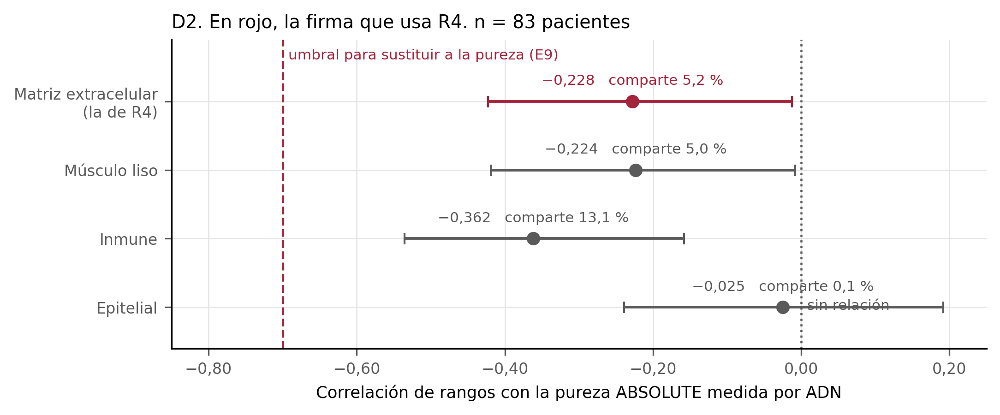

**Figura 11.** El índice estromal de R4 frente a una pureza medida por ADN. Los cuatro índices de composición van en el sentido esperado: más estroma, menos pureza tumoral. Pero ninguno se acerca al umbral que haría de ellos un sustituto de la pureza. El de matriz extracelular, que es el que usa R4, comparte un 5,2 % de la varianza con la pureza medida, y eso con 230 proteínas; la firma inmune, con cuatro, llega más lejos. La consecuencia es que el lenguaje obligatorio del preregistro sobre R4 no es una cautela de más: es la descripción correcta.

*Tabla de origen: `d2_indice_frente_a_pureza.tsv`.*

## 12. Cuánto varía un tumor dentro de sí mismo

Todo este trabajo mide un tumor con una sola biopsia. Conviene saber cuánto se pierde por eso, y la única forma de saberlo es un depósito que haya medido varias regiones del mismo tumor.

La búsqueda de cohortes nuevas revisó 9 candidatos contra los cuatro criterios del preregistro. El resultado es que **ningún depósito nuevo los cumple todos**: solo 1 entra, y es la que ya se usaba. Los que publican una matriz de proteínas no llegan a diez pacientes o no tienen tejido normal; los que tienen el diseño adecuado publican solo espectros crudos, y reconstruir la matriz desde ahí compararía dos programas de análisis en lugar de dos tejidos. El detalle de cada descarte está en la tabla de la etapa y en la ficha de la fuente.

Lo que sí apareció es un depósito con cuatro pacientes, uno de ellos con ocho regiones del mismo tumor. Cuatro pacientes están por debajo del mínimo preregistrado de diez, así que **esta cohorte no entra en el meta-análisis** y el umbral no se ha doblado para que entrara. Entra para una pregunta distinta, que no es un contraste entre cohortes.

La comparación hay que hacerla con el número de observaciones igualado: la desviación de ocho valores y la de cuatro no son estimadores igual de precisos, y comparar una con otra regalaría el resultado. Con el remuestreo que las iguala, la variación dentro del tumor es 0,787 y la variación entre pacientes 0,576, con un cociente de 1,273 (IC 95 % 0,586–1,863).

El intervalo incluye el uno, así que esto es una señal y no un resultado establecido. Lo que sostiene no es que un tumor varíe más dentro de sí que entre pacientes, sino algo igualmente relevante: que las dos variaciones son **del mismo orden**. Si eso es así, el ruido de la biopsia no se reduce añadiendo pacientes, porque entra en cada medida.

Esto no invalida los efectos del certificado, y la razón es estructural: el contraste es dentro de cada paciente y el ruido de región no tiene dirección preferente. Lo que cambia es la interpretación de qué se ha medido. Se ha medido un trozo de tumor, no el tumor.

Hay un dato que favorece al certificado y se describe sin contrastarlo: de las 338 proteínas certificadas presentes en esta cohorte, el cociente mediano de variación es 1,130, frente a 1,489 en el resto. Las proteínas que el certificado selecciona están entre las menos variables de una región a otra. Son dos medianas puestas una al lado de la otra, no una prueba de que una sea mayor.

Los dos contrastes que esta cohorte permite se leen con su referencia de azar, sin la cual no significan nada: con cuatro pares, el azar ya pone de acuerdo a una proteína de cada ocho. Tumor frente a mucosa normal concuerda en los cuatro pares para el 44,9 % de las proteínas, que es 3,6 veces el azar. Metástasis hepática frente a tumor primario solo 1,6 veces. Con cuatro pares no se calcula ningún p ni ningún intervalo: publicarlo invitaría a leerlo como si distinguiera algo.

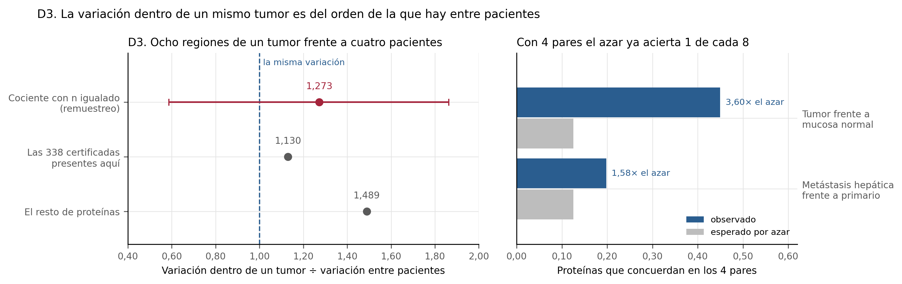

**Figura 12.** Variación dentro de un tumor frente a variación entre pacientes. Izquierda: con el número de observaciones igualado por remuestreo, dos trozos del mismo tumor se parecen algo menos entre sí que dos tumores de pacientes distintos, pero el intervalo incluye el uno. Es una señal, no un resultado: lo que sostiene es que las dos variaciones son del mismo orden. Las 338 proteínas certificadas presentes están entre las menos variables por región, lo que favorece al certificado y se describe sin contrastarlo. Derecha: la concordancia de dirección necesita su referencia de azar para poder leerse.

*Tabla de origen: `d3_heterogeneidad.tsv`.*

## 13. Estimar la composición del tejido con una referencia de fuera

El índice de composición de la sección 8 tiene un problema de principio: se calcula con el mismo proteoma que se está contrastando. La corrección C7 mitigó lo más grave excluyendo cada proteína de su propio índice, pero el índice sigue saliendo de los mismos datos. La forma de romper eso es estimar la composición con perfiles de tipos celulares que vengan de fuera, y eso es lo que el preregistro contemplaba como método de sensibilidad.

Los perfiles salen del Human Protein Atlas, que publica la expresión media de cada gen en cada tipo celular. De ahí se construye una firma de los once tipos celulares del colon, fijados antes de mirar ningún resultado.

Hay dos obstáculos, y los dos se comprueban con los datos en lugar de afirmarlos.

El primero: **esto no se puede hacer en CPTAC**, que es la cohorte donde vive R4. Estimar proporciones celulares supone que lo medido es una mezcla no negativa y lineal de los perfiles. CPTAC publica el logaritmo de un cociente contra un canal de referencia, y el 52,5 % de esos valores es negativo. Una mezcla de perfiles no negativos con pesos no negativos solo puede dar valores no negativos, así que no existe ninguna proporción que reproduzca ese perfil. No es que el ajuste salga malo: el sistema no tiene solución con sentido. Hay dos motivos más, independientes: el logaritmo no es lineal, y el canal de referencia es a su vez una mezcla distinta en cada lote.

El segundo: **las proporciones tipo a tipo no se publican**, y conviene decir por qué con precisión. El residuo del ajuste es de alrededor de 0,9 en las dos cohortes, es decir que la mezcla reproduce menos de una décima parte del perfil medido; y varios tipos celulares salen ausentes en más de la mitad de las muestras, que es lo que ocurre cuando otro tipo con perfil parecido se lleva su señal entera. Un cero en esas tablas no significa «este tipo celular no está»: significa que el método ha asignado su señal a otro.

Lo que sí resiste es el agregado epitelio frente a no epitelio, porque esa separación no depende de distinguir un fibroblasto de una célula de músculo liso. Y se usa solo después de comprobar en los datos que ordena los pares como la histología espera. Una de las dos cohortes no pasa ese filtro y en ella no se calcula el ajuste externo.

En PXD019504, con 22 pares, el ajuste por la composición estimada desde fuera deja en pie el 22,8 % de los hallazgos de esa cohorte, frente al 68,9 % con el índice del propio proteoma.

La tentación es leer el primero como la confusión real y el segundo como un ajuste que se queda corto, y no se puede. Las dos covariables marcan un número parecido de proteínas como dependientes de la composición (93 frente a 102), así que la diferencia no viene de que una detecte mucha más confusión. Viene de la precisión: el cero en el que R4 evalúa el efecto está a 1,10 desviaciones típicas de los datos con la covariable externa y a 0,46 con la interna. Extrapolar más lejos cuesta error típico, y con más error típico menos proteínas pasan el umbral.

Esa es, de hecho, la aportación más útil de esta sección, y es una limitación de R4 y no de esta fuente: R4 evalúa el efecto en una composición que ningún par tiene, así que es una extrapolación, y su valor depende de a qué distancia de los datos quede ese cero. Dos formas razonables de medir la composición dan cotas distintas. R4 es una cota, no una cantidad, y conviene tenerlo delante al leer también el R4 del certificado.

Una advertencia sobre la referencia: es de ARN y lo que se deconvuelve es proteína. La sección 11 midió el acuerdo entre transcrito y proteína del mismo gen y salió flojo. Toda cifra de esta sección hereda esa aproximación.

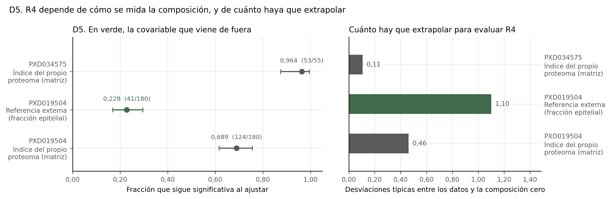

**Figura 13.** R4 con una covariable de composición que no sale del propio proteoma. Izquierda: en PXD019504 el ajuste por una composición estimada con una referencia externa deja en pie una fracción mucho menor que el ajuste por el índice del propio proteoma. Derecha: la razón no es que la covariable externa detecte más confusión —las dos marcan un número parecido de proteínas como dependientes de la composición— sino que obliga a extrapolar más del doble de lejos para evaluar el efecto en composición cero, y extrapolar cuesta precisión. La lectura conjunta es que R4 es una cota, no una cantidad.

*Tabla de origen: `d5_r4_alternativo.tsv`.*

## 14. Separar cáncer de sano no es separar cáncer de enfermo

La parte de plasma de esta tesis compara cáncer con personas sanas. Es el diseño que había, y tiene un sesgo que no se arregla con más muestras: en una consulta real no llegan personas sanas, llegan personas con síntomas. Distinguir cáncer de salud es una tarea más fácil que la que haría falta.

Esta fuente permite poner número a esa diferencia, y lo permite porque las dos comparaciones usan la misma plataforma con el mismo número de ensayos, de modo que los dos AUC son comparables aunque las magnitudes de proteína no lo sean.

Con el mismo panel de 1463 proteínas, el AUC es 0,994 contra personas sanas y 0,800 contra pacientes derivados por síntomas que resultaron no tener cáncer (y 0,820 en la réplica). La diferencia es de 0,194 en AUC, y no viene de la tecnología: viene de contra quién se compara.

Conviene ver qué eran esos controles. De los descritos, una parte tenía una enfermedad autoinmune y otra una infección. Es decir, el AUC más bajo no sale de comparar con gente un poco menos sana: sale de comparar con gente enferma de otra cosa, que es exactamente el problema clínico.

La lista de proteínas del modelo también dice algo. De las 22 proteínas, solo 1 es una proteína inflamatoria secretada; la mayoría son intracelulares, nucleares o citoqueratinas, que en plasma indican recambio y muerte celular más que inflamación. Ninguna de las tres proteínas de plasma que v1 destacó aparece en ella.

Y la limitación que impide estirar esto: solo 5 de los cánceres de la cohorte de descubrimiento y 1 de la réplica eran colorrectales. De aquí no sale ninguna afirmación sobre cáncer colorrectal en particular. Lo que aporta es la medida de cuánto optimismo introduce elegir un grupo de control sano.

## 15. El CEA frente a las alternativas, según la literatura

Si una proteína nueva aspirara algún día a servir de marcador, tendría que superar a lo que ya se usa. Esta sección fija ese listón con un meta-análisis de tablas 2×2 extraídas de la literatura, con el modelo bivariado de Reitsma, que modela la sensibilidad y la especificidad conjuntamente en lugar de promediarlas por separado.

El CEA para detectar una recaída, sobre 8 estudios, tiene una sensibilidad conjunta de 0,605 (IC 95 % 0,492–0,708) y una especificidad de 0,879 (IC 95 % 0,771–0,939). Dicho en claro: de cada diez recaídas, el CEA deja pasar cerca de cuatro. Ese es el listón real, y no es alto.

La metilación de SEPT9 en sangre, sobre 25 estudios, llega a una sensibilidad de 0,702 y una especificidad de 0,915. Parece mejor, pero **no se resta**: responde a otra pregunta clínica, cribado o diagnóstico en lugar de detección de recaída. Los dos puntos se dan por separado y la comparación directa se declara no comparable.

El ADN tumoral circulante, según una cifra publicada sobre 18 estudios en la misma indicación, tiene una sensibilidad de 0,580 y una especificidad de 0,920. Los intervalos se solapan con los del CEA, pero eso es una descripción y no una prueba: son dos grupos de estudios distintos con criterios de inclusión distintos, y restarlos no significaría nada.

Una nota de procedimiento que no es menor. La tabla de extracción tiene 33 filas y las 33 están pendientes de verificación humana: la columna `verificado_por` está vacía a propósito y la rellena una persona tras comparar cada fila con el artículo original. Ningún número extraído del texto de un PDF debería entrar en un resultado sin ese paso.

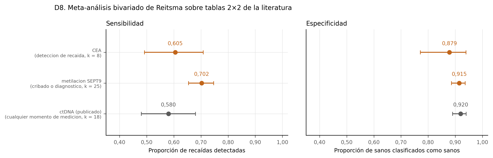

**Figura 15.** El CEA frente a las alternativas, en sensibilidad y especificidad. Cada punto es la estimación conjunta de un modelo bivariado de efectos aleatorios; k es el número de estudios. En naranja, los ajustes hechos aquí; en gris, una cifra publicada puesta al lado. Los intervalos se solapan, pero eso es una descripción y no una prueba: los grupos de estudios son distintos y tienen criterios de inclusión distintos. Ninguna fila de la tabla de extracción se ha dado por verificada: la columna verificado_por está vacía a propósito.

*Tabla de origen: `d8_marcadores.tsv`.*

## 16. Lo que haría falta para responder la pregunta que queda abierta

Las secciones anteriores dejan una pregunta que ningún dato público puede contestar: si mirar cómo **cambia** el CEA a lo largo del tiempo aporta algo sobre mirar solo su último valor. Todas las cohortes de esta tesis tienen una sola determinación por paciente, y una pendiente no se calcula con un punto.

Lo honesto cuando la respuesta exige datos que no existen es escribir el estudio que los generaría, y dejarlo escrito antes de tener los datos. Eso es `docs/protocolo_cohorte_cea.md`: diseño, diccionario de datos con las columnas obligatorias, plan de análisis estadístico cerrado de antemano, y lo que el estudio **no** podría concluir.

**El estudio no se ha hecho.** El protocolo está pendiente de aprobación ética y de datos reales. El código de análisis sí existe y está probado, pero sobre datos sintéticos generados a propósito, en un fichero con el prefijo `SINTETICO_` y confinado a `tests/`. Ninguna cifra de esos datos aparece en este informe ni en ningún resultado.

Lo que los tests comprueban son las dos direcciones, que es lo que hay que verificar antes de usar un análisis con datos de personas: que detecta una diferencia cuando el generador la programó, y que no la fabrica cuando no la programó. También que la validación cruzada parte por paciente y no por visita, porque partir por visita dejaría visitas del mismo paciente a los dos lados y el resultado saldría mejor de lo que es.

El tamaño necesario se calcula con la aproximación de Hanley y McNeil para la varianza de un AUC, corregida por el número de visitas de cada paciente, y partiendo del rendimiento del CEA que mide la sección 15: 560 pacientes para una mejora de 0,05 en AUC; 140 pacientes para una mejora de 0,10 en AUC. Conviene separar de dónde sale cada supuesto. El rendimiento de partida es el del CEA publicado, medido en la sección 15; los otros dos —qué proporción de pacientes recae y cuántas determinaciones tiene cada uno— los fija el protocolo y no los mide nada de esta tesis. Los tres están en la tabla de la etapa. Es un orden de magnitud, no una cifra al paciente.

Dos advertencias que el protocolo recoge y que importan más que el tamaño de muestra. El estudio no diría si conviene hacer más determinaciones de CEA —detectar antes no es vivir más— ni daría un punto de corte para usar en consulta. Y no se trasladaría a otra población sin comprobarlo, porque el CEA basal depende del tabaquismo y de la función hepática.

## 17. Limitaciones

Lo que sigue no es un trámite. Cada punto es una razón concreta por la que algún número de este informe podría estar diciendo menos de lo que parece.

- El brazo de pólipo es un adenoma del mismo paciente, no una cohorte independiente de adenomas.

- La selección independiente cruza dos tecnologías distintas, TMT con razones logarítmicas y LFQ con intensidades. Mide coincidencia de dirección, no de magnitud.

- 16 pacientes de validación dan intervalos anchos. Un AUC alto aquí no selecciona un modelo.

- Ningún resultado de este fichero sirve para decidir sobre un paciente.

- La prueba competitiva compara cada conjunto con el resto de proteínas medidas. El resultado depende del universo medido, que no es el proteoma.

- Las dos cohortes usan tecnologías distintas y universos distintos. Un término puede ser no evaluable en la réplica solo por cobertura.

- El nulo de etiquetas de gen rompe la pertenencia pero conserva la correlación entre proteínas, así que no es un nulo de la correlación.

- La concentración del HPA es de sujetos sanos de referencia, no de los pacientes de PXD055218. Es una aproximación al orden de magnitud.

- Solo una fracción pequeña del proteoma tiene concentración publicada, así que la ventana se define sobre un subconjunto sesgado hacia las proteínas abundantes y ya estudiadas.

- El tejido es CPTAC y el suero es otra cohorte. No hay ningún paciente con las dos medidas, así que la comparación es entre cohortes.

- CPTAC mide razones logarítmicas con TMT y las otras dos miden log2 de intensidad LFQ. El TMT comprime las razones, así que la magnitud no es estrictamente comparable aunque el signo y el orden sí lo sean. Un I² alto puede reflejar esa diferencia de tecnología y no de biología.

- El meta-análisis se limita a las proteínas certificadas en CPTAC, así que el conjunto está seleccionado por el descubrimiento. No es un cribado nuevo.

- Solo las proteínas medidas en al menos tres cohortes entran en R3. Las que solo están en dos se reportan en la tabla pero no en el resumen.

- El CEA de TCGA es prequirúrgico y de una sola extracción. No es una serie de seguimiento, así que no dice nada sobre la cinética del marcador.

- El valor del CEA puede estar censurado por el límite inferior del ensayo y el límite no viene en la tabla. Cualquier modelo tiene que tratarlo como censura, no como un número exacto.

- La pureza ABSOLUTE es de ADN de la misma pieza, no de la sección exacta de la que sale el proteoma. Es una pureza medida, pero de otra alícuota.

- El subtipo disponible es el de PanCanAtlas, no CMS.

- El lado del tumor se deriva de códigos ICD-O-3 y una parte queda en «colon sin especificar». Esos casos entran como categoría propia en lugar de desaparecer.

- El fenotipo no secretor se define con un percentil de expresión y el umbral clínico de 5 ng/ml. Los contrastes que lo describen son exploratorios y no están corregidos por multiplicidad.

- Correlación no es causa: que el CEA suba con el estadio no dice que la masa tumoral sea la causa, solo que las dos cosas van juntas.

- Es label free y PDC000116 es TMT. El índice estromal que se valida aquí es el mismo constructo, pero no son los mismos valores: lo que se comprueba es si la idea del índice mide pureza, no si los números concretos de R4 están bien.

- Son tumores sin normales, así que el índice se calcula entre tumores y no como diferencia dentro de un par. Es una validación del constructo, no del contraste.

- El 36 % de la matriz son ausencias. En label free eso es normal y se trata como ausencia, no se imputa.

- El CEA sérico solo existe en una parte de estos pacientes, así que el análisis del CEACAM5 corre sobre menos gente que el de la pureza. Los dos tamaños se publican por separado.

- La pureza ABSOLUTE es a su vez una estimación, hecha con datos de copias y de variantes. Es una medida de ADN y no un recuento de células al microscopio, así que la comparación es entre dos medidas indirectas y no contra un patrón de oro.

- La pieza del proteoma y la pieza del ADN no son el mismo trozo de tumor. Un tumor no es homogéneo, así que parte de la discrepancia es muestreo y no error de ninguna de las dos medidas.

- Las correlaciones son de rangos y el intervalo es la aproximación de Fisher. Con 83 pacientes va bien, pero es una aproximación.

- Las cuatro firmas se correlacionan con la misma pureza, así que son cuatro pruebas sobre la misma variable. Ninguna está corregida por multiplicidad: la que decide es la de matriz extracelular, que es la que R4 usa, y las otras tres son descriptivas.

- Son cuatro pacientes. De aquí no sale ninguna estimación de efecto que se pueda comparar con las cohortes del certificado.

- Las ocho regiones son de UN tumor de UN paciente. Lo que se puede decir es que existe al menos un tumor así, no cuántos tumores son así. Generalizarlo sería inventar.

- La cuantificación es un cociente contra una referencia común y la plataforma no es la de ninguna cohorte del certificado, así que las magnitudes no son comparables entre fuentes. Lo que se compara aquí es variación contra variación dentro de la misma matriz.

- Las regiones del mismo tumor se midieron probablemente más juntas en el tiempo que las muestras de pacientes distintos. Si eso sesga algo, las haría parecer más parecidas entre sí, no menos: el sesgo va en contra del resultado y no a favor.

- La referencia es de ARN y lo deconvuelto es proteína. D2 midió el acuerdo entre transcrito y proteína del mismo gen en CEACAM5 y salió una correlación de rangos de 0,24. Una firma de ARN aplicada a un proteoma es una aproximación, y el número de arriba la hereda.

- Las proporciones tipo a tipo no se publican: el diagnóstico de cada cohorte explica por qué. Solo se usa el agregado epitelial.

- Los tipos celulares del Human Protein Atlas son de todos los tejidos juntos, así que «fibroblastos» es un promedio entre tejidos.

- La regla de selección de marcadores no estaba preregistrada y se declara como enmienda E9.

- R4 resulta ser sensible a dónde queda el cero respecto de los datos, y no solo a cuánta confusión capta la covariable. Ningún par tiene diferencia de composición cero, así que evaluar el efecto ahí es extrapolar, y el error típico de la extrapolación crece con la distancia. En PXD019504 las dos covariables marcan un número parecido de proteínas como dependientes de la composición y aun así dan cotas muy distintas, porque una extrapola más del doble de lejos en unidades de su propia desviación típica. Es una limitación de R4 como índice, no de esta fuente, y conviene tenerla delante al leer cualquier valor de R4, incluido el del certificado.

- Comparar la fracción epitelial con el índice estromal no valida ninguno de los dos: los dos salen del mismo proteoma. La validación con otra tecnología es la de D2, contra la pureza ABSOLUTE del ADN.

- La varianza dentro de cada estudio se trata como conocida, que es la aproximación normal de Reitsma 2005 y no el binomio exacto. Con celdas pequeñas empeora, y se cuenta cuántos estudios tienen alguna celda por debajo de cinco.

- El intervalo del punto combinado sale de la covarianza de mínimos cuadrados generalizados, que trata la varianza entre estudios como conocida. Eso lo estrecha un poco.

- De los 25 estudios de metilación, la mayoría son de casos y controles, donde la proporción de enfermos la fija el diseño. La revisión de origen califica de alto el riesgo de sesgo de selección en 21 de ellos. La especificidad de un diseño así no es la que se vería en una población de cribado.

- Del ctDNA no hay tablas 2x2 por estudio en la fuente, así que se usa su estimación combinada publicada. Comparar un ajuste propio con el de otro grupo arrastra diferencias de criterio de inclusión que no entran en ningún intervalo.

- No se calcula el área bajo la curva resumen. Obtenerla exige reparametrizar a HSROC y extrapolar a umbrales que ningún estudio midió, y aquí no hace falta: la pregunta es qué rinde cada prueba en su punto de corte habitual.

- Las filas están pendientes de verificación humana mientras la columna verificado_por siga vacía.

- Es un trabajo sobre cáncer en general, no sobre cáncer colorrectal. Las 22 proteínas son de un modelo pan-cáncer.

- Los números de la tabla S5 se han extraído del texto de un PDF. La columna verificado_por está vacía a propósito y la rellena una persona tras comparar cada fila con el original.

- La localización de cada proteína es la anotación de UniProt y sirve solo para decir si la lista se parece a una respuesta de fase aguda. No es un resultado de este trabajo ni del artículo.

- Las dos cohortes son suecas y de dos hospitales. Un grupo de control de pacientes con síntomas no es el mismo en todos los sistemas sanitarios.

- Comparar un AUC de este trabajo con uno de D4b es comparar dos diseños distintos. La comparación es legítima porque la plataforma es la misma, pero no es un contraste estadístico: son dos números publicados puestos uno al lado del otro.

Y la limitación que engloba a todas las demás: esto es un trabajo metodológico sobre datos públicos, con tamaños de muestra de decenas de pacientes. Ningún resultado de esta tesis sirve para decidir sobre un paciente.
