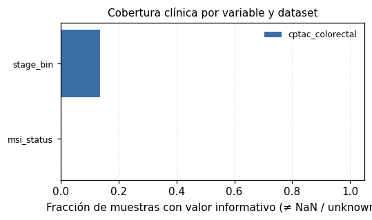

# Cobertura clínica

## cptac_colorectal
- stage_bin: 13.64%
- msi_status: 0.00%

## pride_crc_meta
- Sin cobertura clínica consolidada todavía.

## plasma_crc_2024
- Sin cobertura clínica consolidada todavía.

## Vista gráfica

_Cada barra reporta la fracción de muestras con valor informativo (no NaN ni `unknown`). Variables con cobertura cero indican que la metadata aún no se ha curado para ese dataset._
