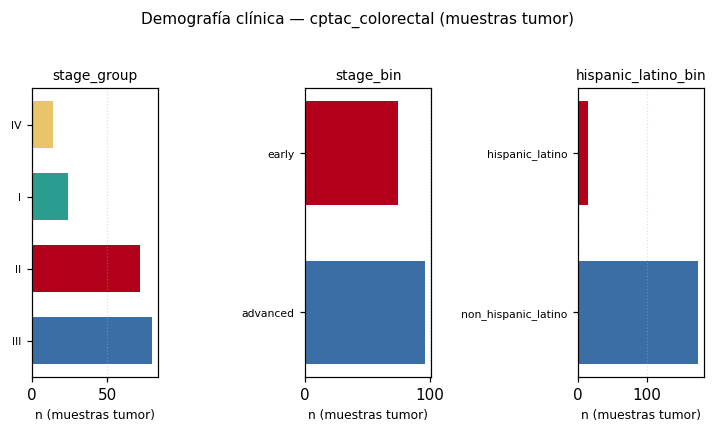

> Documento de la v1. No forma parte de los resultados certificados de la tesis; ver results/v3_7.

# Demografía y contexto clínico (estadio, etnia, geografía)
CPTAC colon (PDC000116) recluta principalmente en centros de EE.UU. La variable 'hispanic_latino_bin' proviene de la categoría NIH 'Hispanic or Latino' (autorreportada), NO de nacionalidad colombiana ni de residencia en Latinoamérica. 'geographic_region_bin' usa país/sitio cuando el Excel clínico lo incluye; si falta, queda 'unknown'. No sustituye un registro clínico local (p. ej. cohorte CTIC Colombia).

Esta página resume **qué información clínica está realmente disponible** en cada cohorte pública integrada. Los conteos se calculan sobre muestras **tumor** (cuando `condition` existe) y, cuando aplica, se reportan participantes únicos (`participant_id`).

## Cómo interpretar los estratos

| Variable | Significado operativo | Uso en el pipeline |
|----------|----------------------|-------------------|
| `stage` / `stage_bin` | Estadio patológico crudo y binario temprano vs avanzado | Comparación `cptac_stage_advanced_vs_early` |
| `stage_group` | Grupo AJCC I–IV extraído del texto de estadio | Tablas y futuras comparaciones por estadio |
| `hispanic_latino_bin` | Categoría NIH: hispano/latino vs no (autorreportada, contexto US) | Comparación opcional `cptac_hispanic_latino_vs_non` |
| `geographic_region_bin` | País/sitio → `latin_america`, `united_states`, `other`, `unknown` | Exploratorio; cobertura suele ser baja en CPTAC |
| `ethnicity` / `race` | Texto normalizado del Excel PDC | Transparencia; no implica origen colombiano |

## cptac_colorectal

- Muestras tumor en metadata: **190** (participantes únicos: **95**)

| Variable | Cobertura | Distribución (conteo) |
|---|---:|---|
| `age_bin` | 0.0% | _sin valores informativos_ |
| `cms_subtype_bin` | 0.0% | _sin valores informativos_ |
| `country` | 0.0% | _sin valores informativos_ |
| `ethnicity` | 100.0% | `not hispanic or latino`: 174, `hispanic or latino`: 14, `not evaluated`: 2 |
| `geographic_region_bin` | 0.0% | _sin valores informativos_ |
| `hispanic_latino_bin` | 99.0% | `non_hispanic_latino`: 174, `hispanic_latino`: 14 |
| `msi_status` | 0.0% | _sin valores informativos_ |
| `race` | 100.0% | `white`: 140, `asian`: 30, `black or african american`: 14, `unknown (could not be determined or unsure)`: 4, `american indian or alaska native`: 2 |
| `sex` | 100.0% | `female`: 110, `male`: 80 |
| `stage` | 100.0% | `stage iia`: 64, `stage iiib`: 60, `stage1`: 20, `stage iiic`: 14, `stage iva`: 14, `stage iib`: 8, `stage iiia`: 6, `stage iv`: 2, `stage ii`: 2 |
| `stage_bin` | 89.5% | `advanced`: 96, `early`: 74 |
| `stage_group` | 100.0% | `III`: 80, `II`: 72, `I`: 24, `IV`: 14 |
| `tumor_site` | 100.0% | `Colon`: 190 |

## pride_crc_meta

- Muestras tumor en metadata: **16** (participantes únicos: **16**)
- Sin variables demográficas tabuladas.

## plasma_crc_2024

- Muestras tumor en metadata: **0** (participantes únicos: **0**)
- Sin variables demográficas tabuladas.

## crcdb_context

- Muestras tumor en metadata: **1** (participantes únicos: **1**)
- Sin variables demográficas tabuladas.

## pharmacoproteomics

- Muestras tumor en metadata: **0** (participantes únicos: **0**)
- Sin variables demográficas tabuladas.

## metastatic_crc_optional

- Muestras tumor en metadata: **2** (participantes únicos: **2**)
- Sin variables demográficas tabuladas.

## Comparaciones opcionales habilitadas por estas variables

- `cptac_stage_advanced_vs_early` — requiere `stage_bin` con suficientes `early` y `advanced`.
- `cptac_hispanic_latino_vs_non` — requiere `hispanic_latino_bin` (derivado de `ethnicity`).
- `cptac_eocrc_vs_lorc`, `cptac_msi_vs_mss`, `cptac_cms4_vs_rest` — ver [Cobertura clínica](clinical_coverage.md).

Si una comparación queda omitida, el log de `differential` indica la columna o el N mínimo.

## Relevancia para Colombia / Latinoamérica (tesis)

La revisión de García-Foncillas et al. enfatiza heterogeneidad del CCR y tendencias en población joven en la región. **Los datos públicos CPTAC no sustituyen** una cohorte colombiana curada: aquí la capa `hispanic_latino_bin` solo permite explorar, de forma prudente, si participantes autorreportados como hispanos/latinos en un estudio US muestran perfiles proteómicos distinguibles — como **hipótesis generadora**, no como generalización a Colombia.

Para validación regional futura: integrar metadata local (edad, estadio TNM, MSI, origen) en el mismo esquema de columnas (`metadata/sample_metadata/`) y re-ejecutar `harmonize_public_metadata` + `differential`.

## Distribución CPTAC (muestras tumor)

_Conteos detallados en `results/clinical/demographics_counts.tsv`._
