# Figuras (generadas automáticamente)

Cada figura se regenera en cada `publish_results`. Las versiones PNG residen bajo `reports/web/figures/` y se espejan en `docs/web/figures/` para MkDocs.

Para definiciones técnicas (volcano, NES, AUC, padj…) ver [Glosario](glosario.md).

## Cobertura clínica

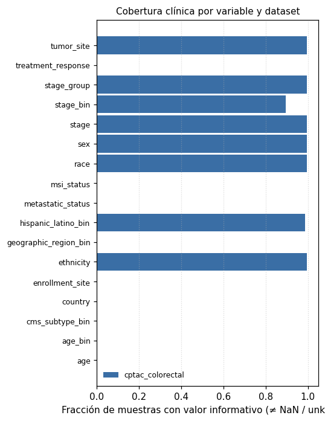

## Volcanos (proteínas diferenciales)

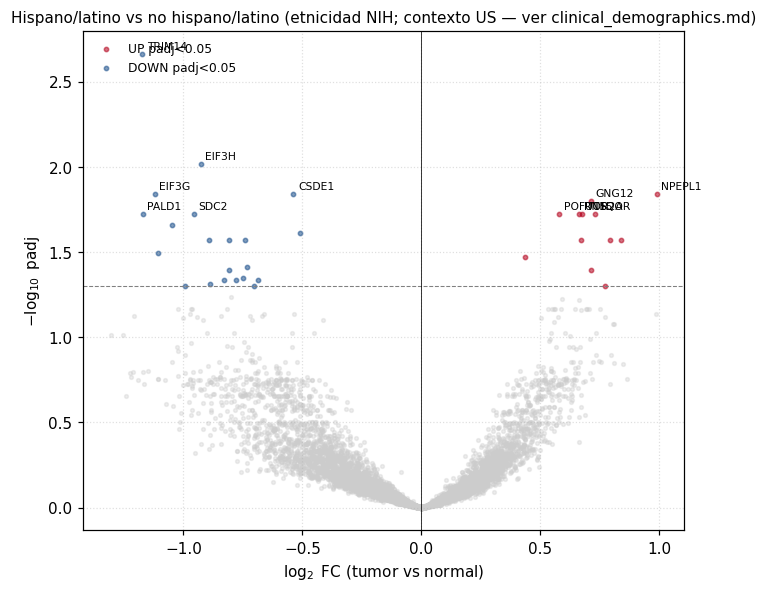

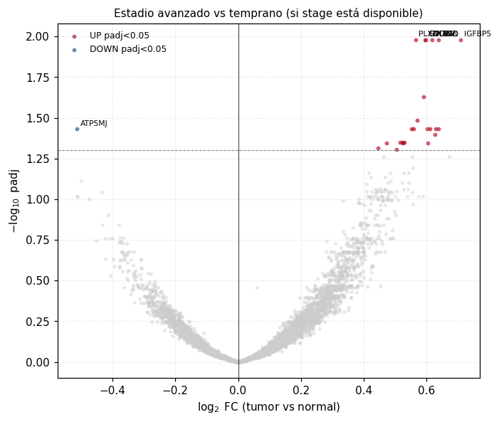

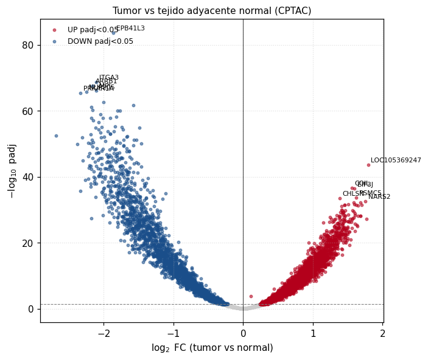

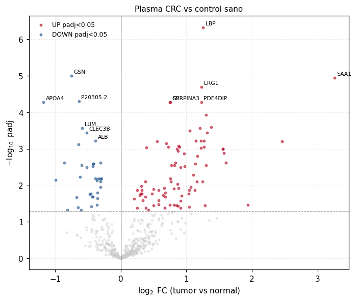

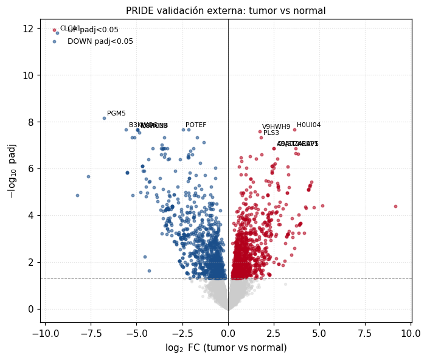

## ORA — top términos GO

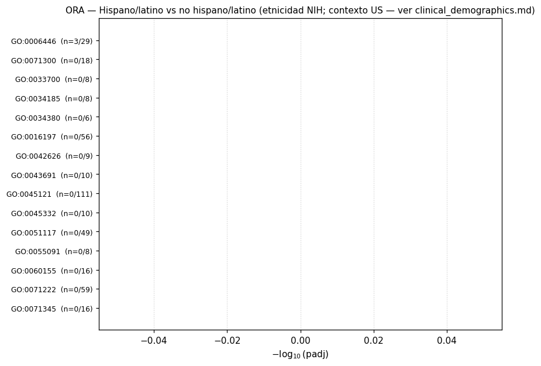

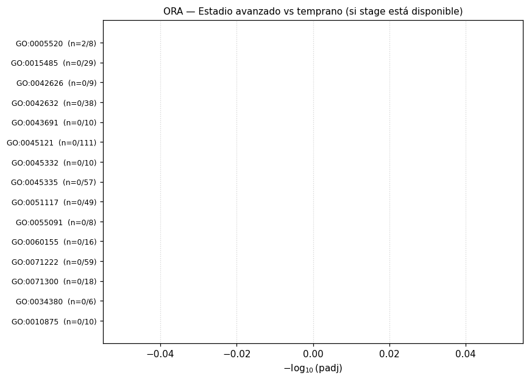

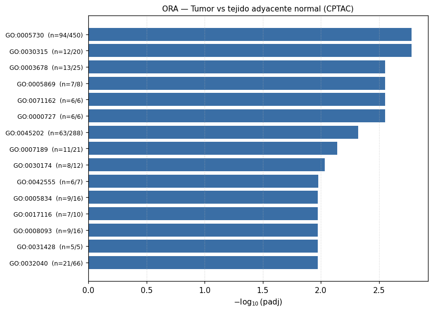

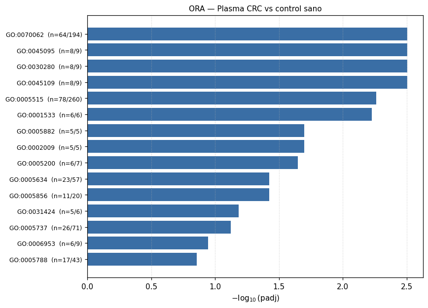

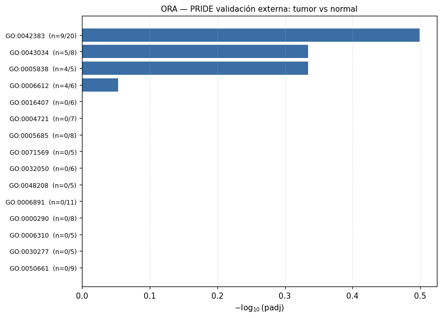

## GSEA — top NES (up/down)

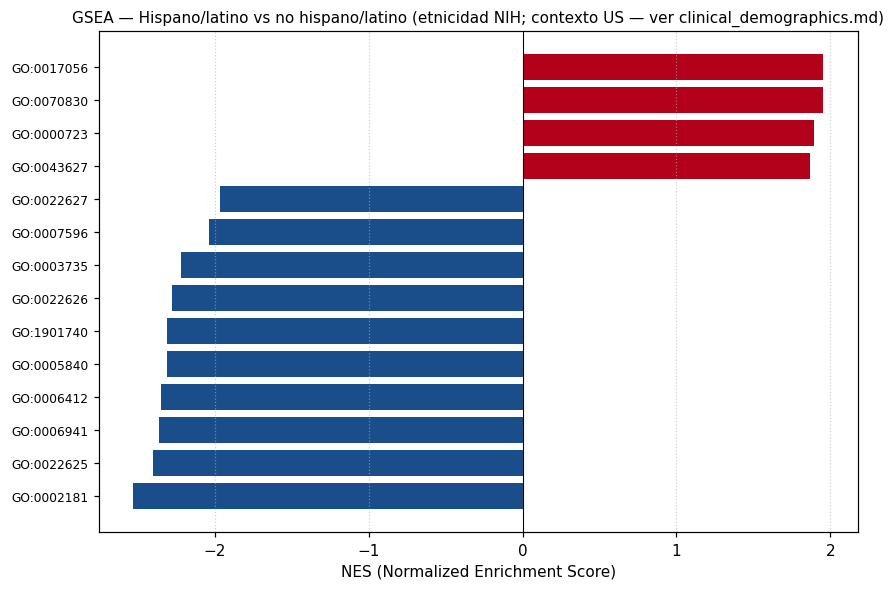

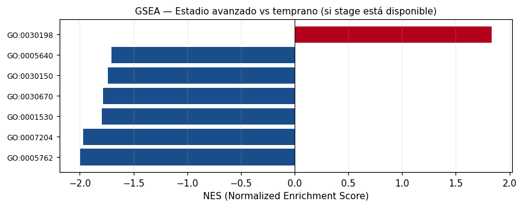

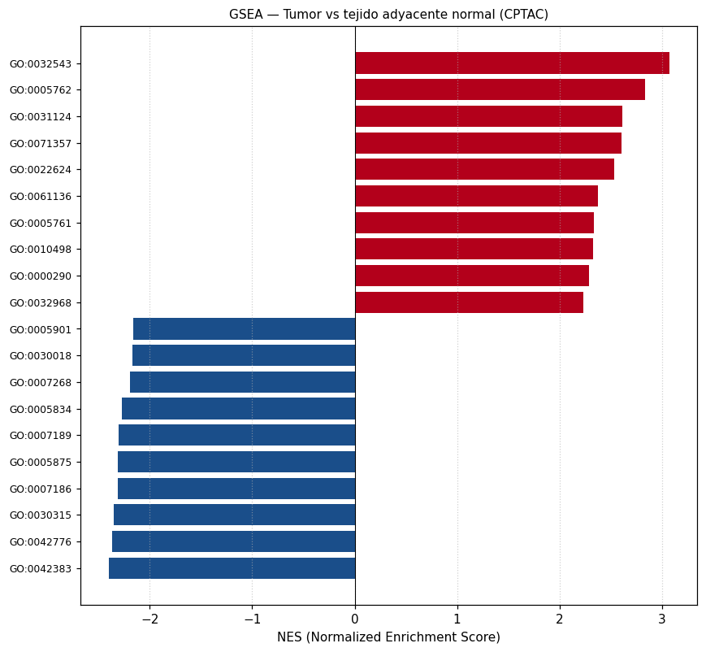

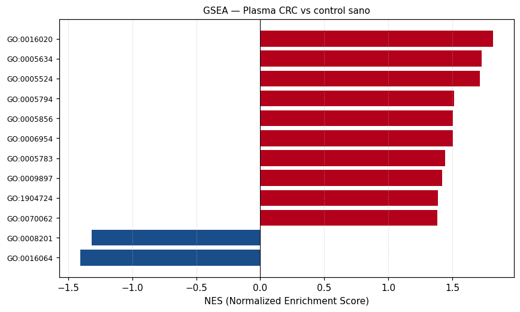

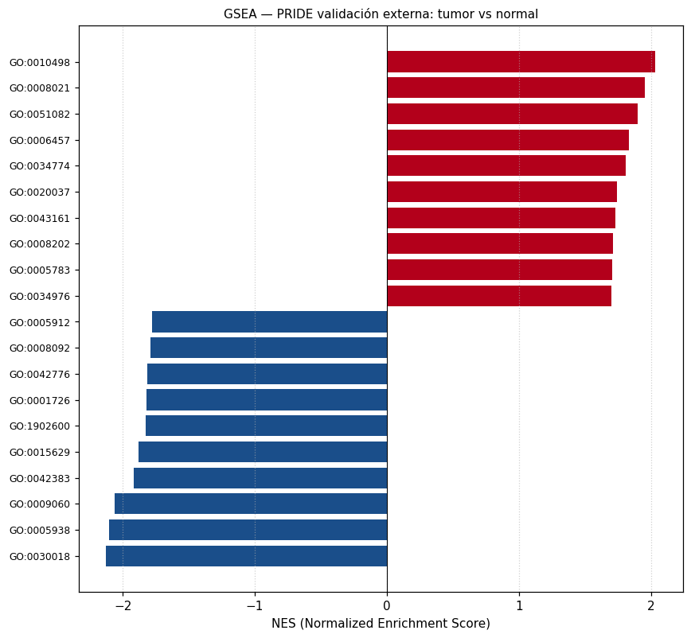

## Reproducibilidad multi-cohorte

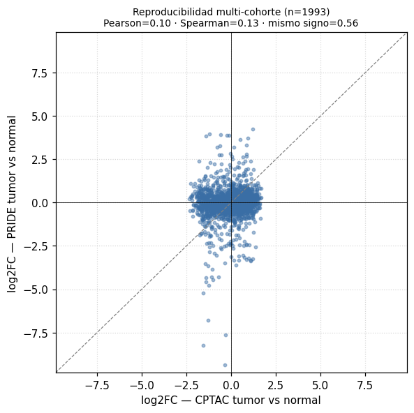

## PCA por dataset

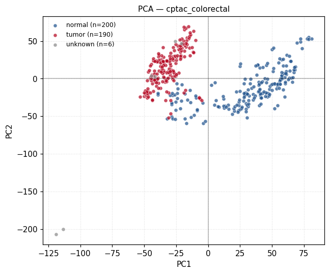

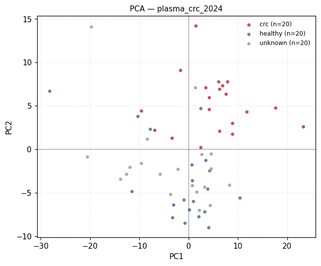

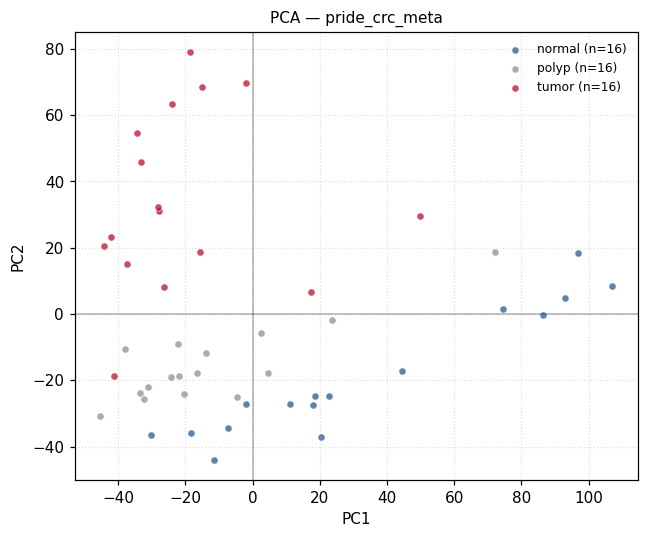

## Heatmaps top features

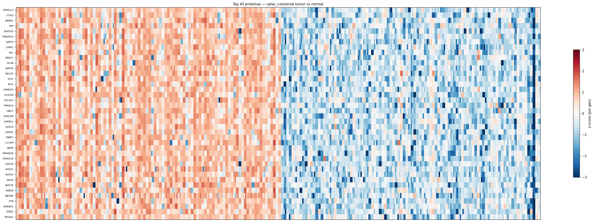

## ML — nested CV y transferencia

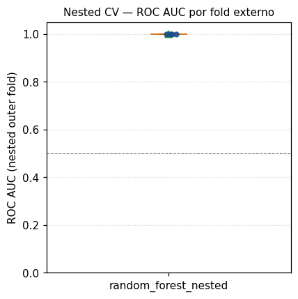

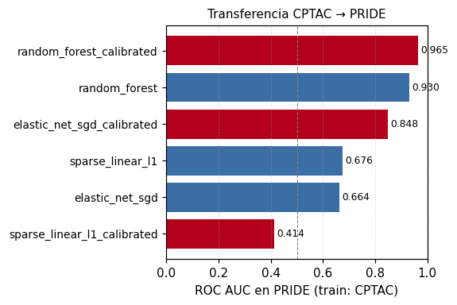

