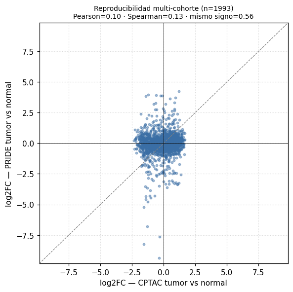
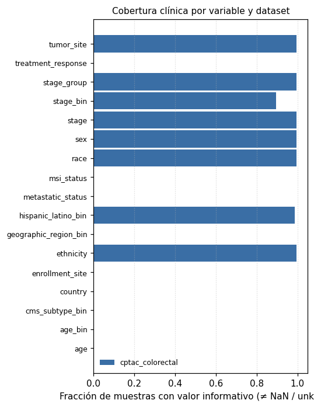
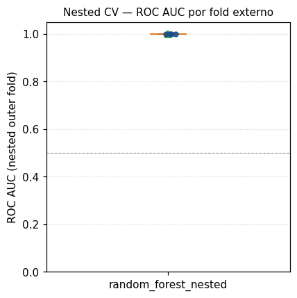

# Resultados base (generado automáticamente)

> **Workspace de datos:** `data/`, `results/`, `reports/`, `metadata/` y `docs/web/` apuntan a `/Volumes/JANCODATA/OncoGO-CRC` (el clon conserva `config/`, `src/` y el resto de `docs/`). Trazabilidad de corrida: `results/run_manifest.json`.

Resumen **cuantitativo** del último `oncogo-crc run`: proteínas por `padj`, **ORA** (lista binaria), **GSEA pre-ranked** (ranking continuo, mejor tolerancia cuando casi todo el proteoma cambia), firma **CPTAC ∩ PRIDE** y extractos ML/red/traslación. La narrativa interpretativa va en [**Síntesis para tesis**](thesis_synthesis.md).

**Umbrales en esta corrida:** FDR diferencial **0.05**; columna `significant` incluye |log2fc| ≥ **0** si `differential.min_abs_log2fc` > 0; ORA puede exigir además |log2fc| ≥ **0** (`go.ora_min_abs_log2fc`); GSEA usa métrica(s) de ranking **t_stat, signed_neglog10_p** y FDR término **0.25** (exploratorio). Cada métrica adicional genera `*_gsea_go_<métrica>.tsv`; el primero se refleja también en `*_gsea_go.tsv`. **Universo ORA/GSEA:** genes mapeados desde la matriz normalizada ∩ `metadata/gene_ontology/go_gene_long.tsv`.

## Tumor vs tejido adyacente normal (CPTAC)

`cptac_tumor_vs_normal`

**Proteínas significativas** (FDR **0.05**; ver `significant` y filtros en config): **5031** / **6237**

### Top filas diferenciales (por `padj`)

| protein_id | log2fc | t_stat | p_value | padj | significant |
| --- | --- | --- | --- | --- | --- |
| EPB41L3 | -1.8613918231373312 | -26.87052799125075 | 4.134102127300767e-88 | 2.5784394967974884e-84 | True |
| ITGA3 | -2.106697767337489 | -22.840903044193876 | 5.5520568690343056e-73 | 1.7314089346083482e-69 | True |
| ARRB1 | -2.1594262825166544 | -22.803097384555656 | 1.4731679090591357e-71 | 3.062716082933943e-68 | True |
| MPI | -2.1075478363097195 | -22.042600932060516 | 4.914633074090869e-70 | 7.663141620776187e-67 | True |
| NUP205 | -2.2509836007801036 | -22.640014689067915 | 1.672466922161901e-69 | 2.086235238704756e-66 | True |
| PRKAR1A | -2.331044288938557 | -21.763635457226513 | 4.124900715419702e-69 | 4.287834293678781e-66 | True |
| GAP43 | -2.0003465337746693 | -21.53271083260022 | 3.5078433001955365e-66 | 3.125488380474222e-63 | True |
| LPAR1 | -1.572830114329287 | -21.935679636398643 | 3.0256995377216557e-65 | 2.3589110020962457e-62 | True |
| AGL | -2.176319620522187 | -20.94307650390909 | 9.476029669195104e-65 | 6.566888560752208e-62 | True |
| GNA11 | -2.157946086762687 | -21.019892326210424 | 1.11465927825504e-63 | 6.952129918476684e-61 | True |
| SCGN | -1.7710195175534358 | -20.443348563741 | 1.9417951645989544e-63 | 1.0092480368003063e-60 | True |
| MATN2 | -1.8022054832646213 | -21.021769572361467 | 1.8510390959487937e-63 | 1.0092480368003063e-60 | True |
| MECP2 | -2.0480745659741344 | -20.597173480859183 | 2.796481667577185e-62 | 1.3416658585137621e-59 | True |
| PLP1 | -1.8239672819187784 | -20.400207066351797 | 1.3144849954960609e-61 | 5.856030654934952e-59 | True |
| NIT1 | -1.9052015155076207 | -19.894332248958698 | 3.267261129816389e-61 | 1.3585271777776545e-58 | True |

### GO — ORA offline (FDR término **0.05**; **34** términos pasan)

| go_id | overlap | term_size | odds_ratio | p_value | padj |
| --- | --- | --- | --- | --- | --- |
| GO:0005730 | 94 | 450 | 1.9003007925645352 | 4.461330705125625e-07 | 0.0016531904530841 |
| GO:0030315 | 12 | 20 | 10.334390862944163 | 8.621592975667176e-07 | 0.0016531904530841 |
| GO:0003678 | 13 | 25 | 7.467704362558238 | 2.726754205994875e-06 | 0.0028001585042054 |
| GO:0005869 | 7 | 8 | 47.984867591424965 | 3.968615977961702e-06 | 0.0028001585042054 |
| GO:0071162 | 6 | 6 | inf | 4.38095202744e-06 | 0.0028001585042054 |
| GO:0000727 | 6 | 6 | inf | 4.38095202744e-06 | 0.0028001585042054 |
| GO:0045202 | 63 | 288 | 1.980135685210312 | 8.718795532036082e-06 | 0.0047766544093369 |
| GO:0007189 | 11 | 21 | 7.566159695817491 | 1.500826315619405e-05 | 0.0071945861505005 |
| GO:0030174 | 8 | 12 | 13.719696969696969 | 2.179547033390292e-05 | 0.0092872920811686 |
| GO:0042555 | 6 | 7 | 41.07808564231738 | 2.731714477967042e-05 | 0.0104761250230036 |
| GO:0017116 | 7 | 10 | 15.989071038251366 | 4.7040324220849946e-05 | 0.0106117437286446 |
| GO:0008093 | 9 | 16 | 8.826079104208056 | 4.4335313324884865e-05 | 0.0106117437286446 |
| GO:0005834 | 9 | 16 | 8.826079104208056 | 4.4335313324884865e-05 | 0.0106117437286446 |
| GO:0110011 | 5 | 5 | inf | 3.434225538994477e-05 | 0.0106117437286446 |
| GO:0016887 | 49 | 217 | 2.0463271193963606 | 3.752159803537378e-05 | 0.0106117437286446 |

_Reducción semántica:_ `results/go/cptac_tumor_vs_normal_go_reduced.tsv`

### GSEA — GO offline pre-ranked (FDR **0.25**; **446** términos; ranking principal `t_stat`)

| Term | NES | NOM p-val | FDR q-val | Tag % | Lead_genes |
| --- | --- | --- | --- | --- | --- |
| GO:0032543 | 3.0713364316979734 | 0.005 | 0.005 | 70/89 | MRPL33;MRPL49;MRPL28;MRPL39;MRPL45;MRPL13;MRPS24;MRPL27;MRPL10;MRPL16;MRPL41;MRPS7;MRPL50;HARS2;MRPL19;MRPL15;MRPS5;MRPL17;MRPL58;MRPS25;MRPS23;MRPL4;MRPS14;MRPL35;MRPS12;MRPS27;MRPL43;MRPS26;MRPL2;IARS2;MRPS16;MRPL48;MRPL14;MRPS30;MRPL51;MRPL47;MRPL44;GADD45GIP1;MRPS35;MRPL37;MRPS22;MRPS31;FASTKD2;LARS2;MRPL40;PTCD3;MRPS15;MRPL46;MRPL42;MRPS33;MRPS18A;DAP3;MRPS9;MRPS18B;MRPL54;MRPL9;MRPL53;MRPL24;MRPS6;GATC;MRPL3;QRSL1;MRPL23;MRPL38;MRPS34;MRPS10;MRPL11;MRPS21;OXA1L;MRPL22 |
| GO:0005762 | 2.8353496058261833 | 0.005 | 0.005 | 38/49 | MRPL33;MRPL49;MRPL28;MRPL39;MRPL45;MRPL13;MRPL27;MRPL10;MRPL16;MRPL41;MRPL50;MRPL19;MRPL15;MRPL17;MRPL58;MRPL4;MRPL35;MRPL43;MRPL2;MRPL48;MRPL14;MRPS30;MRPL51;MRPL47;MRPL44;GADD45GIP1;MRPL37;MRPL40;MRPL46;MRPL42;MRPS18A;MRPL54;MRPL9;MRPL53;MRPL24;MRPL3;MRPL23;MRPL38 |
| GO:0031124 | 2.61486494223563 | 0.005 | 0.005 | 21/28 | NCBP1;NUDT21;CPSF3;NCBP2;CDC73;CPSF1;CSTF2;RPRD2;CPSF2;CPSF7;SYMPK;CSTF1;WDR33;PAPOLA;CLP1;CPSF6;ZCCHC8;MTPAP;RPRD1A;CPSF4;PAF1 |
| GO:0071357 | 2.6089295954115954 | 0.005 | 0.005 | 23/35 | PSMC5;PSMD11;PSMD1;PSMD13;PSMD14;PSMD8;PSMA3;PSMA7;PSMC2;PSMD6;PSMA1;PSMC4;PSMA6;PSMD3;PSMC6;PSMC3;PSMD2;PSMB7;PSMD4;PSMD7;PSMC1;PSMA4;PSMA5 |
| GO:0022624 | 2.5337384921080117 | 0.005 | 0.005 | 15/17 | PSMC5;PSMD11;PSMD1;PSMD13;PSMD14;PSMD8;PSMC2;PSMD6;PSMC4;PSMD3;PSMC6;PSMC3;PSMD2;PSMD4;PSMC1 |
| GO:0042383 | -2.4037621741382376 | 0.005 | 0.005 | 37/59 | CAMK2D;AHNAK2;LAMA2;AHNAK;ANK3;SGCE;ANK2;NOS1;DMD;CAV1;RTN2;ATP2B4;SLC2A4;UTRN;SLC8A1;SYNM;ITGB1;SGCD;CORO1C;COL6A2;DYSF;PGM5;SGCB;AQP1;FLNC;DTNA;SLMAP;ANXA5;DAG1;FLOT1;BGN;ATP1A2;CAV2;BSG;VCL;DES;SNTB1 |
| GO:0061136 | 2.373096342192695 | 0.005 | 0.005 | 24/43 | PSMC5;PSMD11;PSMD1;PSMD13;UCHL5;PSMD14;PSMD8;PSMA3;PSMA7;PSMC2;PSMD6;PSMA1;PSMC4;PSMA6;PSMD3;PSMC6;PSMC3;PSMD2;PSMB7;PSMD4;PSMD7;PSMC1;PSMA4;PSMA5 |
| GO:0042776 | -2.366614190861016 | 0.005 | 0.005 | 37/59 | NDUFS1;ATP5PD;NDUFV1;NDUFV2;ATP5PO;NDUFS6;NDUFA9;ATP5F1C;NDUFA6;NDUFS8;ATP5PB;NDUFB9;NDUFA12;ATP5ME;ATP5MG;NDUFS3;STOML2;NDUFC2;NDUFV3;NDUFB7;NDUFA13;ATP5PF;NDUFB1;MT-ATP6;NDUFA11;NDUFB10;NDUFS4;NDUFA1;NDUFS5;MT-ATP8;NDUFB2;NDUFS2;ATP5F1E;NDUFA7;NDUFB5;SDHA;FAM210B |
| GO:0030315 | -2.3532731341640867 | 0.005 | 0.005 | 16/20 | AHNAK2;AHNAK;ANK3;BIN1;ANK2;NOS1;PPP3CB;RTN2;CACNA2D1;ATP2B4;SLC2A4;SLC8A1;STBD1;DYSF;ATP1A2;SLC30A1 |
| GO:0005761 | 2.333749351091812 | 0.005 | 0.005 | 18/23 | MTG2;MRPL49;MRPL28;MRPL39;MRPL13;MRPS14;MRPL35;MRPS12;MRPL43;MRPL48;MRPL51;MRPL47;MRPL37;MRPS22;MRPL40;MRPS15;DAP3;MRPL9 |
| GO:0010498 | 2.325710196563731 | 0.005 | 0.005 | 29/51 | PSMC5;FAF2;PSMD11;PSMD1;PSMD13;PSMD14;PSMD8;PSMA3;PSMA7;PSMC2;PSMD6;PSMA1;PSMC4;VCP;PSMA6;PSMD3;PSMC6;BAG6;PSMC3;PSMD2;PSMB7;PSMD4;PSMD7;CUL4B;PSMC1;UBR4;PSMA4;PSMA5;PSMB10 |
| GO:0007186 | -2.3133316398137467 | 0.005 | 0.005 | 39/72 | LPAR1;GNA11;GNG7;GNG2;CXCL12;GNAQ;AGT;GNAO1;ECE1;GNB1;GNB4;GNA13;GNAS;RGS10;GPR15LG;PDE3A;NLN;GCG;AKR1C2;AKAP12;DEPTOR;AKT1;ARHGEF11;VIP;GNG5;GNB2;LANCL1;GIPC1;GPRC5A;APOC3;CAV2;PLCB1;APOA1;F2;C3;GNAI3;RIC8A;GNAI2;MRGPRF |

_Fichero completo:_ `results/gsea/cptac_tumor_vs_normal_gsea_go.tsv`

#### GSEA — métrica alternativa `signed_neglog10_p` (FDR **0.25**; **353** términos)

| Term | NES | NOM p-val | FDR q-val | Tag % | Lead_genes |
| --- | --- | --- | --- | --- | --- |
| GO:0032543 | 2.5765447805533555 | 0.005 | 0.005 | 64/89 | MRPL33;MRPL49;MRPL28;MRPL39;MRPL45;MRPS24;MRPL13;MRPL27;MRPL10;MRPL41;MRPL16;MRPS7;MRPL50;HARS2;MRPL19;MRPL15;MRPS5;MRPL17;MRPL58;MRPS25;MRPS23;MRPL4;MRPS14;MRPL35;MRPS12;MRPS27;MRPL43;MRPS26;MRPL2;IARS2;MRPS16;MRPL48;MRPL14;MRPS30;MRPL51;MRPL47;MRPL44;GADD45GIP1;MRPL37;MRPS35;MRPS22;MRPS31;FASTKD2;LARS2;MRPL40;PTCD3;MRPS15;MRPL46;MRPL42;MRPS33;MRPS18A;DAP3;MRPS9;MRPS18B;MRPL54;MRPL9;MRPL53;MRPL24;MRPS6;GATC;MRPL3;QRSL1;MRPL23;MRPL38 |
| GO:0005762 | 2.4501217823070287 | 0.005 | 0.005 | 35/49 | MRPL33;MRPL49;MRPL28;MRPL39;MRPL45;MRPL13;MRPL27;MRPL10;MRPL41;MRPL16;MRPL50;MRPL19;MRPL15;MRPL17;MRPL58;MRPL4;MRPL35;MRPL43;MRPL2;MRPL48;MRPL14;MRPS30;MRPL51;MRPL47;MRPL44;GADD45GIP1;MRPL37;MRPL40;MRPL46;MRPL42;MRPS18A;MRPL54;MRPL9;MRPL53;MRPL24 |
| GO:0071357 | 2.389820976466358 | 0.005 | 0.005 | 23/35 | PSMC5;PSMD11;PSMD1;PSMD13;PSMD14;PSMD8;PSMA3;PSMA7;PSMC2;PSMA1;PSMD6;PSMC4;PSMA6;PSMD3;PSMC6;PSMC3;PSMB7;PSMD2;PSMD4;PSMD7;PSMC1;PSMA4;PSMA5 |
| GO:0022624 | 2.2997664213989393 | 0.005 | 0.005 | 15/17 | PSMC5;PSMD11;PSMD1;PSMD13;PSMD14;PSMD8;PSMC2;PSMD6;PSMC4;PSMD3;PSMC6;PSMC3;PSMD2;PSMD4;PSMC1 |
| GO:0031124 | 2.2996694952545393 | 0.005 | 0.005 | 21/28 | NCBP1;NUDT21;CPSF3;NCBP2;CDC73;CPSF1;CSTF2;RPRD2;CPSF2;CPSF7;SYMPK;CSTF1;WDR33;PAPOLA;CLP1;CPSF6;ZCCHC8;RPRD1A;MTPAP;CPSF4;PAF1 |
| GO:0061136 | 2.208939666783615 | 0.005 | 0.005 | 22/43 | PSMC5;PSMD11;PSMD1;PSMD13;UCHL5;PSMD14;PSMD8;PSMA3;PSMA7;PSMC2;PSMA1;PSMD6;PSMC4;PSMA6;PSMD3;PSMC6;PSMC3;PSMB7;PSMD2;PSMD4;PSMD7;PSMC1 |
| GO:0005761 | 2.144981211882148 | 0.005 | 0.005 | 18/23 | MTG2;MRPL49;MRPL28;MRPL39;MRPL13;MRPS14;MRPL35;MRPS12;MRPL43;MRPL48;MRPL51;MRPL47;MRPL37;MRPS22;MRPL40;MRPS15;DAP3;MRPL9 |
| GO:0010498 | 2.080615256300576 | 0.005 | 0.005 | 26/51 | PSMC5;FAF2;PSMD11;PSMD1;PSMD13;PSMD14;PSMD8;PSMA3;PSMA7;PSMC2;PSMA1;PSMD6;PSMC4;VCP;PSMA6;PSMD3;PSMC6;BAG6;PSMC3;PSMB7;PSMD2;PSMD4;PSMD7;CUL4B;UBR4;PSMC1 |
| GO:0071339 | 2.0543311712496015 | 0.005 | 0.0059961624560281 | 10/19 | RUVBL1;HCFC1;PELP1;ASH2L;TAF9;RUVBL2;MAX;LAS1L;RBBP5;BACC1 |
| GO:0000502 | 2.0508401932362976 | 0.005 | 0.0053965462104253 | 25/46 | PSMC5;PSMD11;PSMD1;PSMD13;PSMD14;PSMD8;PSMA3;PSMA7;PSMC2;PSMA1;PSMD6;PSMC4;VCP;PSMA6;PSMD3;PSMC6;PSMC3;PSMB7;PSMD2;PSMD4;PSMD7;PSMC1;PSMA4;PSMA5;PSMB10 |
| GO:0005875 | -2.0133761427427888 | 0.005 | 0.005 | 13/25 | DCTN1;EML1;DCTN3;MAP1A;DYNLL2;PAFAH1B1;MID1;STAU1;ACTR1A;MAP4;MAP1B;RABGAP1;PEA15 |
| GO:0032039 | 1.97868775862554 | 0.005 | 0.0109021135564148 | 6/15 | INTS4;INTS14;INTS13;INTS1;INTS6;INTS3 |

_Fichero completo:_ `results/gsea/cptac_tumor_vs_normal_gsea_go_signed_neglog10_p.tsv`

## Plasma CRC vs control sano

`plasma_crc_vs_healthy`

**Proteínas significativas** (FDR **0.05**; ver `significant` y filtros en config): **119** / **517**

### Top filas diferenciales (por `padj`)

| protein_id | log2fc | t_stat | p_value | padj | significant |
| --- | --- | --- | --- | --- | --- |
| LBP | 1.2543458337810949 | 8.539477097584285 | 9.18521065610093e-10 | 4.748753909204181e-07 | True |
| GSN | -0.7530256002908366 | -7.122878739713295 | 3.889622040419932e-08 | 1.0054672974485524e-05 | True |
| SAA1 | 3.2565411464710934 | 6.74675151507289 | 6.610912092487636e-08 | 1.1392805172720356e-05 | True |
| LRG1 | 1.23288985345199 | 6.6088412889283505 | 1.5672394302055288e-07 | 2.0256569635406465e-05 | True |
| P20305-2 | -0.6368224726005849 | -6.073943392676242 | 4.806443565570857e-07 | 4.969862646800266e-05 | True |
| SERPINA3 | 0.7518343786754791 | 6.150226909393234 | 6.856064657322412e-07 | 5.316139209563069e-05 | True |
| C9 | 0.7440439040564399 | 6.22887306775164 | 8.249711901898953e-07 | 5.316139209563069e-05 | True |
| PDE4DIP | 1.2276585393464394 | 5.849152207479296 | 9.254400945080776e-07 | 5.316139209563069e-05 | True |
| APOA4 | -1.1790429765372783 | -6.1557288915122275 | 8.726264140518917e-07 | 5.316139209563069e-05 | True |
| KRT5 | 1.3028418464955251 | 5.561569807531528 | 2.287048847888162e-06 | 0.0001182404254358 | True |
| P41981 | 1.3803026589305532 | 5.37381187863695 | 5.423148218600252e-06 | 0.0002548879662742 | True |
| LUM | -0.589602593541219 | -5.244095157341267 | 6.580828324707079e-06 | 0.0002716615846964 | True |
| P24266 | 1.208052469847999 | 5.238647737641074 | 6.830948938209491e-06 | 0.0002716615846964 | True |
| CAMP | 1.049102858501854 | 5.172800296324417 | 8.48636329584187e-06 | 0.0003133892731393 | True |
| KRT9 | 1.3125976157681445 | 5.067647000302324 | 1.1038077055333566e-05 | 0.0003566678648504 | True |

### GO — ORA offline (FDR término **0.05**; **11** términos pasan)

| go_id | overlap | term_size | odds_ratio | p_value | padj |
| --- | --- | --- | --- | --- | --- |
| GO:0070062 | 64 | 194 | 2.398881118881119 | 2.8971006071757396e-05 | 0.0031324809843034 |
| GO:0030280 | 8 | 9 | 28.61261261261261 | 4.746183309550673e-05 | 0.0031324809843034 |
| GO:0045109 | 8 | 9 | 28.61261261261261 | 4.746183309550673e-05 | 0.0031324809843034 |
| GO:0045095 | 8 | 9 | 28.61261261261261 | 4.746183309550673e-05 | 0.0031324809843034 |
| GO:0005515 | 78 | 260 | 2.2578397212543555 | 0.0001031852694129 | 0.0054481822250015 |
| GO:0001533 | 6 | 6 | inf | 0.0001347031006233 | 0.0059269364274253 |
| GO:0005882 | 5 | 5 | inf | 0.000604982346659 | 0.0199644174397487 |
| GO:0002009 | 5 | 5 | inf | 0.000604982346659 | 0.0199644174397487 |
| GO:0005200 | 6 | 7 | 21.079646017699115 | 0.0007641962597005 | 0.0224164236178815 |
| GO:0005634 | 23 | 57 | 2.564950980392157 | 0.00143339489357 | 0.0377528165457141 |
| GO:0005856 | 11 | 20 | 4.402263374485597 | 0.001573034022738 | 0.0377528165457141 |

_Reducción semántica:_ `results/go/plasma_crc_vs_healthy_go_reduced.tsv`

### GSEA — GO offline pre-ranked (FDR **0.25**; **16** términos; ranking principal `t_stat`)

| Term | NES | NOM p-val | FDR q-val | Tag % | Lead_genes |
| --- | --- | --- | --- | --- | --- |
| GO:0016020 | 1.82098374786606 | 0.005 | 0.0140326009922041 | 22/73 | LRG1;KRT5;KRT9;KRT1;KRT10;KRT2;KRT6A;KSR2;ITGAL;AHNAK;TOMM70;FGFR4;CLCC1;F11;PVR;NUP188;DCD;TFRC;F9;CENPE;HSPA5;UFL1 |
| GO:0005634 | 1.7291802757372094 | 0.005 | 0.0280652019844082 | 22/57 | SERPINA3;PDE4DIP;KRT5;KRT9;KRT1;KRT10;KRT2;KRT6A;CBLL2;KRT14;HRNR;AHNAK;IDE;S100A9;CENPE;HSPA5;UFL1;SYMPK;KRT16;ANLN;SOX7;PALB2 |
| GO:0005524 | 1.7162753474381296 | 0.005 | 0.0249468462083628 | 13/22 | KSR2;FGFR4;IDE;ACACA;FLT1;CENPE;HSPA5;GUCY2F;SPEG;PIM2;TK2;ABCE1;ABCC2 |
| GO:0005794 | 1.512237892212268 | 0.0275862068965517 | 0.1660524450744153 | 9/20 | PDE4DIP;SERPINA1;CD14;FGFR4;QSOX1;CHST9;VCAM1;PROC;BAIAP3 |
| GO:0005856 | 1.5065098725234347 | 0.0266666666666666 | 0.1375194897236002 | 10/20 | PDE4DIP;KRT9;KRT1;KRT10;KRT14;S100A9;SYMPK;KRT16;KRIT1;ANLN |
| GO:0006954 | 1.502995998365862 | 0.0354609929078014 | 0.1161587526576895 | 11/22 | SERPINA3;CRP;HP;ITGAL;ORM1;S100A9;KRT16;VCAM1;C5;PF4;S100A8 |
| GO:0005783 | 1.4429687806603404 | 0.0596026490066225 | 0.1837602510883871 | 11/26 | SERPINA1;FGFR4;FGB;VWF;CLCC1;FGA;HSPA5;UFL1;VCAM1;PROC;ADIPOQ |
| GO:0009897 | 1.4189273410793817 | 0.0642857142857142 | 0.1917788802267895 | 10/27 | CD14;ITGAL;IDE;FGB;TFRC;FGA;FCN2;VCAM1;FGG;MBL2 |
| GO:0016064 | -1.4087312618925398 | 0.0416666666666666 | 0.1974293059125964 | 10/34 | IGHV3-64;IGHV3-64D;IGHV4-28;IGHV5-51;IGHV3-13;IGHV3-43D;IGHV2-5;IGHV3-35;IGKC;IGHV1-18 |
| GO:1904724 | 1.3881297910299495 | 0.0559440559440559 | 0.2156862745098039 | 5/15 | LRG1;CAMP;HP;ORM1;QSOX1 |
| GO:0070062 | 1.3849299638592496 | 0.0052631578947368 | 0.1992629340892983 | 42/194 | LBP;SAA1;LRG1;C9;SERPINA3;KRT5;CAMP;KRT9;SERPINA1;KRT1;KRT10;KRT2;ITIH3;KRT6A;HP;CD14;KRT14;ITGAL;IGFBP2;HRNR;AHNAK;TOMM70;IDE;FGB;VWF;MMRN2;ORM1;F11;C1RL;SERPING1;S100A9;ITIH4;DCD;TFRC;CFB;F9;FGA;C6;HSPA5;SERPINA10;COL4A2;KRT16 |
| GO:0005515 | 1.370219694453591 | 0.005 | 0.207512402551382 | 54/260 | LBP;LRG1;C9;SERPINA3;PDE4DIP;KRT5;CAMP;SERPINA1;CRP;KRT1;KRT10;KRT2;ITIH3;KRT6A;HP;KSR2;CBLL2;CD14;KRT14;ITGAL;IGFBP2;AHNAK;TOMM70;CCDC152;FGFR4;IDE;FGB;VWF;MMRN2;ACACA;ORM1;CLCC1;F11;PVR;SERPING1;FLT1;S100A9;ITIH4;DCD;TFRC;CFB;CPN1;F9;CENPE;IGFBP4;FGA;C6;HSPA5;SERPINA10;UFL1;SYMPK;COL4A2;KRT16;KRIT1 |

_Fichero completo:_ `results/gsea/plasma_crc_vs_healthy_gsea_go.tsv`

#### GSEA — métrica alternativa `signed_neglog10_p` (FDR **0.25**; **10** términos)

| Term | NES | NOM p-val | FDR q-val | Tag % | Lead_genes |
| --- | --- | --- | --- | --- | --- |
| GO:0016020 | 1.7841672512682811 | 0.005 | 0.005 | 22/73 | LRG1;KRT5;KRT9;KRT10;KRT1;KRT2;KRT6A;KSR2;ITGAL;AHNAK;TOMM70;FGFR4;CLCC1;F11;PVR;NUP188;DCD;TFRC;F9;CENPE;HSPA5;UFL1 |
| GO:0005634 | 1.6115808458891117 | 0.005 | 0.0585560760540093 | 22/57 | SERPINA3;PDE4DIP;KRT5;KRT9;KRT10;KRT1;KRT2;CBLL2;KRT14;KRT6A;HRNR;AHNAK;IDE;S100A9;CENPE;HSPA5;UFL1;KRT16;SYMPK;ANLN;SOX7;PALB2 |
| GO:0005524 | 1.572027485668264 | 0.006578947368421 | 0.0593368237347294 | 13/22 | KSR2;IDE;FGFR4;ACACA;FLT1;CENPE;HSPA5;GUCY2F;SPEG;PIM2;TK2;ABCC2;ABCE1 |
| GO:0006954 | 1.478413505512401 | 0.0303030303030303 | 0.1733259851198677 | 11/22 | SERPINA3;CRP;HP;ITGAL;ORM1;S100A9;KRT16;VCAM1;C5;PF4;S100A8 |
| GO:0005856 | 1.3693751563302514 | 0.0519480519480519 | 0.2342243042160375 | 10/20 | PDE4DIP;KRT9;KRT10;KRT1;KRT14;S100A9;KRT16;KRIT1;SYMPK;ANLN |
| GO:0007165 | 1.3652969767113416 | 0.0728476821192053 | 0.2170478552401947 | 4/21 | ITGAL;MMRN2;PVR;IGFBP4 |
| GO:0005739 | 1.3593555636166426 | 0.0753424657534246 | 0.2084596307522733 | 7/16 | TOMM70;IDE;ACACA;HSPA5;TK2;ABCE1;LDHB |
| GO:0005783 | 1.352698440353544 | 0.081081081081081 | 0.2031363511109997 | 11/26 | SERPINA1;FGB;FGFR4;VWF;CLCC1;FGA;HSPA5;UFL1;VCAM1;PROC;ADIPOQ |
| GO:0070062 | 1.3177121564316772 | 0.0151515151515151 | 0.2435932763846789 | 42/194 | LBP;SAA1;LRG1;SERPINA3;C9;KRT5;CAMP;KRT9;KRT10;KRT1;KRT2;SERPINA1;ITIH3;HP;KRT14;KRT6A;CD14;HRNR;IGFBP2;ITGAL;AHNAK;TOMM70;IDE;FGB;VWF;MMRN2;ORM1;F11;C1RL;S100A9;DCD;SERPING1;ITIH4;TFRC;CFB;F9;FGA;C6;SERPINA10;HSPA5;COL4A2;KRT16 |
| GO:0005515 | 1.3032684681728146 | 0.0050761421319796 | 0.2325512734716372 | 58/260 | LBP;LRG1;SERPINA3;C9;PDE4DIP;KRT5;CAMP;KRT10;KRT1;KRT2;CRP;SERPINA1;ITIH3;HP;CBLL2;KRT14;KRT6A;CD14;KSR2;IGFBP2;ITGAL;AHNAK;TOMM70;CCDC152;IDE;FGB;FGFR4;VWF;MMRN2;ACACA;ORM1;CLCC1;F11;PVR;FLT1;S100A9;DCD;SERPING1;ITIH4;TFRC;CFB;CPN1;F9;CENPE;IGFBP4;FGA;C6;SERPINA10;HSPA5;UFL1;COL4A2;KRT16;KRIT1;SYMPK;ANLN;CFHR5;FCN2;SOX7 |

_Fichero completo:_ `results/gsea/plasma_crc_vs_healthy_gsea_go_signed_neglog10_p.tsv`

## PRIDE validación externa: tumor vs normal

`pride_validation_tumor_vs_normal`

**Proteínas significativas** (FDR **0.05**; ver `significant` y filtros en config): **1951** / **6782**

### Top filas diferenciales (por `padj`)

| protein_id | log2fc | t_stat | p_value | padj | significant |
| --- | --- | --- | --- | --- | --- |
| CLCA1 | -9.34784519493996 | -16.160287759072986 | 2.401826207985607e-16 | 1.6289185342558389e-12 | True |
| PGM5 | -6.779068134661877 | -11.389705388955242 | 2.041378971729282e-12 | 6.922316093133995e-09 | True |
| B3KWQ6 | -5.574200220491463 | -12.624336913299048 | 9.839478277197546e-12 | 2.2243780558651253e-08 | True |
| H0UI04 | 3.6390853286570537 | 11.07889391437977 | 1.6455099001006225e-11 | 2.231969628496484e-08 | True |
| POTEF | -2.466397941820901 | -11.820128512020837 | 1.644586590493813e-11 | 2.231969628496484e-08 | True |
| Q9HC39 | -4.937458042057571 | -10.385167440613357 | 2.657308253352717e-11 | 2.2527330717797653e-08 | True |
| QPCTL | -2.145156821407557 | -11.178540446101207 | 2.3374577965581773e-11 | 2.2527330717797653e-08 | True |
| M0R0N8 | -4.932466884079524 | -10.418547561773394 | 2.4019621711892475e-11 | 2.2527330717797653e-08 | True |
| DTD2 | -4.945790848675802 | -10.327962617557302 | 3.1637806785206535e-11 | 2.3840845068585636e-08 | True |
| V9HWH9 | 1.7368660206291224 | 10.330818451343132 | 3.812507881219514e-11 | 2.5856428450430745e-08 | True |
| SPI1 | -4.851904975059963 | -10.130610584126078 | 4.9257353486855726e-11 | 3.0369397395259596e-08 | True |
| X5D2Z8 | -1.679180744869079 | -10.052772711662591 | 8.504459989353668e-11 | 4.806437303983048e-08 | True |
| B2R941 | -5.245782027549293 | -9.902792287711872 | 1.1393616837519638e-10 | 4.829469337003636e-08 | True |
| PLS3 | 1.801044245937888 | 9.812061000975126 | 9.89971116899692e-11 | 4.829469337003636e-08 | True |
| D6RGJ2 | -5.099380838485629 | -10.065739349248096 | 1.0532490088286444e-10 | 4.829469337003636e-08 | True |

### GO — ORA offline (FDR término **0.05**; **0** términos pasan)

| go_id | overlap | term_size | odds_ratio | p_value | padj |
| --- | --- | --- | --- | --- | --- |
| GO:0042383 | 9 | 20 | 6.1761866452131935 | 0.0002118870458848 | 0.3165592465520035 |
| GO:0005838 | 4 | 5 | 30.055276381909547 | 0.0008713102088364 | 0.4630980643418586 |
| GO:0043034 | 5 | 8 | 12.534591194968554 | 0.0009299157918511 | 0.4630980643418586 |
| GO:0006612 | 4 | 6 | 15.025125628140705 | 0.0023693808138646 | 0.8849637339784373 |
| GO:0005509 | 22 | 104 | 2.034610320396263 | 0.0042635578342768 | 1.0 |
| GO:0071357 | 5 | 11 | 6.264150943396227 | 0.0056572542797577 | 1.0 |
| GO:0038023 | 8 | 25 | 3.544266191325015 | 0.0062277208244322 | 1.0 |
| GO:0045121 | 8 | 26 | 3.346801346801347 | 0.0080855175218742 | 1.0 |
| GO:0061136 | 5 | 12 | 5.36837376460018 | 0.0087679680720189 | 1.0 |
| GO:0000502 | 5 | 12 | 5.36837376460018 | 0.0087679680720189 | 1.0 |
| GO:0097060 | 4 | 8 | 7.510050251256281 | 0.0090971942526836 | 1.0 |
| GO:0006979 | 9 | 32 | 2.9478920463914693 | 0.0096077064516143 | 1.0 |
| GO:0031663 | 3 | 5 | 11.254705144291092 | 0.0136096094438126 | 1.0 |
| GO:0004895 | 3 | 5 | 11.254705144291092 | 0.0136096094438126 | 1.0 |
| GO:0006909 | 3 | 5 | 11.254705144291092 | 0.0136096094438126 | 1.0 |

_Reducción semántica:_ `results/go/pride_validation_tumor_vs_normal_go_reduced.tsv`

### GSEA — GO offline pre-ranked (FDR **0.25**; **31** términos; ranking principal `t_stat`)

| Term | NES | NOM p-val | FDR q-val | Tag % | Lead_genes |
| --- | --- | --- | --- | --- | --- |
| GO:0030018 | -2.1249760096789676 | 0.005 | 0.0088166696568162 | 16/26 | PGM5;SLMAP;FLNC;SYNPO2;KRT19;FLNA;PDLIM7;PDLIM4;PDLIM3;SPTAN1;ACTN1;LDB3;PALLD;NEXN;SORBS2;BAG3 |
| GO:0005938 | -2.1055307483012955 | 0.005 | 0.005 | 20/42 | POTEF;MYO1C;TRAF6;KANK2;HIP1R;FLNA;NEDD4;AKAP12;MARCKS;SCIN;DYNC1H1;FRYL;PFN1;SEPTIN2;ACTR1A;RASAL3;SPTAN1;PAFAH1B1;TBCB;PARD6B |
| GO:0009060 | -2.061272330661588 | 0.005 | 0.0073472247140135 | 18/19 | NDUFB4;NDUFB6;BLOC1S1;NDUFB8;NDUFA8;UQCRC2;NDUFAB1;UQCRC1;ATP5F1D;NDUFA2;NDUFB9;MFN2;PDHB;NDUFB7;NDUFA13;UQCRB;NDUFS3;SDHB |
| GO:0010498 | 2.0347080346312234 | 0.005 | 0.0335714101539334 | 15/20 | ADRM1;PSMD1;PSMD2;PSMD7;PSMD6;UBR4;PSMB3;FAF2;PSMA4;DDB1;PSMD11;PSMB10;PSMA1;PRPF19;PSMB5 |
| GO:0008021 | 1.953091681038508 | 0.005 | 0.0447618802052445 | 12/24 | NCSTN;ADRM1;PSMD1;PSMD2;PSMD7;SYN1;PSMD6;PICALM;MFF;PSMB3;PSMA4;PSMD11 |
| GO:0042383 | -1.9189315232728577 | 0.005 | 0.036368762334367 | 10/20 | PGM5;SYNM;SLMAP;FLNC;KRT19;COL6A2;AHNAK;ITGB1;SGCD;UTRN |
| GO:0051082 | 1.8986634978570427 | 0.005 | 0.0559523502565557 | 14/24 | HEATR3;CCT6B;HSP90AB2P;CLU;PPIA;CANX;HSP90AA1;RUVBL2;DNAJA1;HSPE1;DNAJB5;PFDN5;GRPEL1;CCT8 |
| GO:0015629 | -1.8795926832219816 | 0.005 | 0.0449650152497629 | 30/71 | POTEF;MYO1C;SYNPO2;ACTG2;FLNA;SWAP70;AHNAK;PDLIM7;GSN;NCOA5;SMTN;MYO1A;MARCKS;SCIN;VILL;CALD1;FILIP1L;PDLIM4;SEPTIN2;PDLIM3;MYLK;TLN2;TAGLN3;SEPTIN9;ACTN1;PALLD;NEXN;SVIL;SORBS2;POTEKP |
| GO:0006457 | 1.8304653538929472 | 0.0098039215686274 | 0.0993154217053863 | 27/49 | ERO1A;CCT6B;HSP90AB2P;CLU;PPIA;CANX;HSP90AA1;ERP44;RUVBL2;PDCL3;DNAJA1;MOGS;HSPE1;PDIA6;CMC1;RIC8A;HSPA4;DNAJB5;PFDN5;GRPEL1;CCT8;HSPBP1;AHSA1;RANBP2;TCP1;CD74;PDIA5 |
| GO:1902600 | -1.8290534501397584 | 0.005 | 0.0646555774833192 | 18/28 | NDUFB4;ATP5PO;NDUFB6;ATP5PD;UQCRFS1;NDUFB8;COX5B;NDUFA8;ATP5ME;COX4I1;COX5A;UQCRC1;NDUFA2;ATP5MG;ATP1A1;NDUFB9;UQCR10;NDUFB7 |
| GO:0001726 | -1.8207166646066673 | 0.0112359550561797 | 0.0598274012426817 | 10/25 | MTMR14;ITGB1;PDLIM7;NCKAP1;APPL1;TLN1;TLN2;TESC;ACTN1;PALLD |
| GO:0042776 | -1.8132888173581745 | 0.0210526315789473 | 0.0562062690622036 | 17/21 | NDUFB4;ATP5PO;NDUFB6;ATP5PD;NDUFB8;NDUFA8;ATP5ME;NDUFAB1;ATP5F1D;NDUFA2;ATP5MG;NDUFB9;NDUFB7;ATP5F1EP2;NDUFA13;NDUFS3;SDHB |

_Fichero completo:_ `results/gsea/pride_validation_tumor_vs_normal_gsea_go.tsv`

#### GSEA — métrica alternativa `signed_neglog10_p` (FDR **0.25**; **19** términos)

| Term | NES | NOM p-val | FDR q-val | Tag % | Lead_genes |
| --- | --- | --- | --- | --- | --- |
| GO:0005938 | -1.9680771099696104 | 0.005 | 0.0310573018499022 | 18/42 | POTEF;MYO1C;TRAF6;KANK2;HIP1R;FLNA;NEDD4;AKAP12;MARCKS;SCIN;FRYL;PFN1;DYNC1H1;SEPTIN2;ACTR1A;RASAL3;SPTAN1;PAFAH1B1 |
| GO:0030018 | -1.897104966341532 | 0.005 | 0.03993081666416 | 16/26 | PGM5;SLMAP;FLNC;SYNPO2;KRT19;FLNA;PDLIM7;PDLIM3;PDLIM4;SPTAN1;ACTN1;PALLD;LDB3;NEXN;BAG3;SORBS2 |
| GO:0010498 | 1.8921997678136009 | 0.005 | 0.0447422571624544 | 15/20 | ADRM1;PSMD1;PSMD2;PSMD7;PSMD6;UBR4;PSMB3;FAF2;PSMA4;DDB1;PSMD11;PSMB10;PSMA1;PRPF19;PSMB5 |
| GO:0042383 | -1.842733355139372 | 0.005 | 0.0502832506141274 | 10/20 | PGM5;SLMAP;FLNC;SYNM;KRT19;COL6A2;AHNAK;ITGB1;SGCD;UTRN |
| GO:0051082 | 1.804130282362837 | 0.005 | 0.0978736875428692 | 14/24 | HEATR3;CCT6B;HSP90AB2P;PPIA;CLU;CANX;HSP90AA1;RUVBL2;DNAJA1;HSPE1;DNAJB5;PFDN5;GRPEL1;CCT8 |
| GO:0008021 | 1.7716267621197914 | 0.005 | 0.1118556429061362 | 12/24 | NCSTN;ADRM1;PSMD1;PSMD2;PSMD7;SYN1;PSMD6;PICALM;MFF;PSMB3;PSMA4;PSMD11 |
| GO:0015629 | -1.7714899014993282 | 0.005 | 0.0876259587907956 | 27/71 | POTEF;MYO1C;SYNPO2;ACTG2;FLNA;AHNAK;SWAP70;PDLIM7;GSN;NCOA5;SMTN;MYO1A;MARCKS;SCIN;VILL;CALD1;FILIP1L;PDLIM3;SEPTIN2;PDLIM4;MYLK;TLN2;SEPTIN9;TAGLN3;ACTN1;PALLD;NEXN |
| GO:0009060 | -1.7698286159757763 | 0.005 | 0.0709881185140622 | 18/19 | NDUFB4;NDUFB6;BLOC1S1;NDUFB8;NDUFA8;UQCRC2;NDUFAB1;UQCRC1;ATP5F1D;NDUFA2;NDUFB9;MFN2;PDHB;NDUFB7;NDUFA13;UQCRB;NDUFS3;SDHB |
| GO:0001726 | -1.762508707951657 | 0.0095238095238095 | 0.0621146036998044 | 10/25 | MTMR14;ITGB1;PDLIM7;NCKAP1;APPL1;TLN1;TLN2;TESC;ACTN1;PALLD |
| GO:0001725 | -1.7571792899997047 | 0.010204081632653 | 0.0564102013192101 | 12/27 | PGM5;SYNPO2;SORBS1;PDLIM7;CALD1;PDLIM3;PDLIM4;MYLK;SEPTIN9;ACTN1;PALLD;LDB3 |
| GO:0005912 | -1.7188929740922407 | 0.005 | 0.0793070386524289 | 12/35 | PGM5;SYNM;SORBS1;PDLIM7;SDCBP;PKP2;TLN1;PDLIM3;PDLIM4;LDB3;NEXN;DSP |
| GO:0034774 | 1.6885209593773407 | 0.005 | 0.2259483986703951 | 21/41 | S100A9;PSMD2;PSMD7;PSMD6;S100P;PPIA;S100A8;GCG;APRT;HSP90AA1;XRCC5;IMPDH2;CAT;ARPC5;PYGL;DERA;PSMD11;EEF2;CCT8;ALOX5;CAND1 |

_Fichero completo:_ `results/gsea/pride_validation_tumor_vs_normal_gsea_go_signed_neglog10_p.tsv`

## Comparaciones opcionales ejecutadas

### Estadio avanzado vs temprano (si stage está disponible)

`cptac_stage_advanced_vs_early`

**Proteínas significativas** (FDR **0.05**; ver `significant` y filtros en config): **24** / **6237**

### Top filas diferenciales (por `padj`)

| protein_id | log2fc | t_stat | p_value | padj | significant |
| --- | --- | --- | --- | --- | --- |
| PDXP | 0.6173393646686973 | 4.645347799964153 | 5.187465771518888e-06 | 0.0104512013448355 | True |
| PLXDC2 | 0.5644566222110474 | 4.492895555053515 | 9.587882701070137e-06 | 0.0104512013448355 | True |
| ADO | 0.6385390322241911 | 4.563555126994877 | 7.705633643471894e-06 | 0.0104512013448355 | True |
| COL3A1 | 0.5947519440580331 | 4.494628294266652 | 1.0054065747797564e-05 | 0.0104512013448355 | True |
| SNUPN | 0.5975536438784173 | 4.641929677353138 | 4.9383538435212425e-06 | 0.0104512013448355 | True |
| IGFBP5 | 0.708836730792646 | 4.50983937476236 | 9.32359486385332e-06 | 0.0104512013448355 | True |
| PSMB5 | 0.589401298222004 | 4.267488702765511 | 2.6336534001534564e-05 | 0.0234658517953672 | True |
| IGFBP7 | 0.5700371722141184 | 4.162017302646841 | 4.182770371467128e-05 | 0.0326099235085505 | True |
| CD9 | 0.6370611048090771 | 3.98698948927694 | 8.3850682569704e-05 | 0.0369402409763146 | True |
| DNAJB2 | 0.5595660307116943 | 3.999314294440228 | 8.025939389837944e-05 | 0.0369402409763146 | True |
| NECAP2 | 0.6280962890616282 | 4.032536701637293 | 7.492955682582601e-05 | 0.0369402409763146 | True |
| UBR2 | 0.6015315371758758 | 4.053383373360817 | 6.562619192367831e-05 | 0.0369402409763146 | True |
| SDC1 | 0.552125291842958 | 4.017334049998747 | 7.329313628636603e-05 | 0.0369402409763146 | True |
| SMS | 0.6104852950291653 | 3.969117373243895 | 8.884136838940505e-05 | 0.0369402409763146 | True |
| ATP5MJ | -0.5136413516258065 | -4.021073132672109 | 7.128209378000702e-05 | 0.0369402409763146 | True |

### GO — ORA offline (FDR término **0.05**; **0** términos pasan)

| go_id | overlap | term_size | odds_ratio | p_value | padj |
| --- | --- | --- | --- | --- | --- |
| GO:0005520 | 2 | 8 | 94.04545454545456 | 0.0003918150806171 | 1.0 |
| GO:0030168 | 2 | 27 | 22.50181818181818 | 0.0046973036448267 | 1.0 |
| GO:0005788 | 4 | 196 | 6.271875 | 0.0061348550604969 | 1.0 |
| GO:0007283 | 3 | 110 | 8.152202937249665 | 0.0082503822850204 | 1.0 |
| GO:0043161 | 3 | 123 | 7.253571428571429 | 0.0111964638983504 | 1.0 |
| GO:0071456 | 2 | 46 | 12.74586776859504 | 0.0132485172612036 | 1.0 |
| GO:0000502 | 2 | 46 | 12.74586776859504 | 0.0132485172612036 | 1.0 |
| GO:0048018 | 2 | 47 | 12.46060606060606 | 0.0138050491099683 | 1.0 |
| GO:0004175 | 2 | 50 | 11.676136363636363 | 0.0155347943164026 | 1.0 |
| GO:0033263 | 1 | 5 | 67.48913043478261 | 0.0190985947206524 | 1.0 |
| GO:0016702 | 1 | 5 | 67.48913043478261 | 0.0190985947206524 | 1.0 |
| GO:0030836 | 1 | 5 | 67.48913043478261 | 0.0190985947206524 | 1.0 |
| GO:0032963 | 1 | 5 | 67.48913043478261 | 0.0190985947206524 | 1.0 |
| GO:1904754 | 1 | 5 | 67.48913043478261 | 0.0190985947206524 | 1.0 |
| GO:0021819 | 1 | 5 | 67.48913043478261 | 0.0190985947206524 | 1.0 |

_Reducción semántica:_ `results/go/cptac_stage_advanced_vs_early_go_reduced.tsv`

### GSEA — GO offline pre-ranked (FDR **0.25**; **7** términos; ranking principal `t_stat`)

| Term | NES | NOM p-val | FDR q-val | Tag % | Lead_genes |
| --- | --- | --- | --- | --- | --- |
| GO:0005762 | -1.9971233697610231 | 0.005 | 0.1679547217513718 | 27/49 | MRPL30;MRPL17;MRPL33;MRPL12;MRPL37;MRPL4;MRPL49;MRPL22;MRPL39;GADD45GIP1;MRPL54;MRPL20;MRPL47;MRPL32;MRPL15;MRPL2;MRPL58;MRPL43;MRPL52;MRPL45;MRPS30;MRPL41;MRPL27;MRPL50;MRPS18A;MRPL3;MRPL11 |
| GO:0007204 | -1.9677593259324135 | 0.005 | 0.1134829201022782 | 6/15 | ITPR3;TRPM4;CD38;C5AR1;ITGAV;HMGB1 |
| GO:0030198 | 1.8322721104959137 | 0.005 | 0.2131678841730442 | 24/37 | COL3A1;COL14A1;MMP12;COL10A1;COLEC12;COL16A1;POSTN;COL18A1;NF1;COL15A1;COL8A1;PAPLN;COL17A1;MATN2;DAG1;ITGA2;MMP2;COL4A5;SPINT1;APP;PXDN;COL22A1;THSD4;FBLN1 |
| GO:0001530 | -1.7941966886377276 | 0.005 | 0.2144827189933059 | 9/17 | RNASE3;BPI;DMBT1;PSMB4;TLR2;LTF;GBP1;CAMP;HMGB1 |
| GO:0030670 | -1.782409408961024 | 0.005 | 0.1915591691326457 | 17/52 | ATG12;RAB5A;TAP2;DMBT1;CORO1A;HLA-C;RAB8A;STX4;TLR2;RAB9A;ATP6V0A2;SNAP23;TCIRG1;ANXA3;RAB11A;RAB23;HVCN1 |
| GO:0030150 | -1.7361233057286367 | 0.005 | 0.2171306537956924 | 8/18 | TOMM7;TIMM17A;TOMM34;HSP90AA1;GRPEL1;TIMM21;HSPA4;TIMM44 |
| GO:0005640 | -1.7024210541500897 | 0.005 | 0.2353959999835829 | 5/19 | ITPRIP;LRPPRC;ITPR3;SYNE2;TMEM109 |

_Fichero completo:_ `results/gsea/cptac_stage_advanced_vs_early_gsea_go.tsv`

#### GSEA — métrica alternativa `signed_neglog10_p` (FDR **0.25**; **7** términos)

| Term | NES | NOM p-val | FDR q-val | Tag % | Lead_genes |
| --- | --- | --- | --- | --- | --- |
| GO:0005762 | -2.165806503223458 | 0.005 | 0.0243188947238571 | 14/49 | MRPL30;MRPL17;MRPL33;MRPL12;MRPL37;MRPL4;MRPL49;MRPL22;MRPL39;GADD45GIP1;MRPL54;MRPL20;MRPL47;MRPL32 |
| GO:0050714 | -1.83747196162422 | 0.027027027027027 | 0.2480527261833433 | 6/18 | FGB;FGA;PPID;FGG;GOLPH3;MYO18A |
| GO:0007204 | -1.82821176300486 | 0.005 | 0.1799598209565431 | 6/15 | ITPR3;TRPM4;CD38;C5AR1;ITGAV;HMGB1 |
| GO:0050839 | -1.7549545175734609 | 0.005 | 0.2310294998766432 | 9/33 | FGB;FGA;FGG;ITGAL;PTPN11;VCAM1;PVR;NECTIN2;EZR |
| GO:0032790 | -1.6267787765886248 | 0.0232558139534883 | 0.2426485273558195 | 7/17 | UFSP2;ASCC3;GFM2;ABCE1;TRIP4;MTIF2;MRRF |
| GO:0006270 | -1.6221968958657875 | 0.0212765957446808 | 0.2242202093539632 | 6/15 | PRIM1;PRIM2;MCM2;ORC3;MCM3;MCM7 |
| GO:0001530 | -1.616110167447362 | 0.0512820512820512 | 0.2113533032364315 | 9/17 | RNASE3;BPI;DMBT1;PSMB4;TLR2;LTF;GBP1;CAMP;HMGB1 |

_Fichero completo:_ `results/gsea/cptac_stage_advanced_vs_early_gsea_go_signed_neglog10_p.tsv`

### Hispano/latino vs no hispano/latino (etnicidad NIH; contexto US — ver clinical_demographics.md)

`cptac_hispanic_latino_vs_non`

**Proteínas significativas** (FDR **0.05**; ver `significant` y filtros en config): **33** / **6237**

### Top filas diferenciales (por `padj`)

| protein_id | log2fc | t_stat | p_value | padj | significant |
| --- | --- | --- | --- | --- | --- |
| TRIM14 | -1.1740030867027014 | -6.314734026386625 | 3.49372812390148e-07 | 0.0021790382308773 | True |
| EIF3H | -0.9272744324929892 | -5.346257300443664 | 3.100400011482953e-06 | 0.0096685974358095 | True |
| EIF3G | -1.121494276976672 | -5.268979475391598 | 8.083735416422374e-06 | 0.01433920904871 | True |
| CSDE1 | -0.5381865398267962 | -4.764271929271666 | 1.149527741599333e-05 | 0.01433920904871 | True |
| NPEPL1 | 0.9908250565395484 | 5.02929960338881 | 1.142101486229646e-05 | 0.01433920904871 | True |
| GNG12 | 0.713837888184572 | 4.8208501747270045 | 1.5159977427887315e-05 | 0.0157587965362888 | True |
| SQOR | 0.7290782611940292 | 4.6091524881821435 | 3.640582780358184e-05 | 0.0189219290009116 | True |
| POFUT1 | 0.5807218083238099 | 4.618054582935225 | 3.264554481150084e-05 | 0.0189219290009116 | True |
| PALD1 | -1.1717478295994843 | -4.8146763988570465 | 3.6352194075546703e-05 | 0.0189219290009116 | True |
| TOR2A | 0.674948713396639 | 4.791925229810734 | 2.6225959206728132e-05 | 0.0189219290009116 | True |
| SDC2 | -0.956556465643815 | -4.904720219679599 | 2.3077240727593803e-05 | 0.0189219290009116 | True |
| RNF5 | 0.6632505332932608 | 4.6101656478880155 | 3.415297800929608e-05 | 0.0189219290009116 | True |
| BAX | -1.0472203827289768 | -4.661782745894783 | 4.581356925705545e-05 | 0.0219799408812503 | True |
| F5 | -0.51088556451263 | -4.3645197091418915 | 5.513872701519016e-05 | 0.0245643028852672 | True |
| C6 | -0.8934632962365643 | -4.514704602485269 | 6.65218855074357e-05 | 0.0267673319077996 | True |

### GO — ORA offline (FDR término **0.05**; **0** términos pasan)

| go_id | overlap | term_size | odds_ratio | p_value | padj |
| --- | --- | --- | --- | --- | --- |
| GO:0006446 | 3 | 29 | 23.76153846153846 | 0.0004490627669331 | 1.0 |
| GO:0003743 | 3 | 43 | 15.41 | 0.0014420797432391 | 1.0 |
| GO:0006413 | 3 | 51 | 12.825 | 0.0023644340937918 | 1.0 |
| GO:0001732 | 2 | 14 | 33.29032258064516 | 0.0023743724040829 | 1.0 |
| GO:0005852 | 2 | 15 | 30.72456575682382 | 0.0027306120303251 | 1.0 |
| GO:0016282 | 2 | 16 | 28.525345622119815 | 0.0031103956654788 | 1.0 |
| GO:0033290 | 2 | 16 | 28.525345622119815 | 0.0031103956654788 | 1.0 |
| GO:0005788 | 5 | 196 | 5.621727748691099 | 0.0033753926434846 | 1.0 |
| GO:0008233 | 3 | 69 | 9.3 | 0.0055763986474911 | 1.0 |
| GO:0002183 | 2 | 24 | 18.129032258064516 | 0.0069673682343056 | 1.0 |
| GO:0031640 | 2 | 27 | 15.945806451612905 | 0.0087734630213581 | 1.0 |
| GO:0030165 | 2 | 32 | 13.27741935483871 | 0.012195368079797 | 1.0 |
| GO:0030145 | 2 | 35 | 12.064516129032258 | 0.0144858887165996 | 1.0 |
| GO:0005796 | 2 | 46 | 9.03225806451613 | 0.0243047630436806 | 1.0 |
| GO:0005078 | 1 | 5 | 48.4375 | 0.0261848654796369 | 1.0 |

_Reducción semántica:_ `results/go/cptac_hispanic_latino_vs_non_go_reduced.tsv`

### GSEA — GO offline pre-ranked (FDR **0.25**; **32** términos; ranking principal `t_stat`)

| Term | NES | NOM p-val | FDR q-val | Tag % | Lead_genes |
| --- | --- | --- | --- | --- | --- |
| GO:0002181 | -2.529796620821396 | 0.005 | 0.005 | 50/87 | RPL8;RPS28;RPL7;RPL12;RPL35A;UBA52;RPSA;RPL13;RPS2;RPS19;RPLP1;RWDD1;RPL18;RPL22L1;RPL24;RPS18;RPLP0;RPL7A;RPLP2;RPL26;RPL23;RPL37A;RPL15;RPS16;RPL21;RPS4X;RPL26L1;RPS10;RPL27;RPS24;RPS3A;RPS27A;RPS13;RPL29;RPL14;RPL27A;RPL10A;RPL6;RPL36AL;RPS6;RPS14;RPL34;RPL13A;RPS15A;RPS26;RPL17;RPL28;RPS21;RPL10;RPL32 |
| GO:0022625 | -2.4007605894693644 | 0.005 | 0.005 | 27/48 | RPL8;RPL7;RPL12;RPL35A;UBA52;RPL13;RPLP1;RPL18;RPL24;RPLP0;RPL7A;RPLP2;RPL26;RPL23;RPL37A;RPL15;RPL21;RPL26L1;RPL27;RPL29;RPL14;RPL27A;RPL10A;RPL6;RPL36AL;RPL34;RPL13A |
| GO:0006941 | -2.364557057800037 | 0.005 | 0.005 | 30/48 | RPL8;RPL7;RPL12;RPL35A;UBA52;RPL13;RPLP1;RPL18;RPL24;RPLP0;RPL7A;RPLP2;RPL23;RPL37A;RPL15;RPL21;RPL27;RPL29;RPL14;RPL27A;RPL10A;RPL6;RPL34;RPL13A;SMPX;RPL17;ARHGEF11;RPL28;RPL10;RPL32 |
| GO:0006412 | -2.3521526374211708 | 0.005 | 0.005 | 65/172 | RPL8;RPS28;RPL7;RPL12;RPL35A;EIF4H;EEF2;UBA52;RPSA;RPL13;RPS2;RARS1;EIF4G1;MRPS21;RPS19;RPLP1;RPL18;PABPC4;RPL22L1;RPL24;RPS18;RPLP0;RPL7A;RPLP2;RPL26;MRPS18B;RPL23;RPL37A;RPL15;RPS16;RPL21;QARS1;RPS4X;RPL26L1;RPS10;MRPS11;RPL27;RPS24;RPS3A;RPS27A;EPRS1;RPS13;RPL29;RPL14;HBS1L;METTL17;MRPL28;MRPS2;MRPS12;MRPL24;RPL27A;MRPL55;RPL10A;HARS1;RPL6;GSPT2;RPL36AL;RPS6;EEF1A1;RPS14;MRPL3;MRPS18A;MRPL51;RPL34;RPL13A |
| GO:0005840 | -2.314874976876179 | 0.005 | 0.005 | 67/137 | RPL8;RPS28;RPL12;RPL35A;EEF2;UBA52;RPSA;RPL13;RPS2;EIF4G1;MRPS21;RPS19;RPLP1;RPL18;RPL22L1;RPS18;SRP68;RPL7A;RPLP2;RPL26;MRPS18B;RPL23;RPL37A;RPL15;RPS16;RPL21;RPS4X;RPL26L1;RPS10;MRPS11;RPL27;RPS24;RPS3A;RPS27A;RPS13;RPL29;RPL14;CALR;MRPS2;MRPS12;MRPL24;RPL27A;RPL6;RPL36AL;RPS6;EEF1A1;RPS14;MRPL3;MRPS18A;GCN1;RPL34;RPL13A;NUFIP2;RPS15A;MRPS7;RPS26;RPL17;RPL28;RPS21;MRPL14;RPL10;RPL32;HSPA14;DNAJC21;OAS1;RPS17;RPL5 |
| GO:1901740 | -2.3098337073524924 | 0.005 | 0.005 | 28/42 | RPL8;RPL7;RPL12;RPL35A;UBA52;RPL13;RPLP1;RPL18;RPL24;RPLP0;RPL7A;RPLP2;RPL23;RPL37A;RPL15;RPL21;RPL27;RPL29;RPL14;RPL27A;RPL10A;RPL6;RPL34;RPL13A;RPL17;RPL28;RPL10;RPL32 |
| GO:0022626 | -2.2778784390822424 | 0.005 | 0.005 | 51/94 | RPL8;RPS28;RPL7;RPL12;RPL35A;UBA52;RPSA;RPL13;RPS2;RPS19;RPLP1;RPL18;RPL24;RPS18;RPLP0;RPL7A;RPL26;RPL23;RPL37A;RPL15;RPS16;RPL21;RPS4X;RPS10;RPL27;RPS24;RPS3A;RPS27A;RPS13;RPL29;RPL14;HBS1L;RPL27A;RPL10A;ASCC2;RPL6;RPS6;EEF1A1;RPS14;GCN1;RPL34;RPL13A;APOD;RIOK3;RPS15A;RPS26;RPL17;RPL28;RPS21;RPL10;RPL32 |
| GO:0003735 | -2.219811797303608 | 0.005 | 0.005 | 67/149 | RPL8;RPS28;RPL7;RPL12;RPL35A;UBA52;RPSA;RPL13;RPS2;MRPS21;RPS19;RPLP1;RPL18;RPL22L1;RPL24;RPS18;RPLP0;RPL7A;RPLP2;RPL26;MRPS18B;RPL23;RPL37A;RPL15;RPS16;RPL21;RPS4X;RPL26L1;RPS10;MRPS11;RPL27;RPS24;RPS3A;RPS27A;MRPS22;RPS13;RPL29;RPL14;MRPL28;MRPS2;MRPS12;MRPL24;RPL27A;MRPL55;RPL10A;RPL6;RPL36AL;RPS6;RPS14;MRPL3;MRPS18A;MRPL51;RPL34;RPL13A;DAP3;RPS15A;MRPL32;MRPS31;MRPS7;RPS26;RPL17;MRPS33;RPL28;RPS21;MRPL14;RPL10;RPL32 |
| GO:0007596 | -2.0393347779478073 | 0.005 | 0.0051130825020997 | 14/35 | F5;LMAN1;FGB;PLG;PABPC4;PROS1;C4BPB;FGA;F2;ITPK1;ITGB3;MMRN1;ANO6;SERPIND1 |
| GO:0022627 | -1.970363050107962 | 0.005 | 0.0143166310058794 | 29/37 | RPS28;RPSA;RPS2;RPS19;LARP4;RPS18;RPS16;RPS4X;RPS10;RPS24;RPS3A;RPS27A;RPS13;RPS6;RPS14;RPS15A;RPS26;RPS21;RPS17;RPS11;RPS20;RPS15;DHX29;RPS12;RPS25;RPS27;RPS29;RPS23;RPS7 |
| GO:0017056 | 1.9553248700776371 | 0.005 | 0.1816844428098565 | 10/20 | NUP155;NUP133;NUP153;NUP58;NUP93;TPR;NUP98;NUP160;NUP188;NUP214 |
| GO:0070830 | 1.9545842309378636 | 0.005 | 0.1243104082383229 | 6/15 | AFDN;PDCD6IP;PAK2;RAB13;MICALL2;OCLN |

_Fichero completo:_ `results/gsea/cptac_hispanic_latino_vs_non_gsea_go.tsv`

#### GSEA — métrica alternativa `signed_neglog10_p` (FDR **0.25**; **37** términos)

| Term | NES | NOM p-val | FDR q-val | Tag % | Lead_genes |
| --- | --- | --- | --- | --- | --- |
| GO:0002181 | -2.3355442892241234 | 0.005 | 0.005 | 43/87 | RPL8;RPS28;RPL7;RPL12;RPL35A;UBA52;RPSA;RPL13;RPS2;RPS19;RPLP1;RWDD1;RPL18;RPL22L1;RPL24;RPS18;RPLP0;RPL7A;RPLP2;RPL26;RPL23;RPL37A;RPL15;RPS16;RPS4X;RPL21;RPL26L1;RPS10;RPL27;RPS24;RPS3A;RPS27A;RPS13;RPL29;RPL14;RPL27A;RPL10A;RPL6;RPS6;RPL36AL;RPS14;RPL13A;RPL34 |
| GO:0006412 | -2.2463562990834283 | 0.005 | 0.005 | 65/172 | RPL8;RPS28;RPL7;RPL12;RPL35A;EIF4H;EEF2;UBA52;RPSA;RPL13;RPS2;RARS1;EIF4G1;MRPS21;RPS19;RPLP1;RPL18;PABPC4;RPL22L1;RPL24;RPS18;RPLP0;RPL7A;RPLP2;RPL26;MRPS18B;RPL23;RPL37A;RPL15;RPS16;RPS4X;RPL21;QARS1;RPL26L1;RPS10;RPL27;MRPS11;RPS24;RPS3A;RPS27A;EPRS1;RPS13;RPL29;RPL14;HBS1L;METTL17;MRPS12;MRPL28;MRPS2;MRPL24;RPL27A;MRPL55;RPL10A;HARS1;RPL6;GSPT2;RPS6;RPL36AL;EEF1A1;RPS14;MRPS18A;MRPL3;MRPL51;RPL13A;RPL34 |
| GO:0022625 | -2.170663240505834 | 0.005 | 0.005 | 27/48 | RPL8;RPL7;RPL12;RPL35A;UBA52;RPL13;RPLP1;RPL18;RPL24;RPLP0;RPL7A;RPLP2;RPL26;RPL23;RPL37A;RPL15;RPL21;RPL26L1;RPL27;RPL29;RPL14;RPL27A;RPL10A;RPL6;RPL36AL;RPL13A;RPL34 |
| GO:1901740 | -2.1236044205271685 | 0.005 | 0.005 | 24/42 | RPL8;RPL7;RPL12;RPL35A;UBA52;RPL13;RPLP1;RPL18;RPL24;RPLP0;RPL7A;RPLP2;RPL23;RPL37A;RPL15;RPL21;RPL27;RPL29;RPL14;RPL27A;RPL10A;RPL6;RPL13A;RPL34 |
| GO:0005840 | -2.1199449604263374 | 0.005 | 0.005 | 53/137 | RPL8;RPS28;RPL12;RPL35A;EEF2;UBA52;RPSA;RPL13;RPS2;EIF4G1;MRPS21;RPS19;RPLP1;RPL18;RPL22L1;RPS18;SRP68;RPL7A;RPLP2;RPL26;MRPS18B;RPL23;RPL37A;RPL15;RPS16;RPS4X;RPL21;RPL26L1;RPS10;RPL27;MRPS11;RPS24;RPS3A;RPS27A;RPS13;RPL29;RPL14;CALR;MRPS12;MRPS2;MRPL24;RPL27A;RPL6;RPS6;RPL36AL;EEF1A1;RPS14;MRPS18A;MRPL3;GCN1;RPL13A;RPL34;NUFIP2 |
| GO:0022626 | -2.1193124855009584 | 0.005 | 0.005 | 51/94 | RPL8;RPS28;RPL7;RPL12;RPL35A;UBA52;RPSA;RPL13;RPS2;RPS19;RPLP1;RPL18;RPL24;RPS18;RPLP0;RPL7A;RPL26;RPL23;RPL37A;RPL15;RPS16;RPS4X;RPL21;RPS10;RPL27;RPS24;RPS3A;RPS27A;RPS13;RPL29;RPL14;HBS1L;RPL27A;RPL10A;ASCC2;RPL6;RPS6;EEF1A1;RPS14;GCN1;RPL13A;RPL34;APOD;RPS15A;RIOK3;RPS26;RPL17;RPL28;RPS21;RPL10;RPL32 |
| GO:0006941 | -2.1043467661780784 | 0.005 | 0.005 | 30/48 | RPL8;RPL7;RPL12;RPL35A;UBA52;RPL13;RPLP1;RPL18;RPL24;RPLP0;RPL7A;RPLP2;RPL23;RPL37A;RPL15;RPL21;RPL27;RPL29;RPL14;RPL27A;RPL10A;RPL6;RPL13A;RPL34;SMPX;RPL17;ARHGEF11;RPL28;RPL10;RPL32 |
| GO:0003735 | -2.0527190979999914 | 0.005 | 0.005 | 67/149 | RPL8;RPS28;RPL7;RPL12;RPL35A;UBA52;RPSA;RPL13;RPS2;MRPS21;RPS19;RPLP1;RPL18;RPL22L1;RPL24;RPS18;RPLP0;RPL7A;RPLP2;RPL26;MRPS18B;RPL23;RPL37A;RPL15;RPS16;RPS4X;RPL21;RPL26L1;RPS10;RPL27;MRPS11;RPS24;RPS3A;RPS27A;MRPS22;RPS13;RPL29;RPL14;MRPS12;MRPL28;MRPS2;MRPL24;RPL27A;MRPL55;RPL10A;RPL6;RPS6;RPL36AL;RPS14;MRPS18A;MRPL3;MRPL51;RPL13A;RPL34;DAP3;RPS15A;MRPL32;MRPS31;RPS26;MRPS7;RPL17;MRPS33;RPL28;RPS21;MRPL14;RPL10;RPL32 |
| GO:0043627 | 1.9662555653589708 | 0.005 | 0.1544588826935194 | 6/19 | BCAS3;MMP14;TRIM25;KRT19;CTNNA1;GSTM3 |
| GO:0007596 | -1.9311303234024415 | 0.005 | 0.0107438640757276 | 14/35 | F5;LMAN1;FGB;PLG;PABPC4;PROS1;C4BPB;FGA;F2;ITPK1;ITGB3;MMRN1;ANO6;SERPIND1 |
| GO:0017056 | 1.887543588239959 | 0.005 | 0.2172078037877617 | 10/20 | NUP155;NUP133;NUP153;NUP58;NUP93;TPR;NUP98;NUP160;NUP188;NUP214 |
| GO:0022627 | -1.8854292111334852 | 0.005 | 0.0188300354590383 | 13/37 | RPS28;RPSA;RPS2;RPS19;LARP4;RPS18;RPS16;RPS4X;RPS10;RPS24;RPS3A;RPS27A;RPS13 |

_Fichero completo:_ `results/gsea/cptac_hispanic_latino_vs_non_gsea_go_signed_neglog10_p.tsv`

## Firma núcleo CPTAC ∩ PRIDE (reproducibilidad multi-cohorte)

Cruce **por UniProt canónico** (primera accesión del grupo MaxQuant; isoformas `-n` colapsadas) usando el mapa maestro `metadata/protein_id_maps/protein_mapping_master.tsv` para traducir símbolos CPTAC → UniProt. Sin mapa amplio, `n_cptac_with_join_uni` será bajo y la firma núcleo se subestima. Métricas `n_intersection_raw_protein_id` vs `n_intersection_uniprot_bridge` diagnostican el problema histórico «0 intersección» por IDs incompatibles.

| metric | value | scope |
| --- | --- | --- |
| n_proteins_cptac | 6237.0 | strict |
| n_proteins_pride | 6782.0 | strict |
| n_intersection_raw_protein_id | 1993.0 | strict |
| n_cptac_with_join_uni | 6220.0 | strict |
| n_pride_with_join_uni | 6648.0 | strict |
| n_intersection_uniprot_bridge | 1993.0 | strict |
| n_both_significant_padj_lt_0.05 | 432.0 | strict |
| n_cptac_sig_only | 1192.0 | strict |
| n_pride_sig_only | 100.0 | strict |
| n_pairs_log2fc_cptac_pride | 1993.0 | strict |
| log2fc_pearson_r_cptac_pride | 0.1042367998599509 | strict |
| log2fc_spearman_r_cptac_pride | 0.1298923663256848 | strict |
| log2fc_same_sign_fraction | 0.557451078775715 | strict |

_Detalle ancho:_ `results/reproducibility/cptac_pride_differential_overlap.tsv` (columna `_join_uni`, etapa `cohort_overlap`).

## ML — priorización (cohorte primaria)

| protein_id | combined_score | rf_importance | l1_abs_coef | elasticnet_abs_coef |
| --- | --- | --- | --- | --- |
| NIT1 | 0.99664101330768 | 0.0085447960699486 | 1.312802854429894 | 0.0735761879126983 |
| PRKACB | 0.9925364758698092 | 0.0080567303270519 | 0.1219743840329063 | 0.0456414972063855 |
| ABI3BP | 0.9909892576559244 | 0.00433429952761 | 0.0835666228687129 | 0.0734652900530375 |
| LYVE1 | 0.9892496392496392 | 0.0033740652198024 | 2.0274253267373914 | 0.0655989737864402 |
| SLC26A3 | 0.9812169312169312 | 0.0037574384317612 | 0.4756990419113682 | 0.0096877402785979 |
| ADIRF | 0.9690315856982524 | 0.0007889101573322 | 0.6353507649255216 | 0.0414279051216015 |
| H2AC18; H2AC19 | 0.9675725509058842 | 0.0006657681453073 | 0.4553739493366912 | 0.0331980838366019 |
| SOD2 | 0.9655363155363156 | 0.0006450165895967 | 1.5650098653640825 | 0.114923467216374 |
| CPQ | 0.965031265031265 | 0.0009450255814931 | 0.133645458775359 | 0.0166096648350004 |
| GOT1 | 0.9611992945326278 | 0.0008290004661574 | 0.7388514806218027 | 0.0045724533143924 |
| GSTT1 | 0.9528940195606864 | 0.0003221718635298 | 0.0746067676255992 | 0.1113609818284569 |
| THRAP3 | 0.946031746031746 | 0.0004011682550473 | 0.9999068575493149 | 0.0136081018119616 |
| DHRS9 | 0.9265993265993266 | 0.0001468155500413 | 0.2855500931866933 | 0.0451624003168636 |
| NUP205 | 0.9238335738335738 | 0.0167771960293175 | 0.0 | 0.0859378486667522 |
| NUP93 | 0.9231762065095398 | 0.0107036996247625 | 0.0 | 0.0850561292963827 |

### Métricas test (hold-out)

| model | accuracy_test | roc_auc_test | roc_auc_mean | roc_auc_std | n_folds | n_outer_folds |
| --- | --- | --- | --- | --- | --- | --- |
| sparse_linear_sgd | 0.9489795918367347 | 0.9804166666666666 |  |  |  |  |
| elastic_net_sgd | 1.0 | 1.0 |  |  |  |  |
| random_forest_cv |  |  | 1.0 | 0.0 | 5.0 |  |
| random_forest | 1.0 | 1.0 |  |  |  |  |
| random_forest_nested |  |  | 1.0 | 0.0 |  | 5.0 |

### Nested cross-validation (sesgo reducido frente a un solo hold-out)

Pliegues **externos** estiman AUC ROC; en cada entrenamiento externo, **GridSearchCV** con pliegues **internos** elige hiperparámetros. Con `ml.nested_cv.only_rf: true` solo aparece **random_forest_nested** (más rápido); con `only_rf: false` se incluyen también L1 y Elastic Net. Los pliegues se **recortan** automáticamente si la clase minoritaria es pequeña (`split_adjustment` en el JSON de resumen). Ver `ml.nested_cv` en `config.yaml`.

| outer_fold | model | roc_auc | best_params_json |
| --- | --- | --- | --- |
| 1 | random_forest_nested | 1.0 | {"max_depth": null, "min_samples_leaf": 1} |
| 2 | random_forest_nested | 1.0 | {"max_depth": null, "min_samples_leaf": 1} |
| 3 | random_forest_nested | 1.0 | {"max_depth": null, "min_samples_leaf": 1} |
| 4 | random_forest_nested | 1.0 | {"max_depth": null, "min_samples_leaf": 1} |
| 5 | random_forest_nested | 1.0 | {"max_depth": null, "min_samples_leaf": 1} |

_Resumen numérico:_ `results/ml/cptac_colorectal_nested_cv_summary.tsv`.

### Transferencia entre cohortes (entrenar en CPTAC, evaluar en PRIDE)

Genes alineados por símbolo post-`harmonize` (filas colapsadas a `gene_symbol`). Las métricas en PRIDE pueden ser **más modestas** que el hold-out dentro de CPTAC: es un resultado válido sobre **dominio distinto** y batch/procedimiento distinto. Si `ml.external_transfer.calibration_method` es `sigmoid` o `isotonic`, se listan también bloques `*_calibrated` (calibración con CV **solo sobre CPTAC** antes de proyectar a PRIDE).

**`cptac_colorectal_train_pride_crc_meta_test_transfer.json`** — estado: `ok`; genes: **1993**; muestras train/test: **390** / **32**.

- _Calibración_: **sigmoid**, `calibration_cv`=3 (ajuste en CPTAC).
- _sparse_linear_l1_ (sin calibrar): ROC-AUC **0.6758**, accuracy **0.5938**
- _elastic_net_sgd_ (sin calibrar): ROC-AUC **0.6641**, accuracy **0.4688**
- _random_forest_ (sin calibrar): ROC-AUC **0.9297**, accuracy **0.8438**
- _sparse_linear_l1_calibrated_: ROC-AUC **0.4141**, accuracy **0.4062**
- _elastic_net_sgd_calibrated_: ROC-AUC **0.8477**, accuracy **0.5625**
- _random_forest_calibrated_: ROC-AUC **0.9648**, accuracy **0.9062**

### Estabilidad bootstrap de features (L1)

| feature_id | bootstrap_topk_frequency |
| --- | --- |
| NUP93 | 0.38 |
| GNG2 | 0.36 |
| GNG7 | 0.34 |
| PRPF19 | 0.34 |
| CROT | 0.32 |
| SEPHS1 | 0.32 |
| RANGAP1 | 0.32 |
| NOC2L | 0.32 |
| CD163L1 | 0.32 |
| ABCA8 | 0.32 |
| UTP14A | 0.32 |
| SCG2 | 0.32 |
| RRP9 | 0.32 |
| UTP15 | 0.3 |
| PIGK | 0.3 |
| SCGN | 0.3 |
| RBM10 | 0.3 |
| ITGA9 | 0.3 |
| ATP2B1 | 0.3 |
| NELFA | 0.3 |

_Frecuencia en la que cada gen entra en el top‑k por |coef| en réplicas bootstrap._ Config: `ml.feature_stability_bootstrap_n`.

## Traslación clínica (extracto)

| feature_id | translational_priority_score | evidence_tier | functional_module_hints | cms_pathway_hints | log2fc | padj | combined_score | evidence_score |
| --- | --- | --- | --- | --- | --- | --- | --- | --- |
| KRAS | 0.8872935706269041 | tier_A_cuantitativo_fuerte |  | CMS3_metabolic | -1.656143164061718 | 4.6039877085774526e-40 | 0.5023649190315856 | 0.9216450216450216 |
| MSH2 | 0.8087269520602856 | tier_A_cuantitativo_fuerte | DNA_repair_damage_response | CMS1_MSI_immune | -1.3863334782655832 | 6.275859666731503e-17 | 0.4293730960397627 | 0.7899430816097481 |
| COL5A3 | 0.757704024370691 | tier_A_cuantitativo_fuerte |  | CMS4_mesenchymal_ECM | -2.1547768038290167 | 1.0420384640064946e-57 | 0.831329164662498 | 0.985137085137085 |
| SMAD4 | 0.7090828924162258 | tier_A_cuantitativo_fuerte |  |  | -1.4392615916658769 | 1.2116700900172091e-26 | 0.4293730960397627 | 0.8255250921917588 |
| FASN | 0.7013099246432581 | tier_A_cuantitativo_fuerte | metabolism_lipid_glycolytic | CMS3_metabolic | 1.148185333213925 | 5.50875888050979e-18 | 0.804954304954305 | 0.824074074074074 |
| NUP205 | 0.697713644380311 | tier_A_cuantitativo_fuerte |  |  | -2.2509836007801036 | 2.086235238704756e-66 | 0.9238335738335738 | 0.9970618887285552 |
| PRKAR1A | 0.6974250440917107 | tier_A_cuantitativo_fuerte |  |  | -2.331044288938557 | 4.287834293678781e-66 | 0.91317139650473 | 0.9968815135481802 |
| PFKM | 0.6965816899150232 | tier_A_cuantitativo_fuerte |  |  | -2.2185444691697205 | 5.1063202770213314e-51 | 0.916017316017316 | 0.9951819785153118 |
| EML1 | 0.6933044733044733 | tier_A_cuantitativo_fuerte |  |  | -2.079798421239502 | 7.158960789030726e-46 | 0.9051066217732884 | 0.9903158569825236 |
| FNBP1 | 0.6926471059804392 | tier_A_cuantitativo_fuerte |  |  | -2.07473303482441 | 5.57660142570182e-55 | 0.9096039762706428 | 0.9902116402116402 |
| HSPA12A | 0.6912137245470579 | tier_A_cuantitativo_fuerte |  |  | -2.04472125014661 | 4.982765958957391e-54 | 0.9151194484527818 | 0.9881673881673882 |
| ARHGEF37 | 0.6911063011063011 | tier_A_cuantitativo_fuerte |  |  | -2.199988015887192 | 7.157052084259877e-48 | 0.8334616001282669 | 0.9888768638768636 |
| GCN1 | 0.6910950777617445 | tier_A_cuantitativo_fuerte |  |  | -2.3811856981260258 | 1.356936688419517e-50 | 0.8994789161455827 | 0.9886604136604136 |
| Median | 0.6908882475549142 | tier_A_cuantitativo_fuerte |  |  | -2.1726396281523104 | 5.9023527582814135e-52 | 0.8418310084976752 | 0.9887085137085138 |
| HNRNPA2B1 | 0.6903799903799904 | tier_A_cuantitativo_fuerte |  |  | -2.2195602579191585 | 4.282431537859888e-40 | 0.9168911335578004 | 0.9859948693282026 |

## Red — hubs (extracto)

| protein_id | degree | is_hub |
| --- | --- | --- |
| EML1 | 565 | True |
| ATP2B4 | 561 | True |
| MCAM | 542 | True |
| NID1 | 542 | True |
| GNAO1 | 530 | True |
| INA | 529 | True |
| DMD | 529 | True |
| LAMC1 | 525 | True |
| AHNAK2 | 518 | True |
| LAMA5 | 518 | True |
| DIP2C | 518 | True |
| PARVA | 517 | True |
| EFTUD2 | 515 | True |
| CRYAB | 515 | True |
| RPS7 | 502 | True |

## Export contextual (ProteinsLanguage / STRING / AlphaFold)

Bundle JSON generado por la etapa `export_bundle`: `results/export/protein_context_bundle.json`. Incluye `external_links` (STRING, UniProt, AlphaFold), vista previa de *leading edges* GSEA si existen, métricas de reproducibilidad CPTAC∩PRIDE y, si activas `export_bundle.uniprot_top_n`, resúmenes UniProt cacheados.

## Figuras de un vistazo

**Reproducibilidad CPTAC ∩ PRIDE (concordancia direccional de log2FC)**

**Cobertura clínica por variable y dataset**

**Nested CV — distribución de AUC por fold externo**

Ver también [**Figuras**](figuras.md) (volcanos, ORA top GO, GSEA NES, PCA, heatmaps por comparación) e [**Interpretación biológica**](interpretacion_biologica.md) para los módulos funcionales detectados.

---

